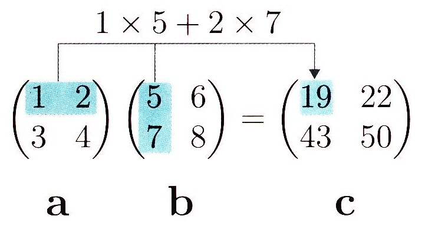
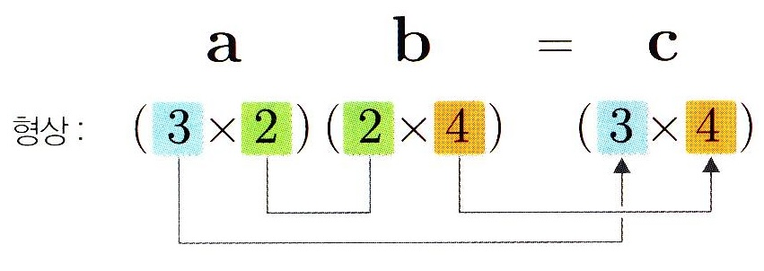
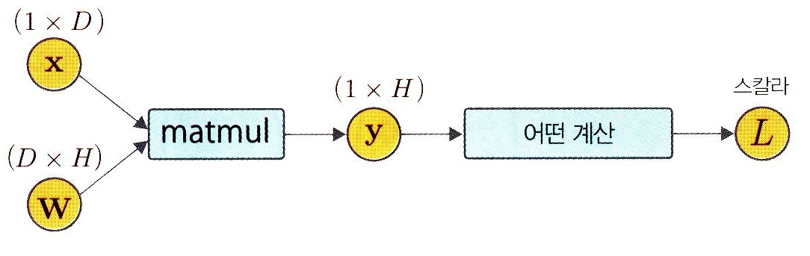
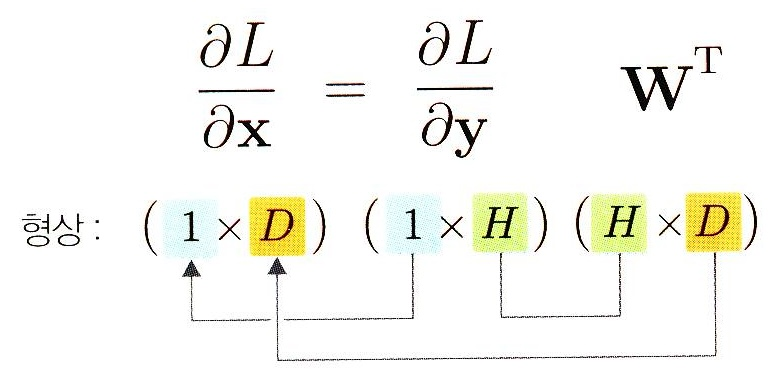
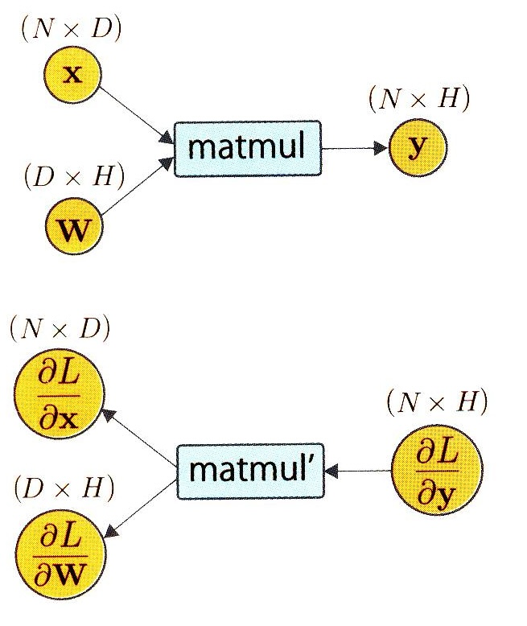
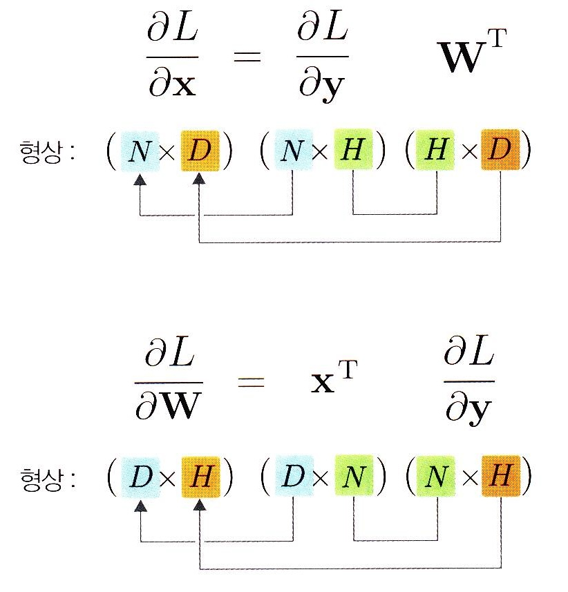

# 41단계 행렬의 곱

이번 단계의 주제는 '벡터의 내적'과 '행렬의 곱'입니다. 먼저 이 두 가지 계산 방법을 알아본 다음 DeZero 함수로 구현하겠습니다. 이번 단계가 끝나면 텐서를 다루는 최소한의 핵심 함수들이 모두 등장하여 드디어 실용적인 문제를 풀 수 있게 됩니다.

---

## 41.1 벡터의 내적과 행렬의 곱

'벡터의 내적'과 '행렬의 곱'이란 무엇일까요? 벡터의 내적부터 알아보죠. 벡터 $\mathbf{a} = (a_1, \dots, a_n)$ 과 $\mathbf{b} = (b_1, \dots, b_n)$ 이 있다고 가정합시다. 이때 두 벡터의 내적은 [식 41.1]과 같이 정의됩니다.

$$
\mathbf{a} \cdot \mathbf{b} = a_1 b_1 + a_2 b_2 + \dots + a_n b_n \tag{식 41.1}
$$

[식 41.1]에서 보듯 두 벡터 사이의 대응 원소의 곱을 모두 합한 값이 벡터의 내적입니다.

> **CAUTION**
> 수식으로 표기할 때 스칼라는 $a, b$ 처럼 보통의 이탤릭체 글꼴로, 벡터나 행렬은 $\mathbf{a}, \mathbf{b}$ 처럼 굵은(bold) 글꼴로 표기하겠습니다.

다음은 '행렬의 곱'입니다. 행렬의 곱은 [그림 41-1]과 같이 계산합니다.

**그림 41-1 행렬의 곱 계산 방법**


$$
1 \times 5 + 2 \times 7 = 19
$$

$$
\begin{pmatrix} 1 & 2 \\ 3 & 4 \end{pmatrix} \begin{pmatrix} 5 & 6 \\ 7 & 8 \end{pmatrix} = \begin{pmatrix} 19 & 22 \\ 43 & 50 \end{pmatrix}
$$

$$
\mathbf{a} \qquad\qquad \mathbf{b} \qquad\qquad \mathbf{c}
$$

[그림 41-1]과 같이 행렬의 곱에서는 왼쪽 행렬의 '가로 방향 벡터'와 오른쪽 행렬의 '세로 방향 벡터' 사이의 내적을 계산합니다. 그리고 그 결과가 새로운 행렬의 원소가 됩니다. 예를 들어 $\mathbf{a}$ 의 1행과 $\mathbf{b}$ 의 1열의 내적이 결과 행렬의 1행 1열 원소가 되고, $\mathbf{a}$ 의 2행과 $\mathbf{b}$ 의 1열의 내적이 결과 행렬의 2행 1열 원소가 되는 식입니다.

자, 벡터의 내적과 행렬의 곱을 우선 넘파이를 사용하여 구현해보려 합니다. `np.dot` 함수를 사용하면 됩니다.

```python
import numpy as np

# 벡터의 내적
a = np.array([1, 2, 3])
b = np.array([4, 5, 6])
c = np.dot(a, b)
print(c)

# 행렬의 곱
a = np.array([[1, 2], [3, 4]])
b = np.array([[5, 6], [7, 8]])
c = np.dot(a, b)
print(c)
```

**실행 결과**
```text
[[19 22]
 [43 50]]
```

보시는 것처럼 벡터의 내적과 행렬의 곱 계산은 모두 `np.dot` 함수로 처리할 수 있습니다. `np.dot(x, y)`의 두 인수가 모두 1차원 배열이면 벡터의 내적을 계산하고, 인수가 2차원 배열이면 행렬의 곱을 계산합니다.

---

## 41.2 행렬의 형상 체크

행렬과 벡터를 사용한 계산에서는 '형상'에 주의해야 합니다. 예컨대 행렬의 곱 계산은 [그림 41-2]와 같이 형상이 달라집니다.

**그림 41-2 행렬의 곱에서는 대응하는 차원(축)의 원소 수를 일치시킨다.**


$$
\mathbf{a} \qquad\qquad \mathbf{b} \quad = \quad \mathbf{c}
$$

$$
\text{형상: } (3 \times 2) \qquad (2 \times 4) \qquad\quad (3 \times 4)
$$

$$
\quad \uparrow \qquad\qquad\quad \uparrow \qquad\qquad\quad \uparrow \quad \uparrow
$$

$$
\quad \text{― ― ― ― ― ―} \qquad\qquad\quad \text{―} \quad \text{―}
$$

[그림 41-2]의 예에서는 $3 \times 2$ 행렬 $\mathbf{a}$ 와 $2 \times 4$ 행렬 $\mathbf{b}$ 를 곱하여 $3 \times 4$ 행렬 $\mathbf{c}$ 가 만들어졌습니다. 이때 그림과 같이 행렬 $\mathbf{a}$ 와 $\mathbf{b}$ 의 대응하는 차원(축)의 원소 수가 일치해야 합니다. 그리고 결과로 만들어진 행렬 $\mathbf{c}$ 의 형상은 행렬 $\mathbf{a}$ 와 같은 수의 행을, 행렬 $\mathbf{b}$ 와 같은 수의 열을 갖게 됩니다.

> **NOTE**
> 행렬의 곱 같은 계산에서는 행렬의 형상에 주의하여 그 추이를 잘 살펴야 합니다. 이 책에서는 이러한 형상 확인 작업을 '형상 체크'라고 부르겠습니다.

---

## 41.3 행렬 곱의 역전파

이어서 행렬 곱의 역전파를 알아보겠습니다. 행렬 곱의 역전파는 다소 복잡하므로 먼저 정공법으로 설명한 다음, 이어서 직관적으로 이해할 수 있는 설명을 보충하겠습니다. 참고로 DeZero는 행렬 곱 계산을 `MatMul` 클래스와 `matmul` 함수로 구현합니다. `matmul`은 'matrix multiply'의 약자입니다.

자, $\mathbf{y} = \mathbf{x}\mathbf{W}$ 라는 계산을 예로 행렬 곱의 역전파를 설명해보겠습니다. 여기에서 $\mathbf{x}, \mathbf{W}, \mathbf{y}$ 의 형상은 차례로 $1 \times D$, $D \times H$, $1 \times H$ 입니다. 계산 그래프로는 [그림 41-3]과 같습니다.

**그림 41-3 행렬 곱의 순전파(각 변수의 위에 형상을 표기)**


$$
\begin{aligned}
(1 \times D) &&&& (1 \times H) && \text{스칼라} \\
\mathbf{x} &\longrightarrow \text{matmul} \longrightarrow &\mathbf{y} \longrightarrow &\text{어떤 계산} \longrightarrow &L \\
&\quad\nearrow \\
\mathbf{W} \\
(D \times H)
\end{aligned}
$$

다시 말하지만 우리는 최종적으로 스칼라를 출력하는 계산을 다룹니다. 따라서 이 계산도 스칼라값인 $L$ 을 출력한다고 가정했습니다($L$ 의 각 변수에 대한 미분을 역전파로 구합니다). 이때 $\mathbf{x}$ 의 $i$ 번째 원소에 대한 미분 $\frac{\partial L}{\partial x_i}$ 은 다음과 같이 구할 수 있습니다.

$$
\frac{\partial L}{\partial x_i} = \sum_{j} \frac{\partial L}{\partial y_j} \frac{\partial y_j}{\partial x_i} \tag{식 41.2}
$$

[식 41.2]의 $\frac{\partial L}{\partial x_i}$ 은 $x_i$ 를 (미세하게) 변화시켰을 때 $L$ 이 얼마나 변화하느냐를 뜻하는 '변화율'을 말합니다. 여기서 $x_i$ 를 변화시키면 벡터 $\mathbf{y}$ 의 모든 원소가 변화합니다. 그리고 $\mathbf{y}$ 의 각 원소의 변화를 통해 궁극적으로 $L$ 이 변화하게 됩니다. 따라서 $x_i$ 에서 $L$ 에 이르는 연쇄 법칙의 경로는 여러 개 있고, 그 총합이 $\frac{\partial L}{\partial x_i}$ 입니다.

그런데 $\frac{\partial y_j}{\partial x_i} = W_{ij}$ $^*$ 가 성립하기 때문에 [식 41.2]를 [식 41.3]처럼 더 간단하게 표현할 수 있습니다.

$$
\frac{\partial L}{\partial x_i} = \sum_{j} \frac{\partial L}{\partial y_j} \frac{\partial y_j}{\partial x_i} = \sum_{j} \frac{\partial L}{\partial y_j} W_{ij} \tag{식 41.3}
$$

[식 41.3]에서 $\frac{\partial L}{\partial x_i}$ 은 '벡터 $\frac{\partial L}{\partial \mathbf{y}}$'와 '$\mathbf{W}$ 의 $i$ 행 벡터'의 내적으로 구해지는 것을 알 수 있습니다. 이 관계로부터 다음 식을 이끌어낼 수 있습니다.

$$
\frac{\partial L}{\partial \mathbf{x}} = \frac{\partial L}{\partial \mathbf{y}} \mathbf{W}^T \tag{식 41.4}
$$

---
$^*$ $\mathbf{y}$ 의 $j$ 번째 원소를 풀어쓰면 $y_j = x_1 W_{1j} + x_2 W_{2j} + \dots + x_i W_{ij} + \dots + x_D W_{Dj}$ 입니다. 따라서 $\frac{\partial y_j}{\partial x_i} = W_{ij}$ 가 성립함을 알 수 있습니다.

[식 41.4]에서 알 수 있듯이 $\frac{\partial L}{\partial \mathbf{x}}$ 은 행렬의 곱으로 한 번에 구할 수 있습니다. [그림 41-4]는 이 계산에서의 행렬(과 벡터)의 형상입니다.

**그림 41-4 행렬 곱의 형상 체크**


$$
\frac{\partial L}{\partial \mathbf{x}} \quad = \quad \frac{\partial L}{\partial \mathbf{y}} \quad \mathbf{W}^T
$$

$$
\text{형상: } (1 \times D) \qquad (1 \times H) \qquad (H \times D)
$$

$$
\quad \uparrow \qquad\qquad\quad \uparrow \qquad\qquad\quad \uparrow \quad \uparrow
$$

$$
\quad \text{― ― ― ― ― ―} \qquad\qquad\quad \text{―} \quad \text{―}
$$

[그림 41-4]를 보면 행렬들의 형상이 올바르게 짝지어져 있습니다. 따라서 [식 41.4]는 올바른 행렬 계산입니다. 또한 이 과정을 거꾸로 진행하여(즉, 일관성을 유지한 채) 역전파 수식(구현)을 도출하는 방식도 생각할 수 있습니다.$^{**}$ 다시 $\mathbf{y} = \mathbf{x}\mathbf{W}$ 라는 행렬 곱 계산을 예로 그 방법을 설명해보겠습니다. 단, 이번에는 $\mathbf{x}$ 의 형상이 $N \times D$ 라고 합시다. 즉, $\mathbf{x}, \mathbf{W}, \mathbf{y}$ 의 형상은 각각 $N \times D$, $D \times H$, $N \times H$ 입니다. 이때 역전파의 계산 그래프는 [그림 41-5]와 같이 됩니다.

**그림 41-5 행렬 곱의 순전파(위)와 역전파(아래)**


*(순전파)*

$$
\begin{aligned}
(N \times D) &&&& (N \times H) \\
\mathbf{x} &\longrightarrow \text{matmul} \longrightarrow &\mathbf{y} \\
&\quad\nearrow \\
\mathbf{W} \\
(D \times H)
\end{aligned}
$$

*(역전파)*

$$
\begin{aligned}
(N \times D) &&&& (N \times H) \\
\frac{\partial L}{\partial \mathbf{x}} &\longleftarrow \text{matmul'} \longleftarrow &\frac{\partial L}{\partial \mathbf{y}} \\
&\quad\nwarrow \\
&\quad \frac{\partial L}{\partial \mathbf{W}} \\
&\quad (D \times H)
\end{aligned}
$$

---
$^{**}$ 행렬의 곱에 대해서는 '형상 체크'에 의해 역전파 식을 도출해낼 수 있다는 뜻일 뿐 '형상 체크'가 올바르다고 해서 역전파 식이 항상 올바르게 도출된다는 뜻은 아닙니다.

이제 $\frac{\partial L}{\partial \mathbf{x}}$ 과 $\frac{\partial L}{\partial \mathbf{W}}$ 을 도출해봅시다. 행렬의 형상에 주목하여 일관성이 유지되도록 행렬 곱을 수행합니다. 그러면 [그림 41-6]의 식을 유도할 수 있습니다.

**그림 41-6 행렬 곱의 역전파**


$$
\frac{\partial L}{\partial \mathbf{x}} \quad = \quad \frac{\partial L}{\partial \mathbf{y}} \quad \mathbf{W}^T
$$

$$
\text{형상: } (N \times D) \qquad (N \times H) \qquad (H \times D)
$$

$$
\quad \uparrow \qquad\qquad\quad \uparrow \qquad\qquad\quad \uparrow \quad \uparrow
$$

$$
\quad \text{― ― ― ― ― ―} \qquad\qquad\quad \text{―} \quad \text{―}
$$

$$
\frac{\partial L}{\partial \mathbf{W}} \quad = \quad \mathbf{x}^T \quad \frac{\partial L}{\partial \mathbf{y}}
$$

$$
\text{형상: } (D \times H) \qquad (D \times N) \qquad (N \times H)
$$

$$
\quad \uparrow \qquad\qquad\quad \uparrow \qquad\qquad\quad \uparrow \quad \uparrow
$$

$$
\quad \text{― ― ― ― ― ―} \qquad\qquad\quad \text{―} \quad \text{―}
$$

[그림 41-6]의 수식은 [그림 41-4]의 수식처럼 각 행렬의 원소를 계산하여 양변을 비교하면 유도할 수 있습니다. 또한 행렬 곱의 형상 체크도 충족하는지 확인합니다. 이 수식이 있으면 DeZero 함수로 '행렬의 곱'을 손쉽게 구현할 수 있습니다. 다음과 같이 구현하면 됩니다.

**dezero/functions.py**
```python
class MatMul(Function):
    def forward(self, x, W):
        y = x.dot(W)
        return y

    def backward(self, gy):
        x, W = self.inputs
        gx = matmul(gy, W.T)
        gW = matmul(x.T, gy)
        return gx, gW

def matmul(x, W):
    return MatMul()(x, W)
```

역전파는 [그림 41-6]의 수식을 DeZero 함수를 사용해 옮기면 됩니다. 한편 순전파는 `np.dot(x, W)` 대신 `x.dot(W)`로 구현했습니다. 이렇게 하면 `ndarray` 인스턴스에도 대응할 수 있습니다.

> **CAUTION**
> 앞의 코드에서 역전파 시 사용하는 `matmul` 함수는 바로 아랫줄에서 구현한 함수입니다. 또한 전치(`W.T`와 `x.T`) 시에는 DeZero의 `transpose` 함수가 호출됩니다(38단계에서 구현).

이제 DeZero의 `matmul` 함수를 사용하여 다음 계산이 가능해졌습니다. 그리고 미분도 계산할 수 있습니다.

**steps/step41.py**
```python
from dezero import Variable
import dezero.functions as F

x = Variable(np.random.randn(2, 3))
W = Variable(np.random.randn(3, 4))
y = F.matmul(x, W)
y.backward()

print(x.grad.shape)
print(W.grad.shape)
```

**실행 결과**
```text
(2, 3)
(3, 4)
```

이 코드에서는 무작위로 생성한 넘파이 다차원 배열을 사용하여 계산하였고, 아무런 오류 없이 실행됩니다. 또한 `x.grad.shape`와 `x.shape`가 동일하고, `w.grad.shape`와 `W.shape`가 동일함을 확인할 수 있습니다. 이상으로 DeZero 버전의 행렬 곱을 완성했습니다.
