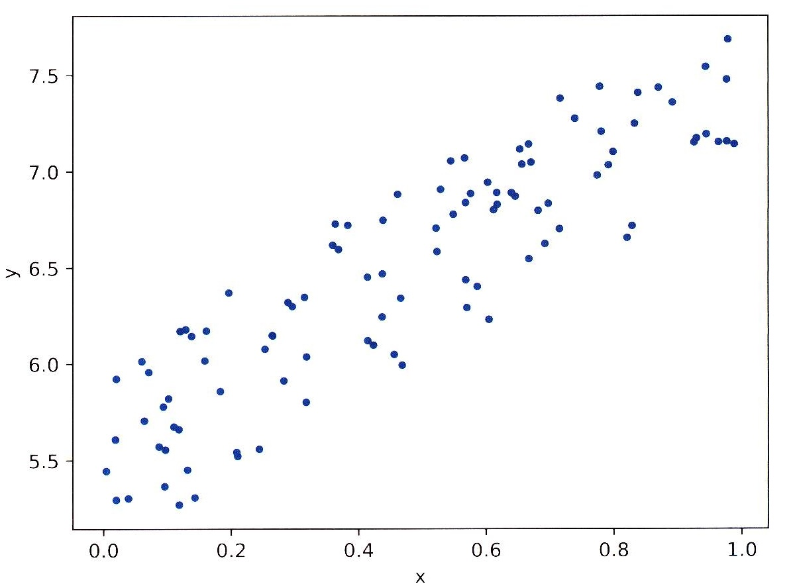
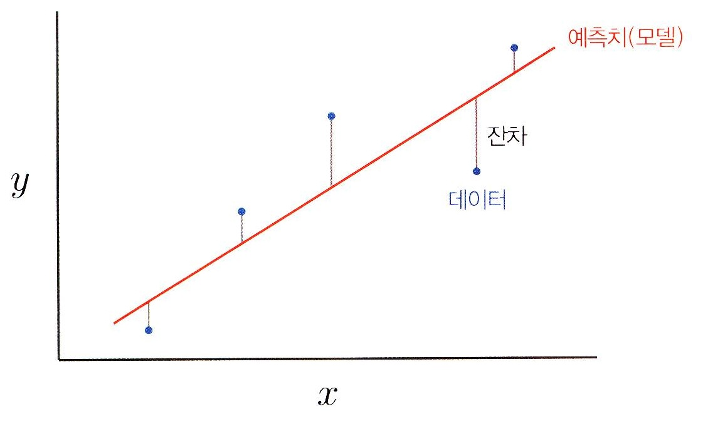
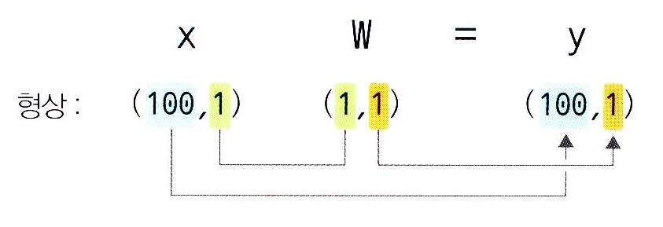
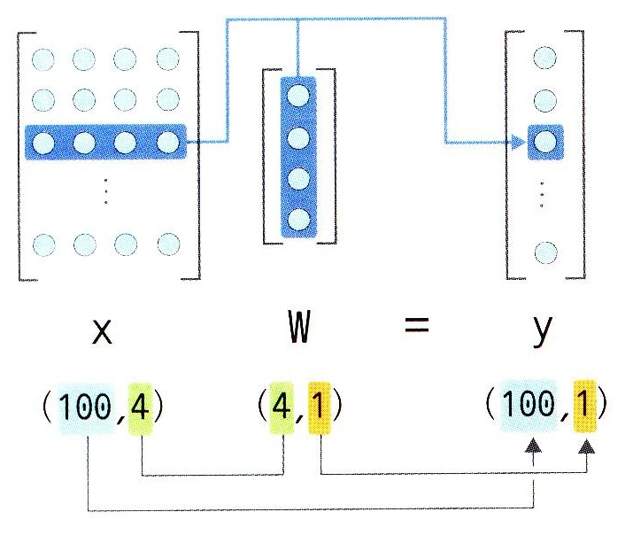
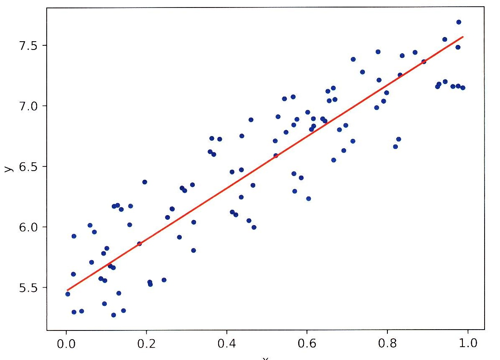
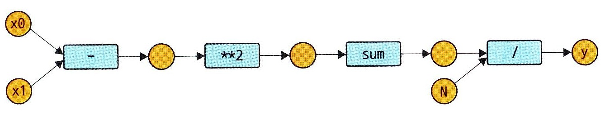
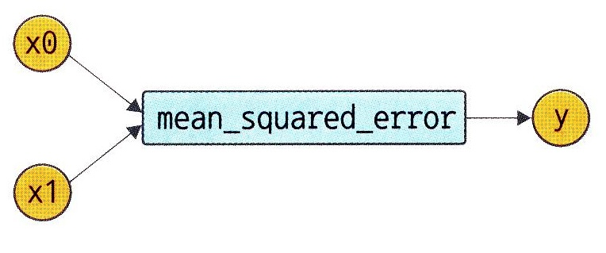

# 42단계 선형 회귀

머신러닝은 '데이터'를 사용하여 문제를 해결합니다. 사람이 해법을 생각하여 알려주는 게 아니라 모아진 데이터로부터 컴퓨터가 스스로 해법을 찾아냅니다(학습합니다). 이처럼 데이터로부터 해법을 찾는 것이 머신러닝의 본질입니다. 앞으로 우리는 DeZero를 사용하여 머신러닝 문제에 부딪혀볼 것입니다. 이를 위해 이번 단계에서는 머신러닝의 가장 기본이 되는 '선형 회귀(linear regression)'를 구현하겠습니다.

---

## 42.1 토이 데이터셋

이번 단계에서는 실험용으로 작은 데이터셋을 만듭니다. 이런 작은 데이터셋을 '토이 데이터셋(toy dataset)'이라고들 하죠. 같은 데이터를 나중에 재현해야 하니 데이터를 생성하는 시드값을 고정하겠습니다.

```python
import numpy as np

np.random.seed(0)  # 시드값 고정
x = np.random.rand(100, 1)
y = 5 + 2 * x + np.random.rand(100, 1)  # y에 무작위 노이즈 추가
```

`x`와 `y`라는 두 개의 변수로 구성된 데이터셋을 생성했습니다. [그림 42-1]은 `(x, y)` 점들을 시각화한 모습입니다. 그림에서 보듯 `x`와 `y`는 '선형' 관계인데 `y`에 추가된 노이즈 때문에 점들이 구름처럼 퍼져 있음을 확인할 수 있습니다.

**그림 42-1 이번 단계에서 사용하는 데이터셋**


*(그래프 이미지: $x$ 축은 $0.0 \sim 1.0$, $y$ 축은 $5.5 \sim 7.5$ 범위의 점들이 선형 분포를 띰)*

우리 목표는 `x`값이 주어지면 `y`값을 예측하는 모델(수식)을 만드는 것입니다.

> **NOTE**
> `x`로부터 실숫값 `y`를 예측하는 것을 '회귀(regression)'라고 합니다. 그리고 회귀 모델 중 예측값이 선형(직선)을 이루는 것을 '선형 회귀'라고 합니다.

---

## 42.2 선형 회귀 이론

목표는 주어진 데이터를 잘 표현하는 함수 찾기입니다. 여기에서는 $y$ 와 $x$ 가 선형 관계라고 가정하기 때문에 $y = Wx + b$ 라는 식으로 표현할 수 있습니다($W$ 는 스칼라값). 이 식은 [그림 42-2]와 같이 직선을 그립니다.

**그림 42-2 선형 회귀 예**


*(그래프 다이어그램)*
* $y$ 축, $x$ 축
* 빨간색 직선: **예측치(모델)**
* 파란색 점: **데이터**
* 빨간색 직선과 파란색 점 사이의 세로 거리: **잔차**

[그림 42-2]와 같이 우리 목표는 데이터에 맞는 직선 $y = Wx + b$ 를 찾는 것입니다. 그러기 위해서는 데이터와 예측치의 차이, 즉 '잔차(residual)'를 최소화해야 합니다. 여기에서는 예측치(모델)와 데이터의 오차를 나타내는 지표를 다음 식으로 정의합니다.

$$
L = \frac{1}{N} \sum_{i=1}^{N} (f(x_i) - y_i)^2 \tag{식 42.1}
$$

[식 42.1]은 총 $N$ 개의 점에 대해 $(x_i, y_i)$ 의 각 점에서 제곱오차를 구한 다음 모두 더합니다. 그리고 평균을 구하기 위해 $\frac{1}{N}$ 을 곱합니다. 이 수식을 **평균 제곱 오차(mean squared error)**라고 합니다. 또한 [식 42.1]은 $\frac{1}{N}$ 의 형태지만 $\frac{1}{2N}$ 형태로 정의하는 경우도 있습니다. 두 경우 모두 경사하강법으로 풀게 되면 학습률 값을 조정해 똑같은 문제로 만들 수 있습니다.

> **NOTE**
> 모델의 성능이 얼마나 '나쁜가'를 평가하는 함수를 손실 함수라고 합니다. 따라서 선형 회귀는 '손실 함수로 평균 제곱 오차를 이용한다'고 말할 수 있습니다.

우리 목표는 [식 42.1]로 표현되는 손실 함수의 출력을 최소화하는 $W$ 와 $b$ 를 찾는 것입니다. 기억하시겠지만, 바로 함수 최적화 문제입니다. 그리고 우리는 이미 28단계에서 함수 최적화 문제를 경사하강법을 사용하여 풀어봤습니다. 이번에도 경사하강법을 사용하여 [식 42.1]을 최소화하는 매개변수를 찾아보려 합니다.

---

## 42.3 선형 회귀 구현

이제 DeZero를 사용하여 선형 회귀를 구현해봅시다. 편의상 코드를 전반과 후반으로 나눠 보여드리겠습니다. 다음은 전반 코드입니다.

**steps/step42.py**
```python
import numpy as np
from dezero import Variable
import dezero.functions as F

# 토이 데이터셋
np.random.seed(0)
x = np.random.rand(100, 1)
y = 5 + 2 * x + np.random.rand(100, 1)
x, y = Variable(x), Variable(y)  # 생략 가능

W = Variable(np.zeros((1, 1)))
b = Variable(np.zeros(1))

def predict(x):
    y = F.matmul(x, W) + b
    return y
```

매개변수 `W`와 `b`를 `Variable` 인스턴스로 생성했습니다(`W`는 대문자로 씁니다). `W`의 형상은 `(1, 1)`이고 `b`의 형상은 `(1,)`입니다.

> **NOTE**
> DeZero 함수는 `ndarray` 인스턴스도 처리할 수 있습니다(DeZero 내부에서 `Variable` 인스턴스로 변환합니다). 따라서 앞의 코드에서 데이터셋 `x`, `y`는 `Variable` 인스턴스로 명시적으로 변환하지 않아도 `ndarray` 인스턴스 상태 그대로 처리할 수 있습니다.

앞의 코드에서 `predict` 함수를 정의했습니다. 이 함수는 `matmul` 함수를 사용하여 행렬의 곱을 계산하는데, 행렬의 곱을 이용하면 여러 데이터를 모아서 한 번에 계산할 수 있습니다(앞의 예에서는 100개). 이때 형상의 추이는 [그림 42-3]과 같습니다.

**그림 42-3 행렬 곱의 형상 추이(수식에서 + b 부분은 생략)**


$$
\mathbf{x} \qquad\qquad \mathbf{W} \quad = \quad \mathbf{y}
$$

$$
\text{형상: } (100, 1) \qquad (1, 1) \qquad\quad (100, 1)
$$

$$
\quad \uparrow \qquad\qquad\quad \uparrow \qquad\qquad\quad \uparrow \quad \uparrow
$$

$$
\quad \text{― ― ― ― ― ―} \qquad\qquad\quad \text{―} \quad \text{―}
$$

[그림 42-3]과 같이 대응하는 차원의 원소 수가 일치하는 것을 알 수 있습니다. 그리고 결과인 `y`의 형상은 `(100, 1)`입니다. 즉, 총 100개의 데이터로 이루어진 `x`에 대해 모든 데이터 각각에 `W`를 곱한 것입니다. 이것으로 단 한 번의 계산으로 모든 데이터의 예측치가 구해집니다. 또한 지금은 `x`의 데이터가 1차원인데, 만약 `D`차원이라면 `W`의 형상이 `(D, 1)`이어야 올바르게 계산됩니다. 예를 들어 `D = 4`라면 [그림 42-4]와 같은 행렬 곱이 이루어집니다.

**그림 42-4 행렬 곱의 형상 추이(x의 데이터 차원이 4인 경우)**


$$
\mathbf{x} \qquad\qquad \mathbf{W} \quad = \quad \mathbf{y}
$$

$$
\text{형상: } (100, 4) \qquad (4, 1) \qquad\quad (100, 1)
$$

$$
\quad \uparrow \qquad\qquad\quad \uparrow \qquad\qquad\quad \uparrow \quad \uparrow
$$

$$
\quad \text{― ― ― ― ― ―} \qquad\qquad\quad \text{―} \quad \text{―}
$$

[그림 42-4]와 같이 `x.shape[1]`과 `W.shape[0]`을 일치시켜야 행렬 곱이 제대로 계산됩니다. 이때 100개의 데이터 각각에 대해 `W`에 의한 '벡터의 내적'을 계산하게 됩니다.

> **CAUTION**
> 앞에서 작성한 코드 `y = F.matmul(x, W) + b`에서 덧셈 계산 시 브로드캐스트가 일어납니다. 구체적으로는 `b`의 형상은 `(1,)`이지만 그 원소를 복제하여 `(100, 1)` 형상으로 만든 후 원소별로 더해주는 것이죠. 브로드캐스트 대응은 40단계에서 해뒀으니 브로드캐스트가 발생해도 역전파가 제대로 이루어집니다.

다음은 후반 코드를 살펴볼 차례입니다.

**steps/step42.py**
```python
def mean_squared_error(x0, x1):
    diff = x0 - x1
    return F.sum(diff ** 2) / len(diff)

lr = 0.1
iters = 100

for i in range(iters):
```

```python
    y_pred = predict(x)
    loss = mean_squared_error(y, y_pred)

    W.cleargrad()
    b.cleargrad()
    loss.backward()

    W.data -= lr * W.grad.data
    b.data -= lr * b.grad.data
    print(W, b, loss)
```

평균 제곱 오차를 구하는 함수를 `mean_squared_error(x0, x1)`이라는 이름으로 구현했습니다. [식 42.1]을 DeZero 함수를 사용하여 구현하면 됩니다. 그런 다음 경사하강법으로 매개변수를 갱신합니다. 이 구현은 28단계에서 완료했습니다. 여기서 주의점은 매개변수를 갱신할 때 `W.data -= lr * W.grad.data`처럼 인스턴스 변수의 `data`에 대해 계산해야 한다는 것입니다. 매개변수 갱신은 단순히 데이터를 갱신할 뿐이므로 계산 그래프를 만들 필요는 없습니다.

코드를 실행해보죠. 그러면 손실 함수의 출력값이 줄어드는 것을 확인할 수 있습니다. 그리고 최종적으로 `W = [[2.11807369]]`, `b = [5.46608905]`라는 값을 얻습니다. 참고로 이 매개변수에 의해 얻어지는 직선의 그래프는 [그림 42-5]와 같습니다.

**그림 42-5 학습이 완료된 모델**


*(그래프 이미지: 파란색 데이터 점들 사이를 관통하는 빨간색 회귀 직선)*

[그림 42-5]와 같이 데이터에 적합(fit)된 모델을 얻을 수 있습니다. DeZero를 사용하여 선형 회귀를 성공적으로 구현한 것입니다! 이것으로 선형 회귀 구현은 끝납니다. 마지막으로 DeZero의 `mean_squared_error` 함수에 관한 설명을 약간 보충하겠습니다.

---

## 42.4 【보충】 DeZero의 mean_squared_error 함수

방금 우리는 평균 제곱 오차를 구하는 함수를 구현했습니다. 코드는 다음과 같습니다.

**steps/step42.py**
```python
def mean_squared_error(x0, x1):
    diff = x0 - x1
    return F.sum(diff ** 2) / len(diff)
```

이 함수는 계산을 정확하게 수행합니다. 그리고 DeZero 함수를 사용하여 계산하므로 미분도 할 수 있습니다. 그러나 이 구현 방식에는 개선할 점이 있습니다. [그림 42-6]의 계산 그래프를 살펴보는 것으로 설명을 시작하겠습니다.

**그림 42-6 mean_squared_error 함수의 계산 그래프(코드 len(diff)는 N으로 표기)**


$$
\begin{aligned}
x_0 &\searrow \\
& \quad [-] \longrightarrow \bigcirc \longrightarrow [**2] \longrightarrow \bigcirc \longrightarrow [\text{sum}] \longrightarrow \bigcirc \longrightarrow [/] \longrightarrow y \\
x_1 &\nearrow \qquad\qquad\qquad\qquad\qquad\qquad\qquad\qquad\qquad\qquad\quad \uparrow \\
& \qquad\qquad\qquad\qquad\qquad\qquad\qquad\qquad\qquad\qquad\qquad\qquad\quad N
\end{aligned}
$$

[그림 42-6]은 앞의 `mean_squared_error` 함수가 만들어내는 계산 그래프입니다. 여기서 주목할 점은 중간에 등장하는 이름 없는 변수 세 개($\bigcirc$)입니다. 이 변수들은 계산 그래프에 기록되어 있기 때문에 계산 그래프가 존재하는 동안은 메모리에 계속 살아 있습니다. 이 변수들의 데이터(`ndarray` 인스턴스)도 마찬가지로 계속 살아 있습니다.

> **NOTE**
> DeZero에서 미분을 하려면 먼저 순전파를 한 다음에 역전파해야 합니다. [그림 42-6]에 존재하는 변수들(과 그 변수들이 참조하는 데이터들)은 순전파와 역전파 내내 메모리를 차지하게 됩니다.

컴퓨터의 메모리가 충분하다면 지금의 구현 방식도 문제없습니다. 하지만 제3자가 사용할 수 있는 함수이므로 더 나은 방식을 도입해보죠. 바로 `Function` 클래스를 상속하여 구현하는 방식입니다. 그래서 다음 코드처럼 `MeanSquaredError`라는 DeZero 함수 클래스를 구현했습니다.

**dezero/functions.py**
```python
class MeanSquaredError(Function):
    def forward(self, x0, x1):
        diff = x0 - x1
        y = (diff ** 2).sum() / len(diff)
        return y

    def backward(self, gy):
        x0, x1 = self.inputs
        diff = x0 - x1
        gx0 = gy * diff * (2. / len(diff))
        gx1 = -gx0
        return gx0, gx1

def mean_squared_error(x0, x1):
    return MeanSquaredError()(x0, x1)
```

우선 순전파는 `ndarray` 인스턴스로 구현합니다. 조금 전에 DeZero 버전의 함수에서 구현한 코드와 거의 같습니다. 이 처리 단위를 하나로 묶어서 그 역전파 코드를 `backward`에 구현합니다. 역전파 구현은 먼저 수식으로 미분을 계산한 다음 해당 수식을 코드로 옮기면 됩니다. 자세한 설명은 생략하겠습니다.

새로 구현한 `mean_squared_error` 함수는 앞서 구현한 함수와 같은 결과를 얻을 수 있지만 메모리는 덜 사용합니다. [그림 42-7]과 같은 계산 그래프가 만들어지기 때문이죠.

**그림 42-7 새로운 mean_squared_error 함수의 계산 그래프**


$$
\begin{aligned}
x_0 &\searrow \\
& \quad [\text{mean\_squared\_error}] \longrightarrow y \\
x_1 &\nearrow
\end{aligned}
$$

[그림 42-7]을 이전 계산 그래프([그림 42-6])와 비교해보면 중간에 등장하던 변수들이 사라졌음을 알 수 있습니다. 중간 데이터들은 `MeanSquaredError` 클래스의 `forward` 메서드에서만 사용됩니다. 더 정확하게 말하면, 이 변수들은 `ndarray` 인스턴스로 사용되며 `forward` 메서드의 범위를 벗어나는 순간 메모리에서 삭제됩니다.

이상의 이유로 `dezero/functions.py`의 `mean_squared_error` 함수는 새로운 방식으로 구현해뒀고, 낡은 버전의 구현은 참고 목적으로 `mean_squared_error_simple`이라는 이름으로 남겨뒀습니다. 이상으로 DeZero의 `mean_squared_error` 함수에 대한 보충 설명을 마칩니다.
