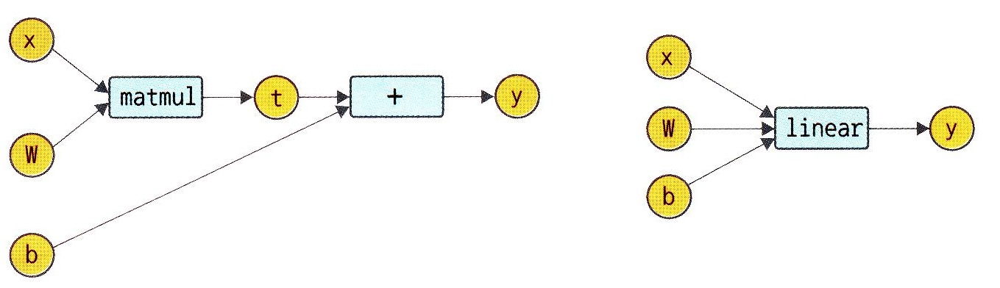
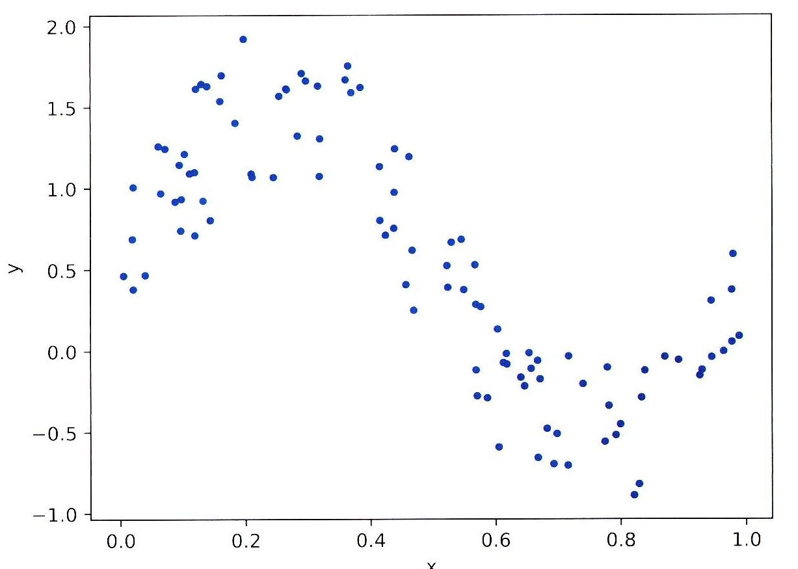
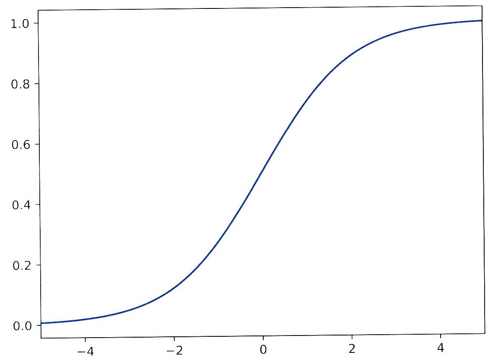
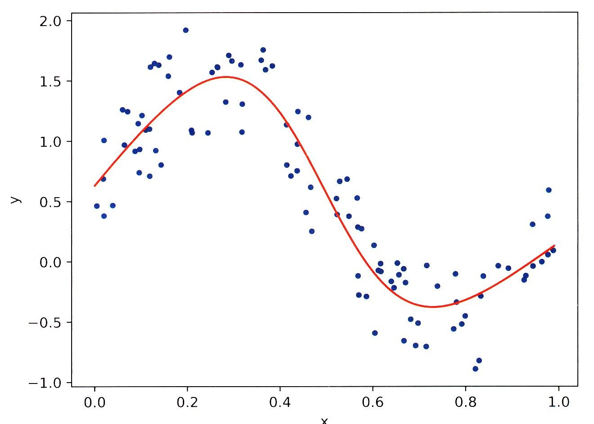

# 43단계 신경망

이전 단계에서는 선형 회귀를 구현하고 올바로 동작시키는 데 성공했습니다. 선형 회귀를 구현했다면 이를 신경망으로 확장하는 일은 간단합니다. 이번 단계에서는 이전 단계의 코드를 수정하여 신경망으로 '진화'시킬 것입니다. 우선 이전 단계에서 수행한 변환을 DeZero의 `linear` 함수로 구현하는 일부터 시작하겠습니다.

---

## 43.1 DeZero의 linear 함수

이전 단계에서는 간단한 데이터셋을 대상으로 선형 회귀를 구현했지만, 그 선형 회귀로 수행한 계산은 (손실 함수를 제외하면) '행렬의 곱'과 '덧셈'뿐이었습니다. 해당 코드를 발췌하면 다음과 같습니다.

```python
y = F.matmul(x, W) + b
```

이와 같이 입력 `x`와 매개변수 `W` 사이에서 행렬 곱을 구하고, 거기에 `b`를 더합니다. 이 변환을 **선형 변환(linear transformation)** 혹은 **아핀 변환(affine transformation)**이라고 합니다.

> **NOTE**
> 선형 변환은 엄밀히 말하면 `y = F.matmul(x, W)`까지로, `b`는 포함되지 않습니다. 그러나 신경망 분야에서는 `b`를 더하는 계산까지 포함한 연산을 선형 변환이라고 부르는 것이 일반적입니다(이 교제도 마찬가지입니다). 그리고 선형 변환은 신경망에서는 **완전연결계층(fully connected layer)**에 해당하며, 매개변수 `W`는 **가중치(weight)**, 매개변수 `b`는 **편향(bias)**이라고 합니다.

이번 절에서는 앞의 선형 변환을 `linear` 함수로 구현하겠습니다. 이전 단계에서 설명한 대로 구현 방법은 두 가지입니다. 하나는 앞의 코드와 같이 지금까지 구현해온 DeZero 함수를 사용하는 방식이고, 다른 하나는 `Function` 클래스를 상속하여 새롭게 `Linear`라는 함수 클래스를 구현하는 방식입니다. 역시 앞서 설명한 대로 후자가 메모리를 더 효율적으로 씁니다. 그 차이는 [그림 43-1]을 보면 알 수 있습니다.

**그림 43-1 선형 변환의 두 가지 구현 방식**


* **왼쪽 방식 (기존 함수 조합):**
  

$$
\begin{aligned}
 x &\searrow \\
 & \quad [\text{matmul}] \longrightarrow t \searrow \\
 W &\nearrow \qquad\qquad\qquad\quad [+] \longrightarrow y \\
 & \qquad\qquad\quad b \quad \nearrow
 \end{aligned}
$$

* **오른쪽 방식 (새로운 `Linear` 클래스):**
  

$$
\begin{aligned}
 x &\searrow \\
 W &\longrightarrow [\text{linear}] \longrightarrow y \\
 b &\nearrow
 \end{aligned}
$$

[그림 43-1]의 왼쪽이 DeZero의 `matmul` 함수와 `+` (`add` 함수)를 이용한 방식입니다. 이 경우 `matmul` 함수의 출력은 `Variable` 인스턴스이므로 계산 그래프에 기록됩니다. 즉, `Variable` 인스턴스와 그 안에 담긴 데이터(`ndarray` 인스턴스)는 계산 그래프가 존재하는 동안은 계속 메모리에 머물게 됩니다.

한편 오른쪽 그림은 `Function` 클래스를 상속하여 `Linear` 클래스를 구현하는 방식입니다. 이 방식에서는 중간 결과가 `Variable` 인스턴스로 보존되지 않기 때문에 순전파 시 사용하던 중간 데이터는 순전파가 끝나는 즉시 삭제됩니다. 따라서 DeZero를 제3자에게 제공할 생각이라면 메모리 효율 관점에서 후자의 방식을 취해야 할 것입니다. 그러나 전자의 방식을 채용하면서 메모리 효율도 개선할 수 있는 '묘수'가 있습니다. 이제부터 그 묘수에 대해 설명합니다.

그럼 다시 [그림 43-1]의 왼쪽을 보겠습니다. `matmul` 함수의 출력 변수로 `t`가 있습니다. 변수 `t`는 `matmul` 함수의 출력인 동시에 `+` (`add` 함수)의 입력입니다. 이 두 함수의 역전파를 생각해보겠습니다. 우선 `+`의 역전파인데, 출력 쪽의 기울기를 단순히 흘려보내기만 할 뿐입니다. 즉, `t`의 데이터는 `+` 역전파에 필요하지 않습니다. 다음으로 `matmul` 역전파는 입력 `x`, `W`만 사용합니다. 따라서 `matmul` 역전파 또한 `t`의 데이터를 필요로 하지 않습니다.

이상으로부터 변수 `t`의 데이터는 역전파 시 아무에게도 필요하지 않다는 사실을 알 수 있습니다. 즉, 기울기를 흘려보내야 하므로 계산 그래프에서는 변수 `t`가 필요하지만, 그 안의 데이터는 즉시 지워도 된다는 것입니다. 이상의 점을 고려하여 `linear_simple` 함수는 다음과처럼 구현할 수 있습니다.

**dezero/functions.py**
```python
def linear_simple(x, W, b=None):
    t = matmul(x, W)
    if b is None:
        return t

    y = t + b
    t.data = None  # t의 데이터 삭제
    return y
```

인수 `x`와 `W`는 `Variable` 인스턴스 혹은 `ndarray` 인스턴스라고 가정합니다. `ndarray` 인스턴스라면 `matmul` 함수(정확하게는 `Function` 클래스의 `__call__` 메서드) 안에서 `Variable` 인스턴스로 변환됩니다. 또한 편향인 `b`를 생략할 수 있도록 했습니다. `b=None`인 경우는 단순히 행렬 곱셈만 계산하여 그 결과를 반환합니다.

그리고 편향이 주어지면 단순히 더해줍니다. 이때 중간 결과인 `t`의 데이터는 역전파 시 아무에게도 필요치 않으므로 `y = t + b` 계산이 끝난 후 삭제할 수 있습니다. 그래서 `t.data = None` 코드에서 `t`의 데이터를 메모리에서 삭제합니다(참조 카운트가 0이 되어 파이썬 인터프리터에 의해 삭제됩니다).

> **NOTE**
> 신경망에서 메모리의 대부분을 차지하는 것이 중간 계산 결과인 텐서(`ndarray` 인스턴스)입니다. 특히 큰 텐서를 취급하는 경우 `ndarray` 인스턴스가 거대해지므로 불필요한 `ndarray` 인스턴스는 즉시 삭제하는 것이 바람직합니다. 이 교제에서는 불필요한 `ndarray` 인스턴스를 (`t.data = None`처럼) 손수 삭제했으나 자동화하는 방법도 존재합니다. 일례로 체이너(Chainer)는 Aggressive Buffer Release라는 구조를 이용합니다.

이상이 메모리 사용을 개선하는 '묘수'입니다. 여기에서 구현한 `linear_simple` 함수는 `dezero/functions.py`에 추가해두었고, `Function` 클래스를 상속한 `Linear` 클래스와 `linear` 함수는 `dezero/functions.py`에 구현되어 있습니다. 간단한 코드이므로 관심 있는 분은 참고하시기 바랍니다.

---

## 43.2 비선형 데이터셋

이전 단계에서는 직선상에 나열된 데이터셋을 사용했는데, 이번 절에서는 더 복잡한 데이터셋에 도전하겠습니다.

**steps/step43.py**
```python
import numpy as np

np.random.seed(0)
x = np.random.rand(100, 1)
y = np.sin(2 * np.pi * x) + np.random.rand(100, 1)  # 데이터 생성에 sin 함수 이용
```

보다시피 `sin` 함수를 사용하여 데이터를 생성했습니다. 이렇게 생성한 `(x, y)` 점들을 2차원 평면에 그리면 [그림 43-2]와 같이 됩니다.

**그림 43-2 이번 단계에서 사용하는 데이터셋**


*(그래프 이미지: $x$ 축은 $0.0 \sim 1.0$, $y$ 축은 $-1.0 \sim 2.0$ 범위이며, 사인파 형태에 노이즈가 섞인 분포를 띰)*

보다시피 `x`와 `y`는 선형 관계가 아닙니다. 이러한 비선형 데이터셋은 당연히 선형 회귀로는 풀 수 없습니다. 신경망이 해결사로 등장하는 순간이죠.

---

## 43.3 활성화 함수와 신경망

선형 변환은 이름 그대로 입력 데이터를 선형으로 변환해줍니다. 한편 신경망은 선형 변환의 출력에 비선형 변환을 수행합니다. 이 비선형 변환을 **활성화 함수(activation function)**라고 하며, 대표적으로 **ReLU(렐루)** 함수와 **시그모이드 함수(sigmoid function)** 등이 있습니다.

여기에서는 활성화 함수로 시그모이드 함수를 사용합니다. 시그모이드 함수는 [식 43.1]로 표현되며, 그래프는 [그림 43-3]과 같습니다.

$$
y = \frac{1}{1 + \exp(-x)} \tag{식 43.1}
$$

**그림 43-3 시그모이드 함수의 그래프**


*(그래프 이미지: $x$ 축은 $-4 \sim 4$, $y$ 축은 $0.0 \sim 1.0$ 범위의 S자형 시그모이드 곡선)*

[그림 43-3]에서와 같이 시그모이드 함수는 비선형입니다. 이 비선형 변환이 텐서의 각 원소에 적용되죠. 다음은 DeZero를 사용하여 구현한 시그모이드 함수입니다.

**dezero/functions.py**
```python
def sigmoid_simple(x):
    x = as_variable(x)
    y = 1 / (1 + exp(-x))
    return y
```

이와 같이 수식을 그대로 코드로 옮기면 됩니다. 지수 함수로 DeZero의 `exp` 함수를 사용한다는 점만 유의하면 특별히 어려운 점은 없을 겁니다. 계속해서 이 함수를 사용하여 신경망을 구현하겠습니다.

> **NOTE**
> 여기에서 제시한 시그모이드 함수 코드는 (이번에도) 메모리 효율이 좋지 않습니다. 더 나은 방식은 `Function` 클래스를 상속한 `Sigmoid` 클래스를 구현하는 것입니다. 또한 시그모이드 함수의 경우 클래스를 하나의 단위로 하여 기울기 계산 효율을 높일 수 있습니다. `Sigmoid` 클래스와 `sigmoid` 함수는 `dezero/functions.py`에 구현되어 있으니 관심 있는 분은 참고하기 바랍니다. 참고로 시그모이드 함수의 미분 도출 과정은 『밑바닥부터 시작하는 딥러닝』의 '5.5.2 Sigmoid 계층' 절에서 설명했습니다.

---

## 43.4 신경망 구현

일반적인 신경망은 '선형 변환 $\rightarrow$ 활성화 함수 $\rightarrow$ 선형 변환 $\rightarrow$ 활성화 함수 $\rightarrow$ 선형 변환 $\rightarrow \dots$' 형태로 연속적으로 변환을 수행합니다. 예를 들어 2층 신경망은 다음과처럼 구현할 수 있습니다(매개변수 생성 코드는 생략함).

```python
W1, b1 = Variable(...), Variable(...)
W2, b2 = Variable(...), Variable(...)

def predict(x):
    y = F.linear(x, W1, b1)  # 또는 F.linear_simple(...)
    y = F.sigmoid(y)         # 또는 F.sigmoid_simple(y)
    y = F.linear(y, W2, b2)
    return y
```

이와 같이 '선형 변환'과 '활성화 함수'를 순서대로 적용합니다. 이것이 신경망 추론(predict) 코드입니다. 물론 이 추론을 제대로 하려면 '학습'이 필요합니다. 신경망 학습에서는 추론을 처리한 후 손실 함수를 추가하고, 손실 함수의 출력을 최소화하는 매개변수를 찾습니다. 이것이 신경망의 학습입니다.

> **NOTE**
> 신경망에서는 선형 변환이나 활성화 함수 등에 의한 변환을 **층(layer, 레이어)**이라고 합니다. 또한 선형 변환과 같이 매개변수가 있는 층 $N$ 개가 연속으로 이어져 $N$ 번의 변환을 수행하는 구조를 '$N$ 층 신경망'이라고 합니다.

그러면 실제 데이터셋을 활용하여 신경망을 학습시켜볼까요? 다음은 그 코드입니다.

**steps/step43.py**
```python
import numpy as np
from dezero import Variable
import dezero.functions as F

# 데이터셋
np.random.seed(0)
x = np.random.rand(100, 1)
y = np.sin(2 * np.pi * x) + np.random.rand(100, 1)

# ① 가중치 초기화
I, H, O = 1, 10, 1
W1 = Variable(0.01 * np.random.randn(I, H))
b1 = Variable(np.zeros(H))
W2 = Variable(0.01 * np.random.randn(H, O))
b2 = Variable(np.zeros(O))

# ② 신경망 추론
def predict(x):
    y = F.linear(x, W1, b1)
    y = F.sigmoid(y)
    y = F.linear(y, W2, b2)
    return y

lr = 0.2
iters = 10000

# ③ 신경망 학습
for i in range(iters):
    y_pred = predict(x)
    loss = F.mean_squared_error(y, y_pred)

    W1.cleargrad()
    b1.cleargrad()
    W2.cleargrad()
    b2.cleargrad()
    loss.backward()

    W1.data -= lr * W1.grad.data
    b1.data -= lr * b1.grad.data
    W2.data -= lr * W2.grad.data
    b2.data -= lr * b2.grad.data
    if i % 1000 == 0:  # 1000회마다 출력
        print(loss)
```

우선 ①에서 매개변수들을 초기화합니다. 여기서 `I(= 1)`는 입력층(input layer)의 차원 수, `H(= 10)`는 은닉층(hidden layer 혹은 middle layer)의 차원 수, `O(= 1)`는 출력층(output layer)의 차원 수에 해당합니다. `I`와 `O`의 값은 이번 문제에서는 1로 설정해야 합니다. 한편 `H`는 하이퍼파라미터(hyperparameter)이며 1 이상의 임의의 정수로 설정할 수 있습니다. 또한 편향은 0 벡터(`np.zeros(...)`)로 초기화하고 가중치는 작은 무작위값(`0.01 * np.random.randn(...)`)으로 초기화합니다.

> **CAUTION**
> 신경망에서는 가중치의 초깃값을 무작위로 설정하는 것이 좋습니다. 이유는 『밑바닥부터 시작하는 딥러닝』의 '6.2.1 초깃값을 0으로 하면?' 절을 참고하세요.

그리고 ②에서 신경망 추론을 수행하고 ③에서 매개변수를 갱신합니다. ③ 부분은 매개변수가 늘어난 것을 제외하면 이전 단계의 코드와 똑같습니다.

이상의 코드를 실행하면 신경망 학습이 시작됩니다. 그리고 학습을 마친 신경망은 [그림 43-4]의 곡선을 예측합니다.

**그림 43-4 학습이 완료된 신경망**


*(그래프 이미지: 파란색 데이터 점들 사이로 유연한 사인파 형태의 빨간색 예측 곡선이 관통함)*

[그림 43-4]와 같이 `sin` 함수의 곡선을 잘 표현하고 있습니다. 보다시피 선형 회귀의 구현에 활성화 함수와 선형 변환을 거듭 적용하여 비선형 관계도 제대로 학습할 수 있었습니다.

이 구현 방식을 그대로 적용하면 더 깊은 신경망도 구현할 수 있습니다. 하지만 층이 깊어질수록 매개변수 관리(매개변수의 기울기를 재설정하거나 매개변수를 갱신하는 등의 작업)가 번거로워집니다. 그래서 다음 단계에서는 매개변수 관리를 간소화하는 구조를 만들려 합니다.
