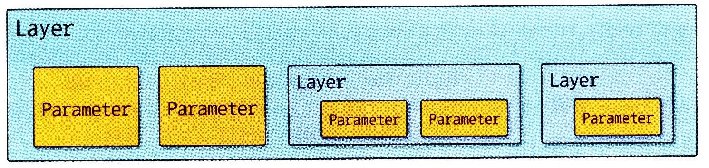
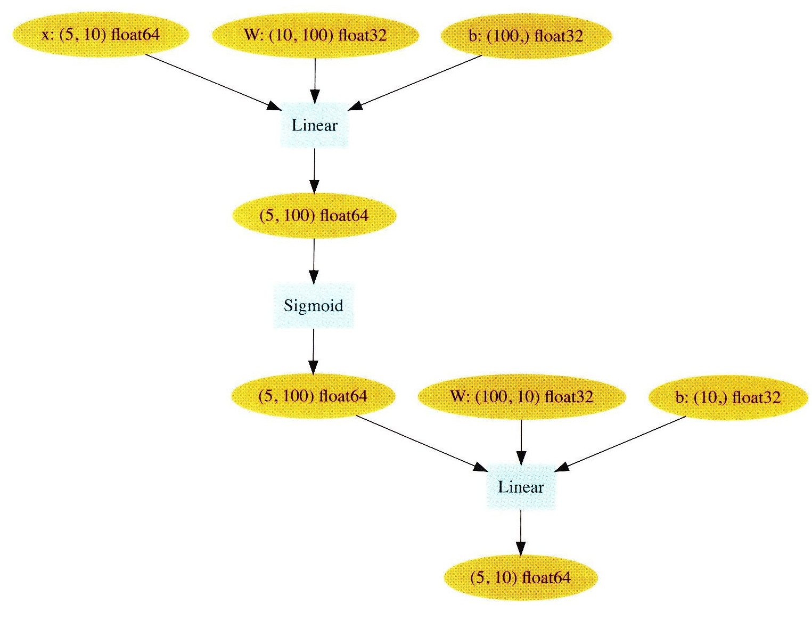

# 45단계 계층을 모아두는 계층

이전 단계에서는 `Layer` 클래스를 만들었습니다. `Layer` 클래스에는 매개변수를 관리하는 구조가 녹아 있어서 `Layer` 클래스를 사용하면 매개변수를 우리가 직접 다루지 않아도 되어 편리합니다. 그런데 `Layer` 인스턴스 자체도 관리는 필요합니다. 예를 들어 10층 신경망을 구현하려면 10개의 `Layer` 인스턴스를 관리해야 합니다(귀찮은 일이죠). 그래서 그런 부담을 줄일 수 있도록 현재의 `Layer` 클래스를 확장하겠습니다.

---

## 45.1 Layer 클래스 확장

현재 `Layer` 클래스는 여러 개의 `Parameter`를 가질 수 있습니다. 여기에 더해서 `Layer` 클래스가 '다른 `Layer`'도 담을 수 있게 확장하려 합니다. [그림 45-1]과 같은 관계로 만드는 것입니다.

**그림 45-1 새로운 Layer 클래스**


*(다이어그램 구조: 바깥쪽 Layer 안에 여러 Parameter들이 존재하고, 동시에 자식 요소로 Layer(그 안에 Parameter들을 포함)들이 중첩되어 담길 수 있는 다중 레이어 구조를 보여줌)*

[그림 45-1]처럼 `Layer` 안에 다른 `Layer`가 들어가는 구조입니다. '상자' 구조라 할 수 있죠. 이번 단계의 목표는 [그림 45-1]의 바깥 `Layer`에서 그 안에 존재하는 모든 매개변수를 꺼낼 수 있도록 하는 것입니다. 이를 위해 현재의 `Layer` 클래스를 다음과 같이 변경합니다.

**dezero/layers.py**
```python
class Layer:
    def __init__(self):
        self._params = set()

    def __setattr__(self, name, value):
        if isinstance(value, (Parameter, Layer)):  # ① Layer도 추가
            self._params.add(name)
        super().__setattr__(name, value)

    def params(self):
        for name in self._params:
            obj = self.__dict__[name]

            if isinstance(obj, Layer):  # ② Layer에서 매개변수 꺼내기
                yield from obj.params()
            else:
                yield obj
```

첫 번째 변화로, 인스턴스 변수를 설정할 때 `Layer` 인스턴스의 이름도 `_params`에 추가하도록 합니다. 따라서 `Parameter` 인스턴스와 `Layer` 인스턴스의 이름이 `_params`에 추가됩니다.

두 번째 변경점은 매개변수를 꺼내는 처리입니다. `params` 메서드는 `_params`에서 `name`(문자열)을 꺼내 그 `name`에 해당하는 객체를 `obj`로 꺼냅니다. 이때 `obj`가 `Layer` 인스턴스라면 `obj.params()`를 호출합니다. 이런 식으로 `Layer` 속 `Layer`에서도 매개변수를 재귀적으로 꺼낼 수 있습니다.

> **CAUTION**
> `yield`를 사용한 함수를 **제너레이터(generator)**라고 합니다. 제너레이터를 사용하여 또 다른 제너레이터를 만들고자 할 때는 `yield from`을 사용합니다. `yield from`은 파이썬 3.3부터 지원합니다.

이것으로 새로운 `Layer` 클래스를 완성했습니다. 새로운 `Layer` 클래스를 사용하면 신경망을 다음 코드처럼 구현할 수 있습니다.

```python
import dezero.layers as L
import dezero.functions as F
from dezero import Layer

model = Layer()
model.l1 = L.Linear(5)  # 출력 크기만 지정
model.l2 = L.Linear(3)

# 추론을 수행하는 함수
def predict(model, x):
    y = model.l1(x)
    y = F.sigmoid(y)
    y = model.l2(y)
    return y

# 모든 매개변수에 접근
for p in model.params():
    print(p)

# 모든 매개변수의 기울기를 재설정
model.cleargrads()
```

먼저 `model = Layer()`에서 인스턴스를 생성한 다음 `model`의 인스턴스 변수로 `Linear` 인스턴스를 추가합니다. 그러면 추론을 수행하는 함수를 `predict(model, x)`로 구현할 수 있습니다. 여기서 중요한 점은 `model.params()`로 `model` 내에 존재하는 모든 매개변수에 접근할 수 있다는 것입니다. 또한 `model.cleargrads()`는 모든 매개변수의 기울기를 재설정합니다. 이처럼 `Layer` 클래스를 이용하여 신경망에서 사용하는 매개변수를 한꺼번에 관리할 수 있습니다.

한편 `Layer` 클래스를 더 편리하게 사용하는 방법도 있습니다. 바로 `Layer` 클래스를 상속하여 모델 전체를 하나의 '클래스'로 정의하는 방법이죠. 준비한 예를 볼까요?

```python
class TwoLayerNet(Layer):
    def __init__(self, hidden_size, out_size):
        super().__init__()
        self.l1 = L.Linear(hidden_size)
        self.l2 = L.Linear(out_size)

    def forward(self, x):
```

```python
        y = F.sigmoid(self.l1(x))
        y = self.l2(y)
        return y
```

`TwoLayerNet`이라는 이름으로 클래스 모델을 정의했습니다. 이 클래스는 `Layer`를 상속했고 `__init__`와 `forward` 메서드를 구현했습니다. `__init__` 메서드에서는 필요한 `Layer`들을 생성하여 `self.l1 = ...` 형태로 설정해둡니다. 한편 `forward` 메서드에는 추론을 수행하는 코드를 작성했습니다. 이처럼 `TwoLayerNet`이라는 클래스 하나에 신경망에 필요한 모든 코드를 집약할 수 있습니다.

> **NOTE**
> 여기에서 선보인 객체지향식 모델 정의 방법(모델을 클래스 단위로 정의)은 체이너가 최초로 제안했고, 그 후 파이토치와 텐서플로 등 많은 다른 프레임워크에서 보편적으로 사용하는 방식으로 굳어졌습니다.

---

## 45.2 Model 클래스

지금까지 몇 번이나 '모델' 혹은 'model'이라는 단어가 등장했습니다. 모델은 '사물의 본질을 단순하게 표현한 것'이라는 뜻인데, 머신러닝에 사용되는 모델도 마찬가지입니다. 복잡한 패턴이나 규칙이 숨어 있는 현상을 수식을 사용하여 단순하게 표현한 것을 말하죠. 신경망도 수식으로 표현할 수 있는 함수이며, 그것을 가리켜 '모델'이라고 합니다.

이번 절에서는 모델을 표현하기 위한 `Model` 클래스를 새로 만듭니다. `Model` 클래스는 `Layer` 클래스의 기능을 이어받으며 시각화 메서드가 하나 추가됩니다. 코드는 다음과 같습니다.

**dezero/models.py**
```python
from dezero import Layer
from dezero import utils

class Model(Layer):
    def plot(self, *inputs, to_file='model.png'):
        y = self.forward(*inputs)
        return utils.plot_dot_graph(y, verbose=True, to_file=to_file)
```

이와 같이 `Model`은 `Layer`를 상속합니다. 따라서 `Model` 클래스를 앞에서 본 `Layer` 클래스처럼 활용할 수도 있습니다. 가령 `class TwoLayerNet(Model):`이라고 작성할 수 있습니다. 또한 `Model` 클래스에는 시각화를 위한 `plot` 메서드가 추가되어 있습니다. `plot`은 인수 `*inputs`로 전달받은 데이터를 `forward` 메서드로 계산한 다음, 이때 생성된 계산 그래프를 이미지 파일로 내보냅니다. 참고로 `utils.plot_dot_graph` 함수의 인수에 대해 `verbose=True`로 설정하면 `ndarray` 인스턴스의 형상과 타입도 계산 그래프에 표시해줍니다.

마지막으로 `Model` 클래스를 쉽게 임포트할 수 있도록 `dezero/__init__.py`에 다음 줄을 추가합니다.

```python
from dezero.models import Model
```

이제 다음과 같은 코드를 작성할 수 있습니다.

```python
import numpy as np
from dezero import Variable, Model
import dezero.layers as L
import dezero.functions as F

class TwoLayerNet(Model):
    def __init__(self, hidden_size, out_size):
        super().__init__()
        self.l1 = L.Linear(hidden_size)
        self.l2 = L.Linear(out_size)

    def forward(self, x):
        y = F.sigmoid(self.l1(x))
        y = self.l2(y)
        return y

x = Variable(np.random.randn(5, 10), name='x')
model = TwoLayerNet(100, 10)
model.plot(x)
```

보다시피 `Model` 클래스는 마치 `Layer` 클래스처럼 활용할 수 있습니다. 여기에 계산 그래프를 시각화해주는 메서드도 제공하죠. 참고로 앞의 코드를 실행하면 [그림 45-2]를 얻을 수 있습니다.

**그림 45-2 TwoLayerNet의 계산 그래프**


*(계산 그래프 다이어그램: 입력 `x: (5, 10) float64`, `W: (10, 100) float32`, `b: (100,) float32` $\rightarrow$ `Linear` $\rightarrow$ `(5, 100) float64` $\rightarrow$ `Sigmoid` $\rightarrow$ `(5, 100) float64`와 `W: (100, 10) float32`, `b: (10,) float32` $\rightarrow$ `Linear` $\rightarrow$ 출력 `(5, 10) float64`로 이어지는 데이터 흐름을 시각화함)*

---

## 45.3 Model을 사용한 문제 해결

그러면 `sin` 함수로 생성한 데이터셋 회귀 문제를 `Model` 클래스를 이용하여 다시 풀어봅시다. 이전 단계에서 달라진 부분은 음영으로 표시했습니다.

**steps/step45.py**
```python
import numpy as np
from dezero import Variable, Model
import dezero.layers as L
import dezero.functions as F

# 데이터셋 생성
np.random.seed(0)
x = np.random.rand(100, 1)
y = np.sin(2 * np.pi * x) + np.random.rand(100, 1)
```

```python
# 하이퍼파라미터 설정
lr = 0.2
max_iter = 10000
hidden_size = 10

# 모델 정의
class TwoLayerNet(Model):
    def __init__(self, hidden_size, out_size):
        super().__init__()
        self.l1 = L.Linear(hidden_size)
        self.l2 = L.Linear(out_size)

    def forward(self, x):
        y = F.sigmoid(self.l1(x))
        y = self.l2(y)
        return y

model = TwoLayerNet(hidden_size, 1)

# 학습 시작
for i in range(max_iter):
    y_pred = model(x)
    loss = F.mean_squared_error(y, y_pred)

    model.cleargrads()
    loss.backward()

    for p in model.params():
        p.data -= lr * p.grad.data
    if i % 1000 == 0:
        print(loss)
```

이와 같이 `Model` 클래스를 상속한 `TwoLayerNet`으로 신경망을 구현했습니다. 덕분에 `for` 문 안의 코드가 더 간단해졌죠. 모든 매개변수는 `model`을 통해 접근할 수 있으며 매개변수의 기울기 재설정도 `model.cleargrads()`로 처리했습니다.

이것으로 우리는 매개변수 관리에서 해방되었습니다! 앞으로는 아무리 복잡한 신경망을 구축한다 해도 필요한 모든 매개변수를 `Model` 클래스(또는 `Layer` 클래스)로 관리할 수 있기 때문입니다. 이번 단계의 주요 목적은 이것으로 달성했습니다. 하지만 다음 단계로 나아가기 전에 더 범용적인 신경망 모델을 하나 구현해봤으면 합니다.

---

## 45.4 MLP 클래스

방금 우리는 층이 2개인 완전연결계층으로 이루어진 모델을 구현했습니다. 해당 코드를 발췌하면 다음과 같습니다.

**steps/step45.py**
```python
class TwoLayerNet(Model):
    def __init__(self, hidden_size, out_size):
        super().__init__()
        self.l1 = L.Linear(hidden_size)
        self.l2 = L.Linear(out_size)

    def forward(self, x):
        y = F.sigmoid(self.l1(x))
        y = self.l2(y)
        return y
```

이와 같이 하나의 클래스로 2층 신경망을 구현했습니다. 이번 절에서는 앞으로를 위해 더 범용적인 완전연결계층 신경망을 구현하겠습니다. 코드는 다음과 같습니다.

**dezero/models.py**
```python
import dezero.functions as F
import dezero.layers as L

class MLP(Model):
    def __init__(self, fc_output_sizes, activation=F.sigmoid):
        super().__init__()
        self.activation = activation
        self.layers = []

        for i, out_size in enumerate(fc_output_sizes):
            layer = L.Linear(out_size)
            setattr(self, 'l' + str(i), layer)
            self.layers.append(layer)

    def forward(self, x):
        for l in self.layers[:-1]:
            x = self.activation(l(x))
        return self.layers[-1](x)
```

간단히 설명해보죠. 먼저 초기화에서는 인수로 `fc_output_sizes`와 `activation`을 받습니다. 여기서 `fc`는 full connect(완전연결)의 약자입니다. `fc_output_sizes`는 신경망을 구성하는 완전연결계층들의 출력 크기를 튜플 또는 리스트로 지정합니다. 가령 `(10, 1)`을 건네면 2개의 `Linear` 계층을 만들고, 첫 번째 계층의 출력 크기는 10으로, 두 번째 계층의 출력 크기는 1로 구성합니다. `(10, 10, 1)`을 건네면 `Linear` 계층이 하나 늘어나서 총 3개가 되죠. 한편 인수 `activation`으로는 활성화 함수를 지정합니다(기본값은 `F.sigmoid` 함수).

> **NOTE**
> 클래스 이름인 `MLP`는 Multi-Layer Perceptron의 약자로, 우리말로 '다층 퍼셉트론'이라고 합니다. `MLP`는 완전연결계층 신경망의 별칭으로 흔히 쓰입니다.

`MLP` 클래스의 구현은 앞서 보여드린 `TwoLayerNet` 클래스의 자연스러운 확장으로 볼 수 있습니다. 한 가지, 인스턴스 변수 설정을 `setattr` 함수로 하고 있음에 주의하세요. 여기에서는 `self.l2 = ...` 형태로 코딩할 수 없기 때문입니다. 또한 `DeZero`는 계층 모델에 인스턴스 변수를 설정하는 식으로 계층에 포함된 매개변수들을 관리하고 있습니다.

이상이 `MLP` 클래스입니다. `MLP` 클래스가 있으면 다음과 같이 'N층' 신경망을 쉽게 구현할 수 있습니다.

```python
model = MLP((10, 1))  # 2층
model = MLP((10, 20, 30, 40, 1))  # 5층
```

`MLP` 클래스는 범용성이 높아 앞으로도 계속 사용할 것입니다. 그래서 `dezero/models.py`에 추가합니다. 이상으로 이번 단계를 마칩니다.
