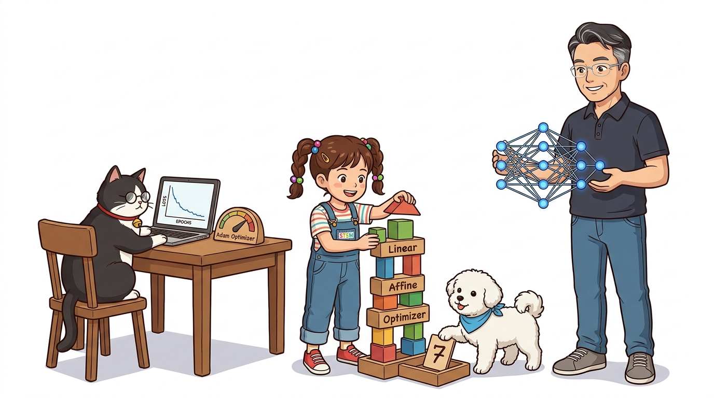

# 제4고지: 신경망 만들기

> *"다차원 텐서와 계층(Layer) 추상화로 완전한 딥러닝 신경망을 구축하다"*

**제4고지**에서는 다차원 텐서 연산을 기반으로 실제 딥러닝 신경망 모델을 설계하고 학습시킵니다.  
텐서의 형상 변환(`reshape`), 전치(`transpose`), 합(`sum`)과 브로드캐스팅을 구현하고, 선형 회귀에서 출발하여 매개변수를 자동으로 추적하는 `Parameter`, `Layer`, `Model` 추상화, 그리고 **Optimizer(SGD, Momentum, Adam)**와 `DataLoader`를 구축하여 **MNIST 손글씨 숫자 인식 데이터셋을 완벽하게 학습**합니다.

**그림 04-Intro** 다차원 텐서 연산과 계층(Layer) 추상화 및 MNIST 손글씨 인식 신경망 학습 (이호진 교수와 도로시 탐험대)

---

## 🎯 학습 목표

이 단원을 학습하고 나면 제4고지 신경망 만들기에 포함된 다음 핵심 내용을 명확히 이해하고 구현할 수 있습니다:

1. **37단계 텐서를 다루다**의 원리와 구현 방식을 이해하고 실전에 적용할 수 있다.
2. **38단계 형상 변환 함수**의 원리와 구현 방식을 이해하고 실전에 적용할 수 있다.
3. **39단계 합계 함수**의 원리와 구현 방식을 이해하고 실전에 적용할 수 있다.
4. **40단계 브로드캐스트 함수**의 원리와 구현 방식을 이해하고 실전에 적용할 수 있다.
5. **41단계 행렬의 곱**의 원리와 구현 방식을 이해하고 실전에 적용할 수 있다.

---

## 📚 학습 목차

- **[37단계 텐서를 다루다](./4_1_텐서를_다루다/index.html)**
  - 지금까지는 변수로 주로 '스칼라'를 다뤘습니다. 그러나 머신러닝 데이터로는 벡터나 행렬 등의 '텐서'가 주로 쓰입니다. 이번 단계에서는 텐서를 사용할 때의 주의점을 알아보면서 DeZero 확장을 준비합니다. 또한 지금까지 구현한 DeZero 함수들이...
- **[38단계 형상 변환 함수](./4_2_형상_변환_함수/index.html)**
  - 이전 단계에서는 텐서를 사용한 계산에서의 역전파를 설명했습니다. 요약하면 다음과 같습니다. 앞으로는 원소별로 계산하지 않는 함수에 대해 살펴보겠습니다. 이번 단계에서는 그 첫걸음으로 두 가지 함수를 구현합니다. 텐서의 형상을 변환하는 `reshape`...
- **[39단계 합계 함수](./4_3_합계_함수/index.html)**
  - 이번 단계에서는 DeZero에 합계를 구하는 함수 `sum`을 추가합니다. 먼저 '덧셈'의 미분을 복습하고 이를 응용하여 `sum` 함수의 미분을 이끌어냅니다. 그런 다음 `sum` 함수를 구현하는 순서로 진행하겠습니다. '덧셈' 함수는 이미 구현되어...
- **[40단계 브로드캐스트 함수](./4_4_브로드캐스트_함수/index.html)**
  - 이전 단계에서 DeZero의 `sum` 함수를 구현했는데, 이 함수의 역전파에서는 당시에는 구현되지 않은 `broadcast_to` 함수를 이용했습니다. 이번 단계에서는 바로 이 `broadcast_to` 함수를 구현합니다. 또한 DeZero에서도 넘...
- **[41단계 행렬의 곱](./4_5_행렬의_곱/index.html)**
  - 이번 단계의 주제는 '벡터의 내적'과 '행렬의 곱'입니다. 먼저 이 두 가지 계산 방법을 알아본 다음 DeZero 함수로 구현하겠습니다. 이번 단계가 끝나면 텐서를 다루는 최소한의 핵심 함수들이 모두 등장하여 드디어 실용적인 문제를 풀 수 있게 됩니다...
- **[42단계 선형 회귀](./4_6_선형_회귀/index.html)**
  - 머신러닝은 '데이터'를 사용하여 문제를 해결합니다. 사람이 해법을 생각하여 알려주는 게 아니라 모아진 데이터로부터 컴퓨터가 스스로 해법을 찾아냅니다(학습합니다). 이처럼 데이터로부터 해법을 찾는 것이 머신러닝의 본질입니다. 앞으로 우리는 DeZero를...
- **[43단계 신경망](./4_7_신경망/index.html)**
  - 이전 단계에서는 선형 회귀를 구현하고 올바로 동작시키는 데 성공했습니다. 선형 회귀를 구현했다면 이를 신경망으로 확장하는 일은 간단합니다. 이번 단계에서는 이전 단계의 코드를 수정하여 신경망으로 '진화'시킬 것입니다. 우선 이전 단계에서 수행한 변환을...
- **[44단계 매개변수를 모아두는 계층](./4_8_매개변수를_모아두는_계층/index.html)**
  - 이전 단계에서는 DeZero를 사용하여 신경망을 구현했습니다. 단순하지만 진짜 신경망이었습니다. 이제 DeZero를 '신경망 프레임워크'라고 말할 수 있을 것입니다. 하지만 '사용 편의성' 면에서는 여전히 몇 가지 문제가 있습니다. 앞으로 우리는 De...
- **[45단계 계층을 모아두는 계층](./4_9_계층을_모아두는_계층/index.html)**
  - 이전 단계에서는 `Layer` 클래스를 만들었습니다. `Layer` 클래스에는 매개변수를 관리하는 구조가 녹아 있어서 `Layer` 클래스를 사용하면 매개변수를 우리가 직접 다루지 않아도 되어 편리합니다. 그런데 `Layer` 인스턴스 자체도 관리는...
- **[46단계 Optimizer로 수행하는 매개변수 갱신](./4_10_Optimizer로_수행하는_매개변수_갱신/index.html)**
  - 지금까지는 경사하강법으로 매개변수를 갱신했습니다만, 딥러닝 분야에서는 경사하강법 외에도 다양한 최적화 기법이 제안되고 있습니다. 이번 단계에서는 매개변수 갱신 작업(갱신 코드)을 모듈화하고 쉽게 다른 모듈로 대체할 수 있는 구조를 만들겠습니다. 이번...
- **[47단계 소프트맥스 함수와 교차 엔트로피 오차](./4_11_소프트맥스_함수와_교차_엔트로피_오차/index.html)**
  - 지금까지 신경망을 사용하여 회귀 문제를 풀어왔는데, 앞으로는 새로운 유형의 문제에 도전해 보겠습니다. 바로 **다중 클래스 분류(multi-class classification)**입니다. 다중 클래스 분류는 이름처럼 '여러 클래스'로 '분류'하는 문...
- **[48단계 다중 클래스 분류](./4_12_다중_클래스_분류/index.html)**
  - 이전 단계에서는 소프트맥스 함수와 교차 엔트로피 오차를 구현했습니다. 그러니 이제 다중 클래스 분류를 할 수 있습니다. 이번 단계에서는 '스파이럴 데이터셋'이라는 작은 데이터셋을 사용하여 다중 클래스 분류를 실제로 해보겠습니다(스파이럴(spiral)은...
- **[49단계 Dataset 클래스와 전처리](./4_13_Dataset_클래스와_전처리/index.html)**
  - 이전 단계에서는 스파이럴 데이터셋을 읽어올 때 `x, t = dezero.datasets.get_spiral()` 코드를 사용했습니다. 이때 `x`와 `t`는 `ndarray` 인스턴스이며, 형상은 `x`가 `(300, 2)`이고 `t`가 `(300,...
- **[50단계 미니배치를 뽑아주는 DataLoader](./4_14_미니배치를_뽑아주는_DataLoader/index.html)**
  - 이전 단계에서는 `Dataset` 클래스를 만들어서 통일된 인터페이스로 데이터셋을 다룰 수 있게 하였습니다. 이번 단계에서는 `Dataset` 클래스에서 미니배치를 뽑아주는 `DataLoader` 클래스를 구현합니다. `DataLoader`는 미니배치...
- **[51단계 MNIST 학습](./4_15_MNIST_학습/index.html)**
  - 지금까지 데이터셋을 쉽게 다룰 수 있는 구조를 마련했습니다. 간단하게 복습하면, 우선 `Dataset` 클래스로 데이터셋 처리를 위한 공통 인터페이스를 마련했고, '전처리'를 설정할 수 있도록 했습니다. 그리고 `DataLoader` 클래스로는 `Da...
- **[칼럼 딥러닝 프레임워크](./4_16_칼럼_딥러닝_프레임워크/index.html)**
  - 딥러닝 프레임워크들은 여명기에는 제각기 큰 차이를 보였습니다. 그러나 성숙기에 접어든 지금은 파이토치, 체이너, 텐서플로 등의 인기 프레임워크들이 거의 같은 방향으로 나아가고 있습니다. 물론 각각의 특징이 있고 인터페이스도 다르지만, 핵심 설계 사상에...

---

## 💡 학습 정리

1. **37단계 텐서를 다루다**: 지금까지는 변수로 주로 '스칼라'를 다뤘습니다. 그러나 머신러닝 데이터로는 벡터나 행렬 등의 '텐서'가 주로 쓰입니다. 이번 단계에서는 텐서를 사용할 때의 주의점을 알아보면서 DeZero 확장을 준비합니다. 또한 지금까지 구현한 DeZero 함수들이...
2. **38단계 형상 변환 함수**: 이전 단계에서는 텐서를 사용한 계산에서의 역전파를 설명했습니다. 요약하면 다음과 같습니다. 앞으로는 원소별로 계산하지 않는 함수에 대해 살펴보겠습니다. 이번 단계에서는 그 첫걸음으로 두 가지 함수를 구현합니다. 텐서의 형상을 변환하는 `reshape`...
3. **39단계 합계 함수**: 이번 단계에서는 DeZero에 합계를 구하는 함수 `sum`을 추가합니다. 먼저 '덧셈'의 미분을 복습하고 이를 응용하여 `sum` 함수의 미분을 이끌어냅니다. 그런 다음 `sum` 함수를 구현하는 순서로 진행하겠습니다. '덧셈' 함수는 이미 구현되어...
4. **40단계 브로드캐스트 함수**: 이전 단계에서 DeZero의 `sum` 함수를 구현했는데, 이 함수의 역전파에서는 당시에는 구현되지 않은 `broadcast_to` 함수를 이용했습니다. 이번 단계에서는 바로 이 `broadcast_to` 함수를 구현합니다. 또한 DeZero에서도 넘...
5. **41단계 행렬의 곱**: 이번 단계의 주제는 '벡터의 내적'과 '행렬의 곱'입니다. 먼저 이 두 가지 계산 방법을 알아본 다음 DeZero 함수로 구현하겠습니다. 이번 단계가 끝나면 텐서를 다루는 최소한의 핵심 함수들이 모두 등장하여 드디어 실용적인 문제를 풀 수 있게 됩니다...
6. **42단계 선형 회귀**: 머신러닝은 '데이터'를 사용하여 문제를 해결합니다. 사람이 해법을 생각하여 알려주는 게 아니라 모아진 데이터로부터 컴퓨터가 스스로 해법을 찾아냅니다(학습합니다). 이처럼 데이터로부터 해법을 찾는 것이 머신러닝의 본질입니다. 앞으로 우리는 DeZero를...
