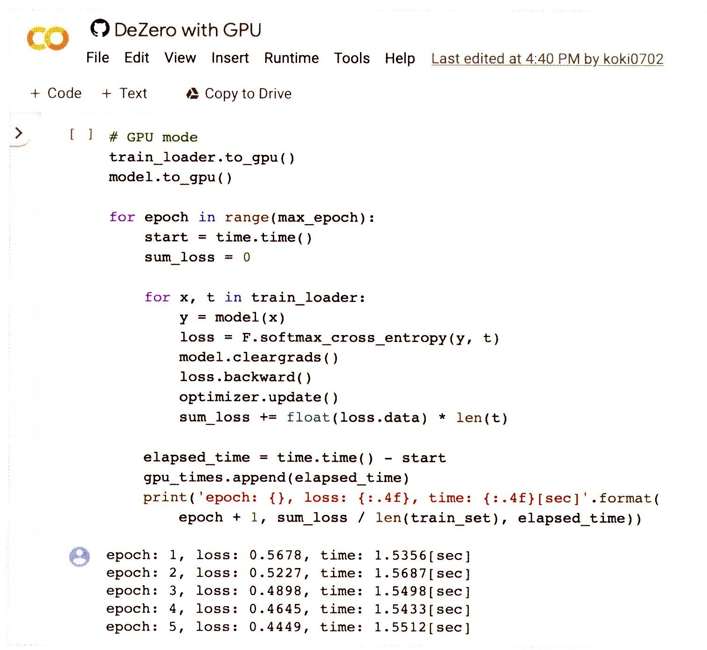

# 52단계 GPU 지원

딥러닝으로 하는 계산은 '행렬의 곱'이 대부분을 차지합니다. 그런데 행렬의 곱은 곱셈과 덧셈으로 구성되어 있어서 병렬로 계산하는 게 가능하고, 병렬 계산에는 CPU보다 GPU가 훨씬 뛰어납니다. 그래서 이번 단계에서는 DeZero를 GPU에서 구동하기 위한 구조를 만들 것입니다.


---

> **CAUTION**
> GPU에서 실행하기 위해서는 엔비디아(NVIDIA)의 GPU와 쿠파이(CuPy)라는 파이썬 라이브러리가 필요합니다. 조건을 충족하는 컴퓨터가 없는 독자는 구글 코랩을 통해 클라우드에서 GPU를 활용해볼 수 있습니다(2020년 2월 시점에서는 무료로 사용할 수 있습니다). 구글 코랩 관련 내용은 부록 C에서 설명하고 있으니 관심 있는 분은 참고하기 바랍니다.


---

## 52.1 쿠파이 설치 및 사용 방법

쿠파이는 GPU를 사용하여 병렬 계산을 해주는 라이브러리입니다. 


---

설치는 다음과 같이 간단히 할 수 있습니다.

```bash
$ pip install cupy
```

그럼 쿠파이를 사용해보죠. 쿠파이의 장점은 넘파이와 API가 거의 같다는 것입니다. 따라서 넘파이 지식을 쿠파이에서도 그대로 활용할 수 있죠. 


---

예컨대 쿠파이를 사용하여 다음과 같은 코드를 작성할 수 있습니다.

```python
import cupy as cp

x = cp.arange(6).reshape(2, 3)
print(x)

y = x.sum(axis=1)
print(y)
```
---

**실행 결과**
```text
[[0 1 2]
 [3 4 5]]
[ 3 12]
```

쿠파이를 임포트하여 합계를 구했습니다. 


---

보다시피 넘파이와 거의 같은 코드로 원하는 계산이 가능합니다(`np` 대신 `cp`를 사용한다는 점만 다릅니다). 그리고 뒤편에서는 CPU가 아닌 GPU가 열심히 계산을 해줍니다.

이처럼 넘파이 코드를 'GPU 버전'으로 변환하기는 식은 죽 먹기입니다. 넘파이 코드에서 `np`(넘파이; numpy)를 `cp`(쿠파이; cupy)로 치환하면 끝이기 때문이죠.

> **CAUTION**
> 쿠파이의 API는 넘파이와 거의 같지만 완전히 똑같지는 않습니다.

그러면 DeZero에게 GPU 활용법을 가르쳐봅시다. 당장 할 일은 DeZero에서 넘파이를 사용하는 부분을 쿠파이로 바꾸는 것(정확히는 전환하는 구조를 만드는 것)입니다. 그러려면 쿠파이에 관해 두 가지를 알아야 합니다. 첫 번째는 넘파이와 쿠파이의 다차원 배열을 서로 변환하는 방법입니다. 다음 코드를 보시죠.

```python
import numpy as np
import cupy as cp

# 넘파이 -> 쿠파이
n = np.array([1, 2, 3])
c = cp.asarray(n)
assert type(c) == cp.ndarray
```

```python
# 쿠파이 -> 넘파이
c = cp.array([1, 2, 3])
n = cp.asnumpy(c)
assert type(n) == np.ndarray
```

이와 같이 넘파이에서 쿠파이로 변환할 때는 `cp.asarray` 함수를, 쿠파이에서 넘파이로 변환할 때는 `cp.asnumpy` 함수를 사용합니다.

> **NOTE**
> `cp.asarray` 함수와 `cp.asnumpy` 함수를 사용하면 데이터가 메인 메모리에서 GPU 메모리로(또는 그 반대로) 전송됩니다. 참고로 실무 딥러닝에서는 다량의 데이터를 다루므로 이 전송 과정이 병목으로 작용할 가능성이 커집니다. 따라서 데이터 전송 횟수를 최소로 억제하게끔 코딩하는 것이 좋습니다.

두 번째로 알아야 하는 것은 `cp.get_array_module` 함수입니다. 이 함수는 주어진 데이터에 적합한 모듈을 돌려줍니다. 사용 방법은 다음과 같습니다.

```python
# x가 넘파이 배열인 경우
x = np.array([1, 2, 3])
xp = cp.get_array_module(x)
assert xp == np

# x가 쿠파이 배열인 경우
x = cp.array([1, 2, 3])
xp = cp.get_array_module(x)
assert xp == cp
```

이와 같이 `x`가 넘파이 또는 쿠파이의 다차원 배열이라면 `xp = cp.get_array_module(x)`는 해당 배열에 적합한 모듈을 돌려줍니다. 따라서 데이터가 넘파이 배열인지 쿠파이 배열인지 모르더라도 올바른 모듈을 가져올 수 있으므로 쿠파이/넘파이 모두에 대응하는 코드를 작성할 수 있습니다. 예를 들어 `xp = cp.get_array_module(x)` 다음에 `y = xp.sin(x)`를 실행하면 쿠파이/넘파이 구분 없이 올바르게 동작합니다.

쿠파이 관련 지식은 이 정도면 충분하니, 지금부터 DeZero에 쿠파이와 넘파이를 전환하는 구조를 심어 넣겠습니다.

---

## 52.2 쿠다 모듈

DeZero에서 쿠파이 관련 함수는 `dezero/cuda.py` 모듈(파일)에 모아뒀습니다. 참고로 쿠다(CUDA)는 엔비디아가 제공하는 GPU용 개발 환경입니다. 우선 `dezero/cuda.py`의 임포트 부분을 볼까요?

**dezero/cuda.py**
```python
import numpy as np
gpu_enable = True
try:
    import cupy as cp
    cupy = cp
except ImportError:
    gpu_enable = False
from dezero import Variable
```

이 부분에서 넘파이와 쿠파이를 임포트합니다. 쿠파이 라이브러리는 필수는 아니므로(없어도 CPU 기반으로 동작하므로) 설치되어 있지 않은 경우도 고려하는 게 좋겠죠? 그래서 `try` 문에서 임포트를 수행해보고 `ImportError`가 발생하면 `gpu_enable = False`로 설정합니다. 이제 쿠파이가 설치되지 않은 환경에서도 오류 없이 작동합니다.

이어서 `dezero/cuda.py`에는 다음의 세 가지 함수가 추가되어 있습니다.

**dezero/cuda.py**
```python
def get_array_module(x):
    if isinstance(x, Variable):
        x = x.data

    if not gpu_enable:
        return np
    xp = cp.get_array_module(x)
    return xp

def as_numpy(x):
    if isinstance(x, Variable):
        x = x.data

    if np.isscalar(x):
        return np.array(x)
```

```python
    elif isinstance(x, np.ndarray):
        return x
    return cp.asnumpy(x)

def as_cupy(x):
    if isinstance(x, Variable):
        x = x.data

    if not gpu_enable:
        raise Exception('쿠파이(CuPy)를 로드할 수 없습니다. 쿠파이를 설치해주세요!')
    return cp.asarray(x)
```

첫 번째 `get_array_module(x)`는 인수 `x`에 대응하는 모듈을 돌려줍니다. `x`는 `Variable` 또는 `ndarray`(`numpy.ndarray` 또는 `cupy.ndarray`)여야 합니다. 이 함수는 기본적으로 `cp.get_array_module` 함수의 래퍼(wrapper)지만 cupy가 임포트되지 않은 경우도 대처해줍니다. 즉, `gpu_enable`이 `False`면 항상 `np`(`numpy`)를 돌려줍니다.

나머지 두 가지 함수는 쿠파이/넘파이의 다차원 배열을 서로 변환해주는 함수입니다. 넘파이의 `ndarray`로 변환하는 함수가 `as_numpy`이고, 쿠파이의 `ndarray`로 변환하는 함수가 `as_cupy`입니다.

이상이 `dezero/cuda.py`에 담긴 코드의 전부입니다. 이 모듈(파일)에 있는 세 함수를 앞으로 DeZero의 다른 클래스들에 적용할 것입니다.

---

## 52.3 Variable/Layer/DataLoader 클래스 추가 구현

이제부터는 DeZero의 다른 클래스들에 GPU 대응 기능을 추가하겠습니다. 이번 절에서 수정할 클래스는 `Variable`, `Layer`, `DataLoader`입니다.

우선 `Variable` 클래스의 `__init__` 메서드와 `backward` 메서드를 다음과 같이 수정합니다.

**dezero/core.py**
```python
...
try:
    import cupy
    array_types = (np.ndarray, cupy.ndarray) # ❶
except ImportError:
    array_types = (np.ndarray)

class Variable:
    def __init__(self, data, name=None):
        if data is not None:
            if not isinstance(data, array_types): # ❶
                raise TypeError('{} is not supported'.format(type(data)))
            ...

    def backward(self, retain_grad=False, create_graph=False):
        if self.grad is None:
            xp = dezero.cuda.get_array_module(self.data) # ❷
            self.grad = Variable(xp.ones_like(self.data))
            ...
```

`__init__` 메서드는 인수 `data`로 `cupy.ndarray`가 넘어와도 대응할 수 있도록 수정합니다. 이를 위해 cupy 임포트에 성공하면 두 배열 타입을 동적으로 변경할 수 있도록 `array_types`를 `(np.ndarray, cupy.ndarray)`로 설정합니다(❶).

`backward` 메서드에서는 기울기(`self.grad`)를 자동으로 보완하는 부분을 수정합니다. 데이터(`self.data`)의 타입에 따라 넘파이 또는 쿠파이 중 하나의 다차원 배열을 생성하게 했습니다(❷).

그런데 `Variable` 클래스는 지금까지 인스턴스 변수 `data`에 넘파이 다차원 배열을 보관해왔습니다. 이 데이터를 GPU로 혹은 CPU로 전송해주는 기능이 필요합니다. 다음 `to_gpu` 메서드와 `to_cpu` 메서드가 이 일을 해줍니다.

**dezero/core.py**
```python
class Variable:
    ...

    def to_cpu(self):
        if self.data is not None:
            self.data = dezero.cuda.as_numpy(self.data)
```

```python
    def to_gpu(self):
        if self.data is not None:
            self.data = dezero.cuda.as_cupy(self.data)
```

보다시피 단순히 `as_numpy` 함수 또는 `as_cupy` 함수를 사용해주면 됩니다. 그러면 `Variable`의 데이터를 'GPU에서 CPU로' 또는 'CPU에서 GPU로' 전송할 수 있습니다.

계속해서 `Layer` 클래스 차례입니다. `Layer`는 매개변수를 담고 있는 클래스이고, 매개변수는 `Variable`을 상속한 `Parameter` 클래스로 표현됩니다. 이번에도 `Layer` 클래스의 매개변수를 CPU 또는 GPU에 전송하는 기능이 필요하니 다음과 같이 추가합니다.

**dezero/layers.py**
```python
class Layer:
    ...

    def to_cpu(self):
        for param in self.params():
            param.to_cpu()

    def to_gpu(self):
        for param in self.params():
            param.to_gpu()
```

마지막으로 `DataLoader` 클래스에는 다음 음영 부분의 코드를 추가합니다.

**dezero/dataloaders.py**
```python
...
import numpy as np
from dezero import cuda

class DataLoader:
    def __init__(self, dataset, batch_size, shuffle=True, gpu=False):
        self.dataset = dataset
        self.batch_size = batch_size
        self.shuffle = shuffle
        self.data_size = len(dataset)
        self.max_iter = math.ceil(self.data_size / batch_size)
        self.gpu = gpu

        self.reset()
```

```python
    def __next__(self):
        ...

        xp = cuda.cupy if self.gpu else np
        x = xp.array([example[0] for example in batch])
        t = xp.array([example[1] for example in batch])

        self.iteration += 1

        return x, t

    def to_cpu(self):
        self.gpu = False

    def to_gpu(self):
        self.gpu = True
```

`DataLoader` 클래스는 데이터셋을 미니배치로 뽑는 역할을 수행하며, 미니배치는 `__next__` 메서드에서 만들어집니다. 지금까지는 물론 넘파이 다차원 배열로 만들었지만, 수정된 코드에서는 인스턴스 변수 중 `gpu` 플래그를 확인하여 쿠파이와 넘파이 중 알맞은 다차원 배열을 만들어줍니다.

이상으로 DeZero의 세 개 클래스(`Variable`, `Layer`, `DataLoader`)의 'GPU 대응'을 마쳤습니다.

---

## 52.4 함수 추가 구현

GPU 대응과 관련하여 아직 DeZero 함수 수정이라는 중요한 일이 남아 있습니다. DeZero 함수들의 실제 계산은 `forward` 메서드에서 수행됩니다. 예를 들어 `Sin` 클래스는 현재 다음처럼 구현되어 있습니다.

**dezero/functions.py**
```python
class Sin(Function):
    def forward(self, x):
        y = np.sin(x)
        return y
```

```python
    def backward(self, gy):
        x, = self.inputs
        gx = gy * cos(x)
        return gx
```

여기에서 `def forward(self, x):`의 인수 `x`는 넘파이의 `ndarray` 인스턴스라고 가정하고 있습니다. 따라서 `np.sin(x)`처럼 넘파이 함수를 사용하여 계산할 수 있지요. 이 작업이 만약 GPU에서 실행된다면 인수 `x`에는 쿠파이의 `ndarray` 인스턴스가 전달됩니다. 그러므로 `np.sin(x)` 대신 `cp.sin(x)`로 변환해야 합니다. 즉, `x`가 넘파이이면 `np.sin`을 사용하고, 쿠파이이면 `cp.sin`을 사용해야 하죠. 이 점을 감안하여 `Sin` 클래스를 다음처럼 수정합니다.

**dezero/functions.py**
```python
from dezero import cuda

class Sin(Function):
    def forward(self, x):
        xp = cuda.get_array_module(x)
        y = xp.sin(x)
        return y

    def backward(self, gy):
        x, = self.inputs
        gx = gy * cos(x)
        return gx
```

이처럼 `xp = cuda.get_array_module(x)` 코드로 `x`에 적합한 모듈을 꺼냅니다. 결과적으로 `xp`는 `cp`와 `np` 중 하나가 되고, 그 `xp`를 사용하여 계산을 수행합니다. 이제 `Sin` 클래스는 CPU(넘파이)와 GPU(쿠파이) 어느 경우에도 제대로 동작합니다.

> **CAUTION**
> 여기에서는 Sin 클래스의 코드만 보여드렸지만, 같은 수정을 `dezero/functions.py`의 모든 해당 부분에 반영해뒀습니다. 여기서 '해당 부분'이라 하면 `np.xxx()`처럼 `np.`로 시작하는 코드를 말합니다. 그리고 `dezero/optimizers.py`와 `dezero/layers.py`도 똑같이 수정했습니다.

마지막으로 DeZero의 사칙연산 코드를 수정합니다. `dezero/core.py`를 다음처럼 수정하면 됩니다.

**dezero/core.py**
```python
def as_array(x, array_module=np):
    if np.isscalar(x):
        return array_module.array(x)
    return x

def add(x0, x1):
    x1 = as_array(x1, dezero.cuda.get_array_module(x0.data))
    return Add()(x0, x1)

def mul(x0, x1):
    x1 = as_array(x1, dezero.cuda.get_array_module(x0.data))
    return Mul()(x0, x1)

# sub, rsub, div, rdiv도 똑같이 수정
...
```

먼저 `as_array` 함수에 새로운 인수 `array_module`을 추가합니다. `array_module`은 `numpy` 또는 `cupy` 중 하나의 값을 취하며, 해당 모듈의 `ndarray`로 변환해줍니다. 그리고 `add` 함수와 `mul` 함수 등의 사칙연산이 새로운 `as_array` 함수를 사용하도록 수정합니다. 참고로 `add` 함수에서 `as_array` 함수를 사용하는 이유는 `x + 1`과 같은 코드도 실행되도록 하기 위함입니다(`x`는 `Variable` 인스턴스). 이제 `x.data`가 쿠파이 데이터라 해도 `x + 1` 형태의 코드가 문제없이 실행됩니다.

---

## 52.5 GPU로 MNIST 학습하기

드디어 DeZero를 GPU에서 실행할 수 있습니다. MNIST 학습 코드를 GPU에서 실행해봅시다.

**steps/step52.py**
```python
import time
import dezero
import dezero.functions as F
from dezero import optimizers
from dezero import DataLoader
from dezero.models import MLP
```

```python
max_epoch = 5
batch_size = 100

train_set = dezero.datasets.MNIST(train=True)
train_loader = DataLoader(train_set, batch_size)
model = MLP((1000, 10))
optimizer = optimizers.SGD().setup(model)

# GPU 모드
if dezero.cuda.gpu_enable:
    train_loader.to_gpu()
    model.to_gpu()

for epoch in range(max_epoch):
    start = time.time()
    sum_loss = 0

    for x, t in train_loader:
        y = model(x)
        loss = F.softmax_cross_entropy(y, t)
        model.cleargrads()
        loss.backward()
        optimizer.update()
        sum_loss += float(loss.data) * len(t)

    elapsed_time = time.time() - start
    print('epoch: {}, loss: {:.4f}, time: {:.4f}[sec]'.format(
        epoch + 1, sum_loss / len(train_set), elapsed_time))
```

GPU를 사용할 수 있는 환경에서 이 코드를 실행하면 `DataLoader`가 모델 데이터를 GPU로 전송합니다. 그러면 이후의 계산에서는 쿠파이 함수를 사용합니다.

코드를 실행해보면 지금까지와 마찬가지로 손실이 순조롭게 줄어듭니다. 하지만 CPU에서 돌릴 때보다 빠른 것을 알 수 있죠. [그림 52-1]은 구글 콜랩에서 실행해본 결과입니다.

#### 그림 52-1 구글 콜랩에서의 실행 결과


**DeZero with GPU**
File Edit View Insert Runtime Tools Help Last edited at 4:40 PM by koki0702

```python
# GPU mode
train_loader.to_gpu()
model.to_gpu()

for epoch in range(max_epoch):
    start = time.time()
    sum_loss = 0

    for x, t in train_loader:
        y = model(x)
        loss = F.softmax_cross_entropy(y, t)
        model.cleargrads()
        loss.backward()
        optimizer.update()
        sum_loss += float(loss.data) * len(t)

    elapsed_time = time.time() - start
    gpu_times.append(elapsed_time)
    print('epoch: {}, loss: {:.4f}, time: {:.4f}[sec]'.format(
        epoch + 1, sum_loss / len(train_set), elapsed_time))
```
Output:
```
epoch: 1, loss: 0.5678, time: 1.5356[sec]
epoch: 2, loss: 0.5227, time: 1.5687[sec]
epoch: 3, loss: 0.4898, time: 1.5498[sec]
epoch: 4, loss: 0.4645, time: 1.5433[sec]
epoch: 5, loss: 0.4449, time: 1.5512[sec]
```

---

[그림 52-1]과 같이 GPU를 사용하자 1에포크 당 1.5초 정도면 계산할 수 있습니다. 정확한 결과는 구글 콜랩 실행 환경(할당된 GPU 수 등)에 따라 달라집니다. 참고로 CPU로 실행했을 때는 1에포크 당 8초 정도가 걸립니다. 따라서 [그림 52-1]의 결과는 CPU보다 5배 정도 빠른 것이죠. 이상으로 DeZero의 GPU 대응을 완료했습니다.
