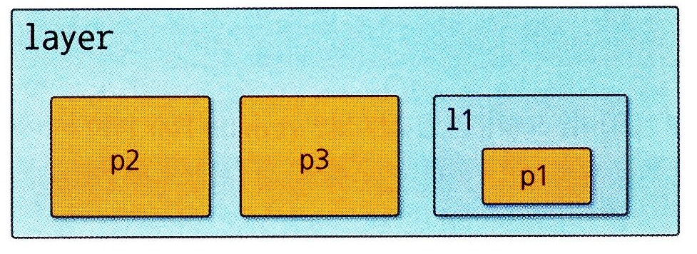

# 53단계 모델 저장 및 읽어오기

이번 단계에서는 모델이 가지는 매개변수를 외부 파일로 저장하고 다시 읽어오는 기능을 만듭니다. 이런 기능이 있다면 학습 중인 모델의 '스냅샷'을 저장하거나 이미 학습된 매개변수를 읽어와서 추론만 수행할 수 있습니다.

DeZero의 매개변수는 `Parameter` 클래스로 구현되어 있습니다(`Variable` 클래스를 상속한 클래스입니다). 그리고 `Parameter`의 데이터는 인스턴스 변수 `data`에 `ndarray` 인스턴스로 보관됩니다. 따라서 우리가 할 일은 `ndarray` 인스턴스를 외부 파일로 저장하는 것입니다. 다행히 넘파이에는 `ndarray`를 파일로 저장하고 읽어오는 함수가 몇 개 준비되어 있으니 먼저 이 함수들의 사용법을 알아보겠습니다.

> **NOTE**
> DeZero를 GPU에서 실행하는 경우에는 넘파이의 `ndarray` 대신 쿠파이의 `ndarray`(즉, `cupy.ndarray`)를 사용합니다. 이럴 때는 쿠파이 텐서를 넘파이 텐서로 변환한 후 외부 파일로 저장하면 됩니다. 따라서 외부 파일 저장은 넘파이만을 고려하겠습니다.

---

## 53.1 넘파이의 save 함수와 load 함수

넘파이에는 `np.save`와 `np.load`라는 함수가 있습니다. 이 함수들을 사용하면 `ndarray` 인스턴스를 저장하고 읽어올 수 있죠. 사용법은 다음과 같습니다.

```python
import numpy as np

x = np.array([1, 2, 3])
np.save('test.npy', x)

x = np.load('test.npy')
print(x)
```

**실행 결과**
```
[1 2 3]
```

`np.save` 함수부터 보겠습니다. 이 함수는 `ndarray` 인스턴스를 외부 파일로 저장해줍니다. 이미 저장되어 있는 데이터를 읽어올 때는 `np.load` 함수를 사용합니다. 이것으로 하나의 `ndarray` 인스턴스를 저장하고 읽어올 수 있음을 확인했습니다.

> **CAUTION**
> 앞의 코드에서 데이터를 `test.npy`라는 파일로 저장했습니다. 이 예시처럼 확장자는 `.npy`로 해주는 게 좋습니다. 만약 확장자를 생략하면 자동으로 `.npy`가 뒤에 추가됩니다.

이어서 여러 개의 `ndarray` 인스턴스를 저장하고 읽어오는 방법을 살펴보겠습니다. 이 경우에는 `np.savez` 함수와 `np.load` 함수를 사용합니다. 예를 보시죠.

```python
x1 = np.array([1, 2, 3])
x2 = np.array([4, 5, 6])

np.savez('test.npz', x1=x1, x2=x2)

arrays = np.load('test.npz')
x1 = arrays['x1']
x2 = arrays['x2']
print(x1)
print(x2)
```

**실행 결과**
```
[1 2 3]
[4 5 6]
```

이와 같이 `np.savez('test.npz', x1=x1, x2=x2)` 코드로 여러 개의 `ndarray` 인스턴스를 저장할 수 있습니다. 이때 `x1=x1`과 `x2=x2`처럼 '키워드 인수'를 지정할 수 있습니다. 이렇게 해두면 데이터를 읽을 때 `arrays['x1']`이나 `arrays['x2']`처럼 원하는 키워드를 명시하여 해당 데이터만 꺼내올 수 있습니다. 그리고 `np.savez` 함수로 저장하는 파일의 확장자는 `.npz`로 해줍니다.

이어서 앞의 코드를 파이썬 딕셔너리를 사용해 수정해보겠습니다.

```python
x1 = np.array([1, 2, 3])
x2 = np.array([4, 5, 6])
data = {'x1': x1, 'x2': x2} # 키워드를 파이썬 딕셔너리로 묶음

np.savez('test.npz', **data)

arrays = np.load('test.npz')
x1 = arrays['x1']
x2 = arrays['x2']
print(x1)
print(x2)
```

**실행 결과**
```
[1 2 3]
[4 5 6]
```

이와 같이 `np.savez('test.npz', **data)` 코드로 데이터를 저장할 수 있습니다. 이 코드에서처럼 딕셔너리 타입의 인수를 전달할 때 `**data`와 같이 앞에 별표 두 개를 붙여주면 딕셔너리가 자동으로 전개되어 전달됩니다.

이상이 넘파이의 저장 및 읽어오기 함수 사용법입니다. 이어서 방금 설명한 함수들을 이용하여 DeZero 매개변수를 외부 파일로 저장하는 기능을 만들겠습니다. `Layer` 클래스 안의 `Parameter`를 '평탄화'하여 꺼낼 것입니다.

> **NOTE**
> `np.savez` 함수와 비슷한 기능을 하는 함수로 `np.savez_compressed`가 있습니다. 이름에서 짐작할 수 있듯이 `np.savez_compressed`는 `np.savez`에 내용 압축 기능을 추가한 함수입니다. 파일 크기가 작아지므로 앞으로는 `np.savez_compressed` 함수를 사용하겠습니다.

---

## 53.2 Layer 클래스의 매개변수를 평평하게

기억하시겠지만 `Layer` 클래스는 계층의 구조를 표현합니다. 계층은 `Layer` 안에 다른 `Layer`가 들어가는 중첩 형태의 구조를 취합니다. 구체적인 예로 다음 코드를 살펴보죠.

```python
layer = Layer()

l1 = Layer()
l1.p1 = Parameter(np.array(1))

layer.l1 = l1
layer.p2 = Parameter(np.array(2))
layer.p3 = Parameter(np.array(3))
```

`layer`에 또 다른 계층인 `l1`을 넣었습니다. [그림 53-1]과 같은 모습입니다.

#### 그림 53-1 Layer 클래스는 계층의 구조를 표현함

(layer 안에 p2, p3가 존재하고, l1 안에 p1이 존재하는 중첩된 계층 구조 다이어그램)

[그림 53-1]과 같은 계층 구조로부터 `Parameter`를 '하나의 평평한 딕셔너리'로, 즉 중첩되지 않은 딕셔너리로 뽑아내려면 어떻게 해야 할까요? 이를 위해 `Layer` 클래스에 `_flatten_params` 메서드를 추가합니다. 먼저 이 메서드의 사용법부터 보여드리겠습니다.

```python
params_dict = {}
layer._flatten_params(params_dict)
print(params_dict)
```

**실행 결과**
```
{'p2': variable(2), 'l1/p1': variable(1), 'p3': variable(3)}
```

이와 같이 `params_dict = {}`로 딕셔너리를 만들어 `layer._flatten_params(params_dict)`로 건네줍니다. 그러면 `layer`에 포함된 매개변수가 '평탄화'되어 나옵니다. 출력 결과를 보면 `l1` 계층 안의 매개변수 `p1`은 `l1/p1`이라는 키로 저장되어 있음을 알 수 있습니다. 이쯤에서 `_flatten_params` 메서드의 코드가 궁금해집니다.

**dezero/layers.py**
```python
class Layer:
    ...

    def _flatten_params(self, params_dict, parent_key=''):
        for name in self._params:
            obj = self.__dict__[name]
            key = parent_key + '/' + name if parent_key else name

            if isinstance(obj, Layer):
                obj._flatten_params(params_dict, key)
            else:
                params_dict[key] = obj
```

이 메서드는 인수로 딕셔너리인 `params_dict`와 텍스트인 `parent_key`를 받습니다. 참고로 `Layer` 클래스의 인스턴스 변수인 `_params`에는 '`Parameter`의 인스턴스 변수 이름' 또는 '`Layer`의 인스턴스 변수 이름'이 담겨 있습니다. 따라서 실제 객체는 `obj = self.__dict__[name]`으로 꺼내야 합니다. 그리고 꺼낸 `obj`가 `Layer`라면 `obj`의 `_flatten_params` 메서드를 호출합니다. 이처럼 메서드가 재귀적으로 호출되므로 모든 `Parameter`를 한 줄로 평탄화시켜 꺼낼 수 있는 것입니다.

---

## 53.3 Layer 클래스의 save 함수와 load 함수

`Layer` 클래스의 매개변수를 외부 파일로 저장할 준비가 되었습니다. 이번 절에서는 `save_weights`와 `load_weights`라는 이름으로 새로운 메서드를 추가합니다.

**dezero/layers.py**
```python
import os

class Layer:
    ...
```

```python
    def save_weights(self, path):
        self.to_cpu()

        params_dict = {}
        self._flatten_params(params_dict)
        array_dict = {key: param.data for key, param in params_dict.items()
                      if param is not None}
        try:
            np.savez_compressed(path, **array_dict)
        except (Exception, KeyboardInterrupt) as e:
            if os.path.exists(path):
                os.remove(path)
            raise

    def load_weights(self, path):
        npz = np.load(path)
        params_dict = {}
        self._flatten_params(params_dict)
        for key, param in params_dict.items():
            param.data = npz[key]
```

`save_weights` 메서드는 먼저 `self.to_cpu()`를 호출하여 데이터가 메인 메모리에 존재함을(데이터가 넘파이 `ndarray`임을) 보장합니다. 그리고 `ndarray` 인스턴스를 값으로 갖는 딕셔너리 `array_dict`를 만듭니다. 그런 다음 `np.savez_compressed` 함수를 호출하여 데이터를 외부 파일로 저장합니다. 한편 `load_weights` 메서드는 `np.load` 함수로 데이터를 읽어 들인 후 대응하는 키 데이터를 매개변수로 설정합니다.

> **CAUTION**
> 앞의 코드에서 파일을 저장할 때 `try` 구문을 사용했습니다. 사용자에 의해 발생하는 'Ctrl + C' 등의 키보드 인터럽트에 대비한 보호 코드입니다. 이 `try` 구문 덕분에 저장 도중 인터럽트가 발생하면 파일은 삭제됩니다. 불완전한 상태의 파일이 만들어지는 일을, 그리고 나중에 그런 파일을 읽어오는 일을 사전에 방지하는 것이죠.

그럼 MNIST 학습을 예로 들어 매개변수 저장과 읽기 기능을 시험해봅시다.

**steps/step53.py**
```python
import os
import dezero
import dezero.functions as F
from dezero import optimizers
```

```python
from dezero import DataLoader
from dezero.models import MLP

max_epoch = 3
batch_size = 100

train_set = dezero.datasets.MNIST(train=True)
train_loader = DataLoader(train_set, batch_size)
model = MLP((1000, 10))
optimizer = optimizers.SGD().setup(model)

# 매개변수 읽기
if os.path.exists('my_mlp.npz'):
    model.load_weights('my_mlp.npz') # ❷

for epoch in range(max_epoch):
    sum_loss = 0

    for x, t in train_loader:
        y = model(x)
        loss = F.softmax_cross_entropy(y, t)
        model.cleargrads()
        loss.backward()
        optimizer.update()
        sum_loss += float(loss.data) * len(t)

    print('epoch: {}, loss: {:.4f}'.format(
        epoch + 1, sum_loss / len(train_set)))

# 매개변수 저장하기
model.save_weights('my_mlp.npz') # ❶
```

이 코드를 처음 실행하면 `my_mlp.npz` 파일이 존재하지 않으므로 언제나처럼 모델의 매개변수를 무작위로 초기화한 상태에서 학습을 시작합니다. 그리고 마지막 `model.save_weights('my_mlp.npz')` 줄에서 학습된 매개변수들을 저장합니다(❶).

그리고 다음번에 실행하면 `my_mlp.npz` 파일이 존재하므로 파일로부터 매개변수들을 읽어 들입니다(❷). 이를 통해 앞서 학습한 매개변수값이 모델에 설정됩니다. 이상으로 모델의 매개변수를 저장하고 읽어오는 기능을 완성했습니다.
