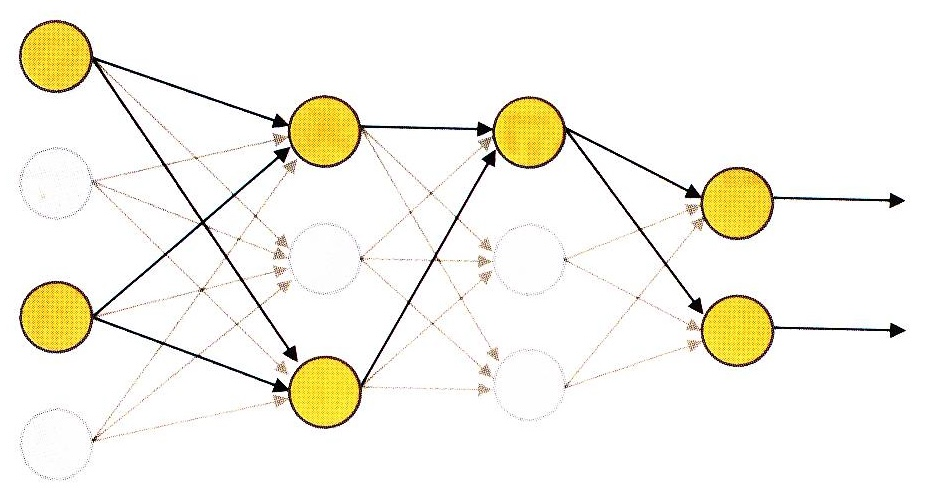

# 54단계 드롭아웃과 테스트 모드

신경망 학습에서는 과대적합이 자주 문제가 됩니다. 다음은 과대적합이 일어나는 주요 원인입니다.

* 훈련 데이터가 적음
* 모델의 표현력이 지나치게 높음

첫 번째 원인 때문이라면 데이터를 더 확보하거나 데이터 수를 인위적으로 늘리는 데이터 확장(data augmentation)을 이용하면 효과적입니다.

두 번째 원인에는 가중치 감소(Weight Decay), 드롭아웃(Dropout) [34], 배치 정규화(Batch Normalization) [35] 등이 유효합니다. 특히 드롭아웃은 간단하면서도 효과적이어서 실무에서 많이 사용됩니다. 그래서 이번 단계에서는 DeZero에 드롭아웃을 추가합니다. 드롭아웃을 적용하려면 학습 시와 테스트 시의 처리 로직을 달리해야 합니다. 그래서 학습 단계인지 테스트 단계인지 구별하는 구조를 만들겠습니다.

---

## 54.1 드롭아웃이란

드롭아웃은 뉴런을 임의로 삭제(비활성화)하면서 학습하는 방법입니다. 학습 시에는 은닉층 뉴런을 무작위로 골라 삭제합니다. 삭제된 뉴런은 [그림 54-1]과 같이 신호를 전송하지 않습니다.

#### 그림 54-1 드롭아웃을 적용해 학습할 때의 신경망 동작

(드롭아웃으로 일부 뉴런(점선 원)이 비활성화되어 신호 전송이 차단되는 신경망의 동작 다이어그램)

드롭아웃을 사용하면 학습 데이터를 흘려보낼 때마다 삭제할 뉴런을 무작위로 선택합니다. 예를 들어 10개의 뉴런으로 이루어진 층이 있고, 그다음 층에서 드롭아웃 계층을 사용하여 60%의 뉴런을 무작위로 삭제한다고 해보죠. 이 동작을 코드로는 다음처럼 작성할 수 있습니다.

```python
import numpy as np

dropout_ratio = 0.6
x = np.ones(10)

mask = np.random.rand(10) > dropout_ratio
y = x * mask
```

여기에서 `mask`는 원소가 `True` 혹은 `False`인 배열입니다. 이 `mask`를 만드는 방법은 먼저 `np.random.rand(10)` 코드로 0.0~1.0 사이의 값을 임의로 10개 생성합니다. 그런 다음 각 원소의 값을 `dropout_ratio`, 즉 0.6과 비교하여 `dropout_ratio`보다 큰 원소는 `True`로, 그렇지 않은 원소는 `False`로 변환합니다. 이렇게 생성한 `mask`는 `False`의 비율이 평균적으로 60%가 될 것입니다.

`mask`를 만들었으면 `y = x * mask`를 실행합니다. 이 코드는 `mask`에서 값이 `False`인 원소에 대응하는 `x`의 원소를 0으로 설정합니다(즉, 삭제합니다). 결과적으로 매회 평균 4개의 뉴런만이 출력을 다음 층으로 전달합니다. 드롭아웃 계층은 학습 시 데이터를 흘려보낼 때마다 이와 같은 선별적 비활성화를 수행합니다.

> **NOTE**
> 머신러닝에서는 앙상블 학습(Ensemble Learning)이 자주 사용됩니다. 앙상블 학습이란 여러 모델을 개별적으로 학습시킨 후 추론 시 모든 모델의 출력을 평균 내는 방법입니다. 신경망으로 예를 들면 다섯 개의 동일한(또는 유사한) 구조의 신경망을 준비하고, 각각을 독립적으로 학습시킵니다. 그런 다음 테스트할 때는 다섯 신경망이 출력한 값들의 평균을 '결과'로 냅니다. 이렇게 하면 인식 정확도를 몇 % 정도 향상시킬 수 있음이 실험적으로 알려져 있습니다. 앙상블 학습은 드롭아웃과 가까운 관계입니다. 왜냐하면 드롭아웃은 학습 시 뉴런을 임의로 삭제하는데, 이를 매번 다른 모델을 학습하고 있다고 해석할 수 있기 때문입니다. 즉, 드롭아웃은 앙상블 학습과 같은 효과를 신경망 하나에서 가상으로 시뮬레이션한다고 간주할 수 있습니다.

자, 방금 보여드린 코드는 드롭아웃의 학습 시 처리입니다. 테스트 시에는 모든 뉴런을 사용하면서도 앙상블 학습처럼 동작하게끔 '흉내' 내야 합니다. 이를 위해 우선 모든 뉴런을 써서 출력을 계산하고, 그 결과를 '약화'시킵니다. 약화하는 비율은 학습 시에 살아남은 뉴런의 비율입니다. 코드로 살펴보시죠.

```python
# 학습 시
mask = np.random.rand(*x.shape) > dropout_ratio
y = x * mask

# 테스트 시
scale = 1 - dropout_ratio # 학습 시에 살아남은 뉴런의 비율
y = x * scale
```

이와 같이 테스트 시의 비율을 조절합니다. 지금 예시에서는 학습할 때 평균 40%의 뉴런이 생존했기 때문에 테스트할 때는 모든 뉴런을 사용해 계산한 출력에 0.4를 곱했습니다. 이렇게 하여 학습 시와 테스트 시의 비율을 일치시킵니다.

이상이 '일반적인 드롭아웃'입니다. 여기서 '일반적'이라고 말한 데는 또 다른 형태로도 드롭아웃을 구현할 수 있기 때문입니다. 바로 '역 드롭아웃(Inverted Dropout)'으로, 다음 절에서 설명하겠습니다. 또한 지금까지 설명한 일반적인 드롭아웃은 앞으로 '다이렉트 드롭아웃(Direct Dropout)'으로 표기해 구분하겠습니다.

---

## 54.2 역 드롭아웃

역 드롭아웃은 스케일 맞추기를 '학습할 때' 수행합니다. 앞 절 마지막에서 스케일을 맞추기 위해 '테스트할 때' `scale`을 곱했습니다. 그래서 이번에는 학습할 때 미리 뉴런의 값에 `1/scale`을 곱해두고, 테스트 때는 아무런 동작도 하지 않겠습니다. 코드는 다음과 같습니다.

```python
# 학습 시
scale = 1 - dropout_ratio
mask = np.random.rand(*x.shape) > dropout_ratio
y = x * mask / scale

# 테스트 시
y = x
```

역 드롭아웃도 보통의 드롭아웃과 원리는 같지만, 나름의 장점이 있습니다. 테스트 시 아무런 처리도 하지 않기 때문에 테스트 속도가 (살짝) 향상됩니다. 추론 처리만을 이용하는 경우에 바람직한 특성이죠.

또한 역 드롭아웃은 학습할 때 `dropout_ratio`를 동적으로 변경할 수 있습니다. 예를 들어 데이터를 첫 번째 흘려보낼 때 `dropout_ratio`를 0.43455로 한 후 다음번에는 0.56245로 변화를 줄 수 있습니다. 이에 반해 다이렉트 드롭아웃에서는 `dropout_ratio`를 고정해두고 학습해야 합니다. 만약 값을 중간에 바꾸면 테스트 시의 동작과 어긋나게 되죠. 이러한 이점 때문에 많은 딥러닝 프레임워크에서 역 드롭아웃 방식을 채용하고 있습니다. DeZero도 마찬가지입니다.

---

## 54.3 테스트 모드 추가

드롭아웃을 사용하려면 학습 단계인지 테스트 단계인지 구분해야 하는데, 이런 용도로는 18단계에서 만든 역전파 비활성 모드(`with dezero.no_grad():`) 방식을 유용하게 활용할 수 있습니다. 우선 `dezero/core.py`의 `Config` 클래스 주변에 다음 음영 부분의 코드를 추가합니다.

**dezero/core.py**
```python
class Config:
    enable_backprop = True
    train = True

@contextlib.contextmanager
def using_config(name, value):
    old_value = getattr(Config, name)
    setattr(Config, name, value)
    yield
    setattr(Config, name, old_value)

def test_mode():
    return using_config('train', False)
```

이와 같이 `Config` 클래스에 `train`이라는 클래스 변수를 추가합니다. `train`의 값은 기본적으로 `True`입니다. 또한 `dezero/__init__.py`에 `from dezero.core import Config` 문장이 이미 있으므로 다른 파일에서 `dezero.Config.train`값을 참조할 수 있습니다.

그다음으로 `test_mode` 함수를 추가합니다. 이 함수를 `with` 문과 함께 사용하면 `with` 블록 안에서만 `Config.train`이 `False`로 전환됩니다. 이 함수는 사용자도 사용하기 때문에 `dezero/__init__.py`에 `from dezero.core import test_mode` 문장을 추가합니다. 이제 사용자 코드에서 `from dezero import test_mode` 형태로 임포트할 수 있습니다.

---

## 54.4 드롭아웃 구현

마지막으로 드롭아웃을 다음과 같이 구현합니다.*

**dezero/functions.py**
```python
def dropout(x, dropout_ratio=0.5):
    x = as_variable(x)

    if dezero.Config.train:
        xp = cuda.get_array_module(x)
        mask = xp.random.rand(*x.shape) > dropout_ratio
```

---
\* `Function` 클래스를 상속한 `Dropout` 클래스로 정의하는 방식도 생각할 수 있습니다. 클래스 상속 방식이 처리 효율은 더 좋지만, 드롭아웃은 로직이 간단하고, 또 추론 시에는 아무런 일도 하지 않기 때문에 따로 구현하지 않겠습니다.

```python
        scale = xp.array(1.0 - dropout_ratio).astype(x.dtype)
        y = x * mask / scale
        return y
    else:
        return x
```

`x`는 `Variable` 인스턴스 또는 `ndarray` 인스턴스입니다. 쿠파이의 `ndarray` 인스턴스인 경우도 고려하여 `xp = cuda.get_array_module(x)`에서 적절한 모듈을 가져옵니다. 나머지 코드는 이미 설명한 내용입니다. 이제 다음과 같이 `dropout` 함수를 사용할 수 있습니다.

**steps/step54.py**
```python
import numpy as np
from dezero import test_mode
import dezero.functions as F

x = np.ones(5)
print(x)

# 학습 시
y = F.dropout(x)
print(y)

# 테스트 시
with test_mode():
    y = F.dropout(x)
    print(y)
```

**실행 결과**
```
[1. 1. 1. 1. 1.]
variable([0. 2. 2. 0. 0.])
variable([1. 1. 1. 1. 1.])
```

이와 같이 `F.dropout` 함수를 사용할 수 있습니다. 또한 '학습/테스트' 단계를 지정하는 구조도 갖췄습니다. 이제 과대적합이 일어난다 싶으면 적극적으로 드롭아웃을 사용해보세요.
