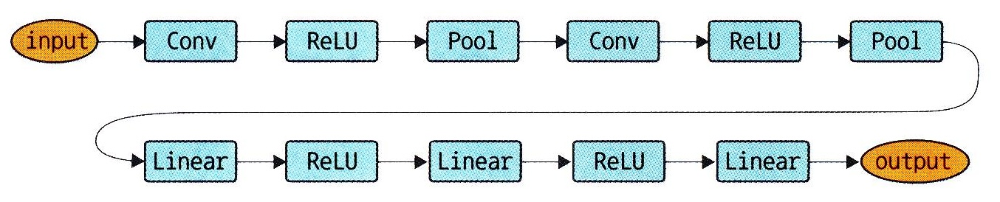
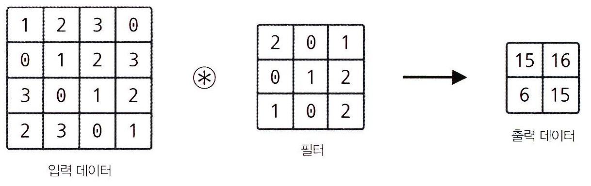
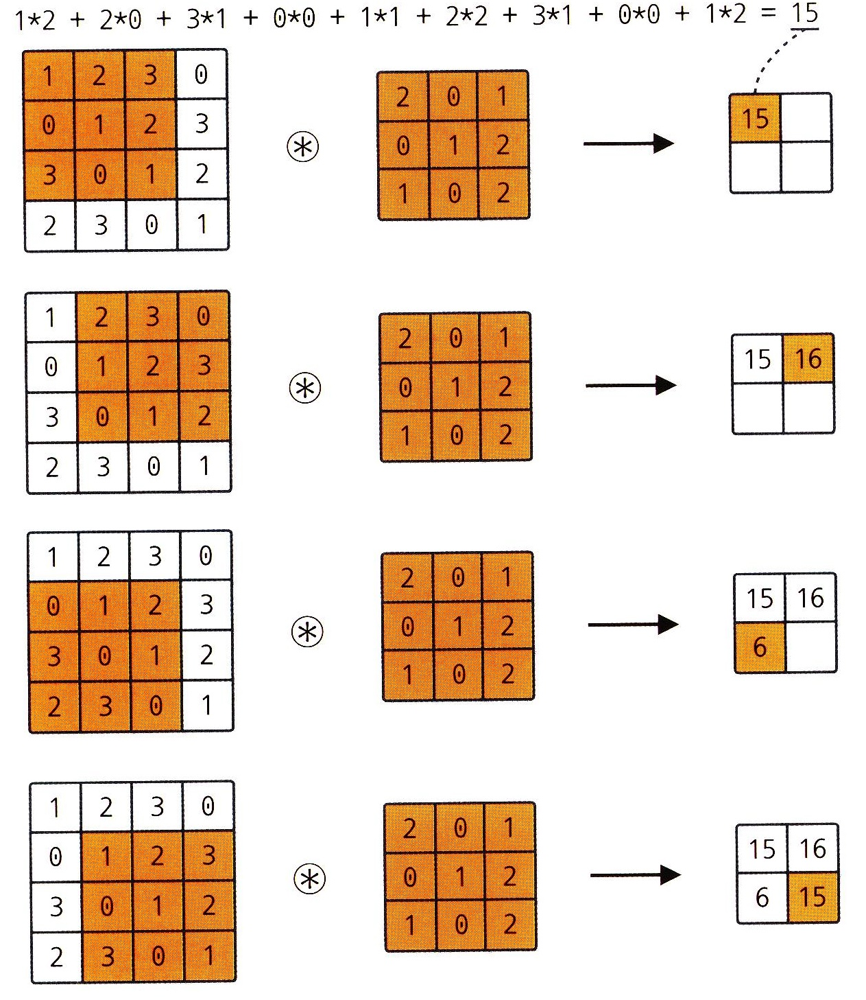
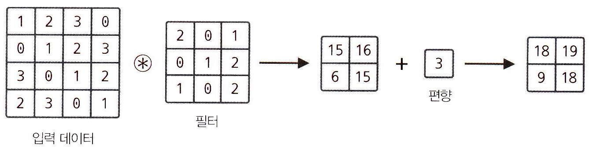
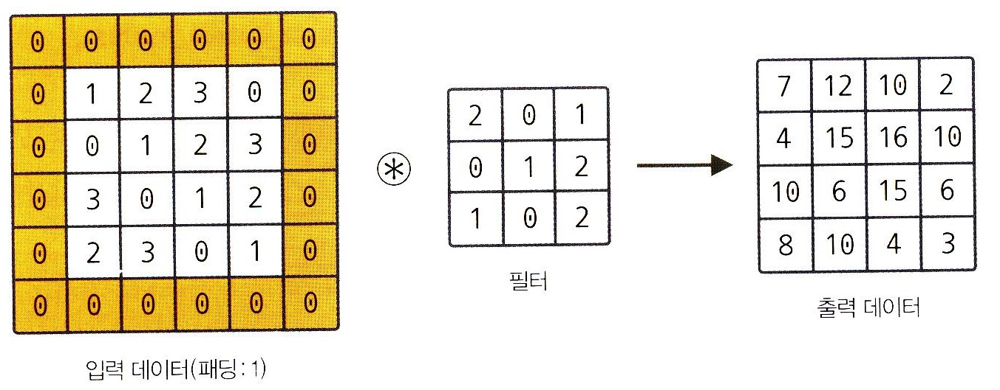
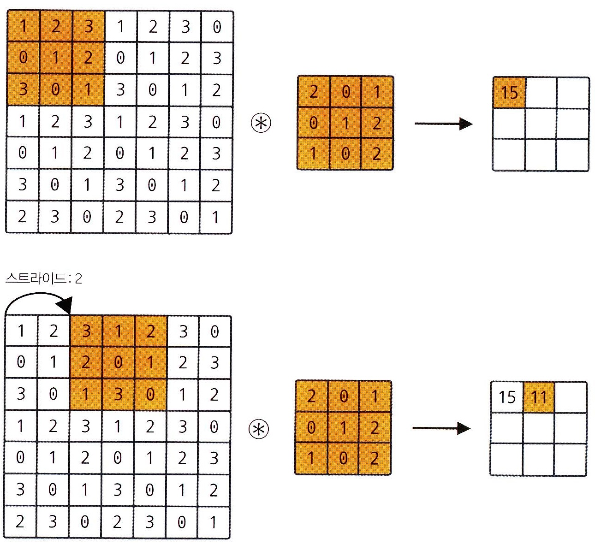

# 55단계 CNN 메커니즘(1)

지금부터 몇 단계에 걸쳐 'CNN'에 대해 알아볼 것입니다. CNN은 합성곱 신경망(Convolutional Neural Network)의 약자로, 이미지 인식, 음성 인식, 자연어 처리 등 다양한 분야에서 사용됩니다. 특히 이미지 인식용 딥러닝이라고 하면 대부분 CNN을 기반으로 합니다. 이번 단계에서는 CNN, 특히 이미지 인식용 CNN의 메커니즘을 설명합니다.

> **NOTE**
> 이 교제는 CNN을 다 구현했다고 가정하고 그 메커니즘만 설명합니다. CNN이 왜 이미지 인식에 탁월한지, 어떻게 이미지로부터 특징량을 추출해낼 수 있는지는 설명하지 않습니다. 이런 내용이 궁금하다면 『밑바닥부터 시작하는 딥러닝』을 참고하세요.

---

## 55.1 CNN 신경망의 구조

CNN도 지금까지 다룬 신경망과 마찬가지로 계층을 조합하여 만듭니다. 다만 CNN에서는 새롭게 '합성곱층(convolution layer)'과 '풀링층(pooling layer)'이 등장합니다. 합성곱층과 풀링층의 상세 내용은 나중에 설명하고, 당장은 CNN이 어떤 계층들의 조합으로 생성되는지부터 살펴보겠습니다. [그림 55-1]에 CNN 신경망의 예를 준비했습니다.

#### 그림 55-1 CNN 신경망 예(계산 그래프를 계층 단위로 그리고, 변수는 입력과 출력만 표시함. Conv=합성곱층, Pool=풀링층)

`input` -> `Conv` -> `ReLU` -> `Pool` -> `Conv` -> `ReLU` -> `Pool` -> `Linear` -> `ReLU` -> `Linear` -> `ReLU` -> `Linear` -> `output`

[그림 55-1]에서 보듯 CNN에는 `Conv` 계층과 `Pool` 계층이 새로 추가됩니다. 그리고 '`Conv` -> `ReLU` -> (`Pool`)' 순서로 연결됩니다(`Pool` 계층은 생략할 수 있습니다). 지금까지의 '`Linear` -> `ReLU`' 연결이 '`Conv` -> `ReLU` -> (`Pool`)'로 대체되었다고 생각할 수 있습니다. 한편 출력에 가까워지면 이전과 같은 '`Linear` -> `ReLU`' 조합이 사용됩니다. 이상이 일반적인 CNN에서 흔히 볼 수 있는 구성입니다.

---

## 55.2 합성곱 연산

CNN에는 합성곱층이 사용됩니다. 이 층에서 수행하는 일이 바로 '합성곱 연산'으로, 이미지 처리에서 말하는 '필터 연산'에 해당합니다. 이번 절에서는 [그림 55-2]의 예를 이용하여 합성곱 연산을 설명하겠습니다.

#### 그림 55-2 합성곱 연산의 예(합성곱 연산은 ⊛로 표기)


**입력 데이터**
| | | | |
|---|---|---|---|
| 1 | 2 | 3 | 0 |
| 0 | 1 | 2 | 3 |
| 3 | 0 | 1 | 2 |
| 2 | 3 | 0 | 1 |

$$
\quad \circledast \quad
$$

**필터**
| | | |
|---|---|---|
| 2 | 0 | 1 |
| 0 | 1 | 2 |
| 1 | 0 | 2 |

$$
\quad \longrightarrow \quad
$$

**출력 데이터**
| | |
|---|---|
| 15 | 16 |
| 6 | 15 |

[그림 55-2]에서와 같이 합성곱 연산은 입력 데이터에 필터를 적용합니다. 이 예에서 입력 데이터는 수직/수평 방향의 차원을 가지는 데이터고, 필터 역시 수직/수평 방향의 차원을 가집니다. 그 형상을 (높이, 너비) 순서로 표기하면 [그림 55-2]의 예에서 입력 형상은 $(4, 4)$, 필터

는 $(3, 3)$, 출력은 $(2, 2)$ 입니다. 그리고 이때 수행할 합성곱 연산은 [그림 55-3]처럼 계산합니다.

#### 그림 55-3 합성곱 연산의 계산 순서


$$
1\times 2 + 2\times 0 + 3\times 1 + 0\times 0 + 1\times 1 + 2\times 2 + 3\times 1 + 0\times 0 + 1\times 2 = 15
$$

1. **첫 번째 위치 (좌상단 3x3 영역)**
   * 입력 데이터의 좌상단 $3 \times 3$ 영역에 필터를 적용하여 곱의 합(적화 연산)을 계산합니다.
   * 결과: $15$ -> 출력 데이터의 $(0, 0)$ 위치에 저장

2. **두 번째 위치 (우상단 3x3 영역)**
   * 필터 윈도를 오른쪽으로 한 칸 이동하여 우상단 $3 \times 3$ 영역에 필터를 적용합니다.
   * 결과: $16$ -> 출력 데이터의 $(0, 1)$ 위치에 저장

3. **세 번째 위치 (좌하단 3x3 영역)**
   * 필터 윈도를 아래쪽으로 한 칸 이동하여 좌하단 $3 \times 3$ 영역에 필터를 적용합니다.
   * 결과: $6$ -> 출력 데이터의 $(1, 0)$ 위치에 저장

4. **네 번째 위치 (우하단 3x3 영역)**
   * 필터 윈도를 오른쪽으로 한 칸 이동하여 우하단 $3 \times 3$ 영역에 필터를 적용합니다.
   * 결과: $15$ -> 출력 데이터의 $(1, 1)$ 위치에 저장

합성곱 연산은 입력 데이터에 대해 필터 윈도(window)를 일정 간격으로 이동시키면서 적용합니다. [그림 55-3]과 같이 필터와 입력의 해당 원소를 곱하고 총합을 구합니다. 그리고 그 결과를 해당 위치에 저장합니다. 이 과정을 모든 장소에서 수행하면 합성곱 연산의 출력을 얻을 수 있습니다. 참고로 필터(filter)를 문헌에 따라 커널(kernel)이라고도 쓰며, 이 교제에서도 둘을 같은 의미로 사용합니다.

> **NOTE**
> [그림 55-3]의 필터 움직임을 잘 보면 가로와 세로 두 방향으로 이동합니다. 이처럼 필터가 두 개의 차원으로 움직인다고 하여 '2차원 합성곱층'이라고도 합니다. 같은 원리로, 필터가 한 방향으로만 움직이면 '1차원 합성곱층'으로, 세 방향으로 움직이면 '3차원 합성곱층'으로 부를 수 있습니다. 이미지는 주로 2차원 합성곱층을 사용합니다. 참고로 DeZero에서는 2차원 합성곱층을 `Conv2d`라는 이름으로 구현합니다.

완전연결계층으로 구성된 신경망에는 가중치 매개변수 외에 '편향'도 존재하였고, 합성곱층도 다르지 않습니다. 편향까지 포함시키면 합성곱 연산의 처리 흐름은 [그림 55-4]처럼 됩니다.

#### 그림 55-4 합성곱 연산의 편향


**입력 데이터**
| | | | |
|---|---|---|---|
| 1 | 2 | 3 | 0 |
| 0 | 1 | 2 | 3 |
| 3 | 0 | 1 | 2 |
| 2 | 3 | 0 | 1 |

$$
\quad \circledast \quad
$$

**필터**
| | | |
|---|---|---|
| 2 | 0 | 1 |
| 0 | 1 | 2 |
| 1 | 0 | 2 |

$$
\quad \longrightarrow \quad
$$

**필터링 결과**
| | |
|---|---|
| 15 | 16 |
| 6 | 15 |

$$
\quad + \quad
$$

**편향**
| |
|---|
| 3 |

$$
\quad \longrightarrow \quad
$$

**최종 출력 데이터**
| | |
|---|---|
| 18 | 19 |
| 9 | 18 |

[그림 55-4]와 같이 편향은 필터링 후에 더해줍니다. 여기에서 편향은 하나뿐이라는 점에 주의합시다(그림의 예시에서 필터링된 데이터는 4개지만, 편향은 하나뿐입니다). 하나의 똑같은 값이 필터 적용 후의 모든 원소에 브로드캐스트되어 더해지는 것이죠.

이어서 합성곱층에서의 '패딩'과 '스트라이드'라는 용어를 설명하겠습니다.

---

## 55.3 패딩

합성곱층의 주요 처리 전에 입력 데이터 주위에 고정값(가령 0 등)을 채울 수 있습니다. 이러한 처리를 패딩(padding)이라고 합니다. [그림 55-5]는 형상이 $(4, 4)$ 인 입력 데이터에 폭 1짜리 패딩을 적용하는 모습을 보여줍니다.

#### 그림 55-5 합성곱 연산의 패딩 처리


**입력 데이터(패딩: 1)**
| | | | | | |
|---|---|---|---|---|---|
| 0 | 0 | 0 | 0 | 0 | 0 |
| 0 | 1 | 2 | 3 | 0 | 0 |
| 0 | 0 | 1 | 2 | 3 | 0 |
| 0 | 3 | 0 | 1 | 2 | 0 |
| 0 | 2 | 3 | 0 | 1 | 0 |
| 0 | 0 | 0 | 0 | 0 | 0 |

$$
\quad \circledast \quad
$$

**필터**
| | | |
|---|---|---|
| 2 | 0 | 1 |
| 0 | 1 | 2 |
| 1 | 0 | 2 |

$$
\quad \longrightarrow \quad
$$

**출력 데이터**
| | | | |
|---|---|---|---|
| 7 | 12 | 10 | 2 |
| 4 | 15 | 16 | 10 |
| 10 | 6 | 15 | 6 |
| 8 | 10 | 4 | 3 |

[그림 55-5]와 같이 $(4, 4)$ 형상이던 입력 데이터가 패딩에 의해 $(6, 6)$ 형상으로 변합니다. 그리고 $(3, 3)$ 형상의 필터에 의해 $(4, 4)$ 형상의 데이터가 출력됩니다. 이 예에서는 패딩을 1로 설정했지만 2나 3 등 임의의 정수로 설정할 수 있습니다. 또한 세로 방향 패딩과 가로 방향 패딩을 서로 다르게 설정할 수도 있습니다.

> **NOTE**
> 패딩을 사용하는 주된 이유는 출력 크기를 조정하기 위해서입니다. 예를 들어 $(4, 4)$ 형상의 입력 데이터에 $(3, 3)$ 형상의 필터를 적용하면 출력 형상은 $(2, 2)$ 가 되어, 크기가 입력 데이터보다 2칸씩 줄어들게 됩니다. 그래서 합성곱 연산을 반복 수행하는 깊은 신경망에서는 문제를 일으키죠. 합성곱 연산을 거칠 때마다 공간이 축소되다 보면 어느 순간 더 이상의 합성곱 연산을 할 수 없게 되기 때문입니다. 이런 사태를 피하기 위해 패딩을 이용합니다. 앞의 예에서는 패딩의 폭을 1로 설정하여 출력 형상이 원래의 입력과 같은 $(4, 4)$ 로 유지되었습니다.

---

## 55.4 스트라이드

필터를 적용하는 위치의 간격을 스트라이드(stride, 보폭을 뜻함)라고 합니다. 지금까지의 예에서는 스트라이드가 항상 1이었지만, 2로 설정하면 [그림 55-6]처럼 필터를 적용하는 윈도가 한 번에 두 원소씩 움직입니다.

#### 그림 55-6 스트라이드가 2인 합성곱 연산의 예


1. **첫 번째 위치 (스트라이드: 2)**
   * 입력 데이터: $7 \times 7$ 형상에서 좌상단 $3 \times 3$ 영역에 필터를 적용합니다.
   * 결과: $15$ -> 출력 데이터의 $(0, 0)$ 위치에 저장

2. **두 번째 위치 (스트라이드: 2로 우측 2칸 이동)**
   * 입력 데이터의 열 인덱스 2~4 영역에 필터를 적용합니다. (보폭이 2이므로 2칸 오른쪽으로 건너뜀)
   * 결과: $11$ -> 출력 데이터의 $(0, 1)$ 위치에 저장

[그림 55-6]의 예는 입력 크기가 $(7, 7)$ 인 데이터에 필터의 스트라이드를 2로 설정했을 때의 동작 모습입니다. 스트라이드를 2로 설정하면 출력 크기는 $(3, 3)$ 이 됩니다. 이와 같이 스트라이드는 필터를 적용하는 간격을 지정합니다. 스트라이드 역시 세로 방향과 가로 방향 값을 다르게 설정할 수도 있습니다.

---

## 55.5 출력 크기 계산 방법

앞의 두 절에서 보았듯이 패딩 크기를 늘리면 출력 데이터의 크기가 커지고, 스트라이드를 크게 하면 반대로 작아집니다. 즉, 출력 크기는 패딩과 스트라이드의 영향을 받습니다. 그래서 패딩과 스트라이드의 크기, 그리고 입력 데이터와 커널(필터)의 크기가 주어지면 출력 데이터의 크기가 결정됩니다. 계산 방법은 다음과 같습니다.

**steps/step55.py**
```python
def get_conv_outsize(input_size, kernel_size, stride, pad):
    return (input_size + pad * 2 - kernel_size) // stride + 1
```

모든 인수가 `int` 타입이라고 가정했습니다. `input_size`는 입력 데이터의 크기, `kernel_size`는 커널의 크기, `stride`는 스트라이드의 크기, `pad`는 패딩의 크기입니다.

> **CAUTION**
> 앞의 코드에서 `//`는 몫 연산자입니다. 나누기 연산 후 소수점 이하는 버리고 정수 부분(몫)만 취하는 것이죠. 예를 들어 `33 // 5`의 결과는 `6`입니다.

그럼 시험 삼아 방금 구현한 `get_conv_outsize` 함수를 사용해보죠.

**steps/step55.py**
```python
H, W = 4, 4 # 입력 형상
KH, KW = 3, 3 # 커널 형상
SH, SW = 1, 1 # 스트라이드(세로 방향 스트라이드와 가로 방향 스트라이드)
PH, PW = 1, 1 # 패딩(세로 방향 패딩과 가로 방향 패딩)

OH = get_conv_outsize(H, KH, SH, PH)
OW = get_conv_outsize(W, KW, SW, PW)
print(OH, OW)
```

**실행 결과**
```
4 4
```

이와 같이 출력 크기를 계산할 수 있습니다. `get_conv_outsize` 함수는 앞으로도 사용하기 때문에 `dezero/utils.py`에 추가해뒀습니다.

합성곱 연산과 관련한 기본적인 설명은 끝났으므로 이번 단계는 여기서 마치겠습니다. 다음 단계에서는 CNN 메커니즘의 나머지 주제인 채널과 풀링에 관해 이야기합니다.
