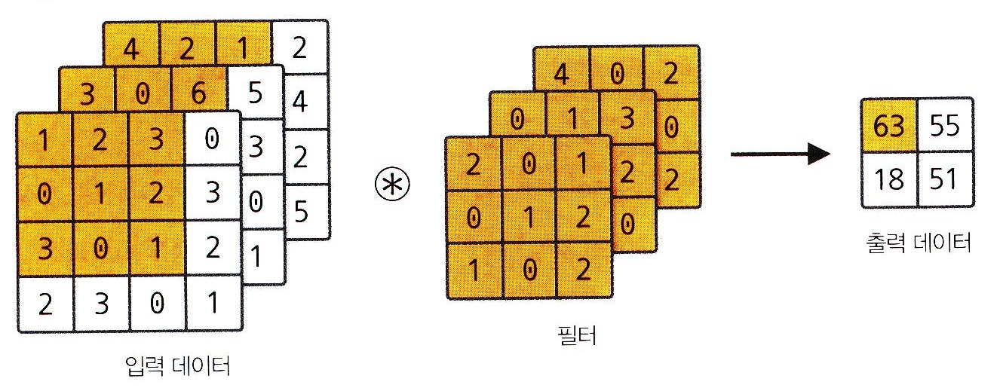
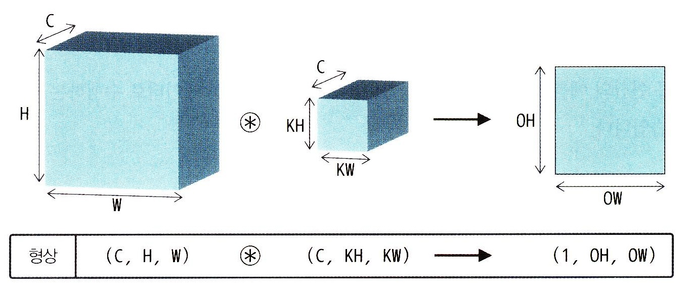
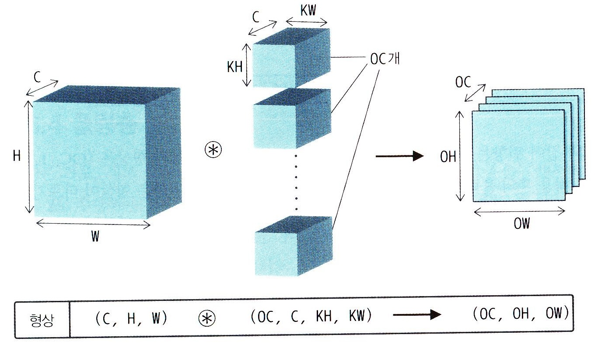
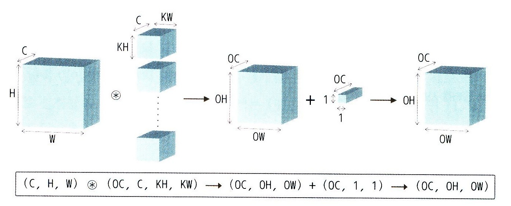
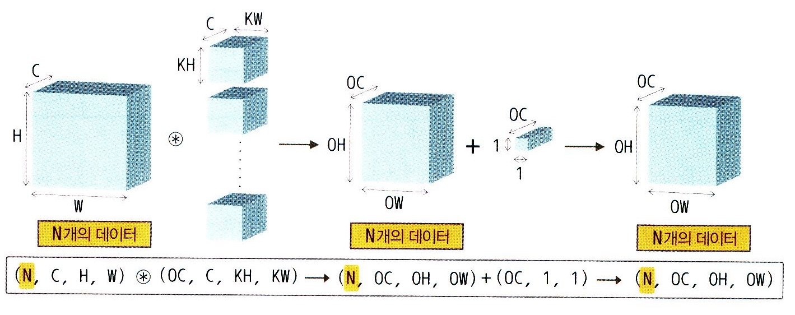
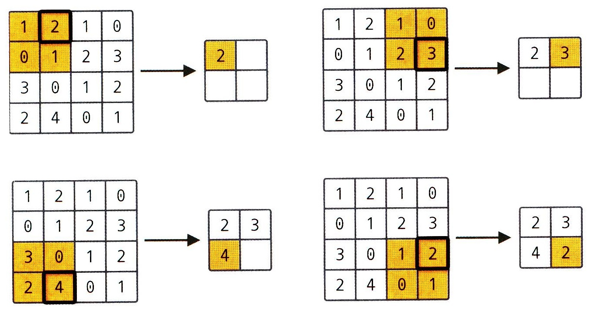
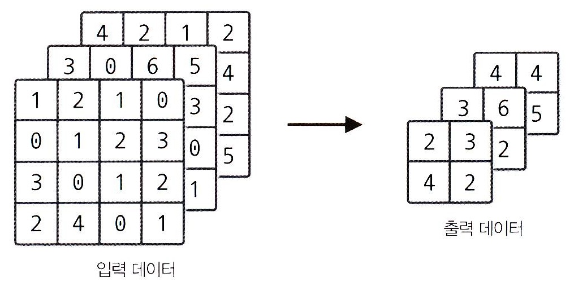
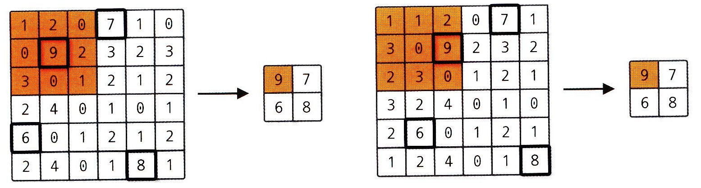

# 56단계 CNN 메커니즘(2)

이전 단계에서는 수직 및 수평 방향으로 늘어선 2차원 데이터(2차원 텐서)에서의 합성곱 연산을 설명했습니다. 그러나 사진에는 가로/세로 방향뿐 아니라 RGB처럼 '채널 방향'으로도 데이터가 쌓여 있기 때문에 3차원 데이터(3차원 텐서)를 다뤄야 합니다. 이번 단계에서는 앞 단계와 똑같은 순서로 3차원 텐서에서의 합성곱 연산을 살펴보고, 이어서 풀링까지 설명하겠습니다.

---

## 56.1 3차원 텐서

곧바로 합성곱 연산의 예를 보겠습니다. [그림 56-1]은 채널이 3개인 데이터로 수행하는 합성곱 연산의 모습입니다.

#### 그림 56-1 3차원 텐서에서의 합성곱 연산 예


**입력 데이터 (채널 수 = 3, 형상 = (3, 4, 4))**
* **Channel 0 (가장 뒤쪽)**
  ```
  [ 4  2  1  2 ]
  [ 3  0  6  5 ]  <-- 앞 레이어에 가려진 부분 포함
  [ ...        ]
  ```
* **Channel 1 (중간)**
  ```
  [ 3  0  6  5 ]
  [ ...     4  ]
  [ ...     2  ]
  [ ...     5  ]
  ```
* **Channel 2 (가장 앞쪽)**
  ```
  [ 1  2  3  0 ]
  [ 0  1  2  3 ]
  [ 3  0  1  2 ]
  [ 2  3  0  1 ]
  ```

$$
\quad \circledast \quad
$$

**필터 (채널 수 = 3, 형상 = (3, 3, 3))**
* **Channel 0 (가장 뒤쪽)**
  ```
  [ 4  0  2 ]
  [ 0  1  3 ]
  [ 2  0  2 ]
  ```
* **Channel 1 (중간)**
  ```
  [ ...  0 ]
  [ ...  2 ]
  [ ...  0 ]
  ```
* **Channel 2 (가장 앞쪽)**
  ```
  [ 2  0  1 ]
  [ 0  1  2 ]
  [ 1  0  2 ]
  ```

$$
\quad \longrightarrow \quad
$$

**출력 데이터 (형상 = (2, 2))**
| | |
|---|---|
| 63 | 55 |
| 18 | 51 |

[그림 56-1]에서 보듯 합성곱 연산 절차는 2차원 텐서일 때와 똑같습니다. 깊이 방향으로 데이터가 늘어난 것을 제외하면 필터가 움직이는 방법도 계산 방법도 그대로입니다. 여기에서 주의할 점은 입력 데이터와 필터의 '채널' 수를 똑같이 맞춰줘야 한다는 것입니다. [그림 56-1]에서 입력 데이터와 필터의 채널 수는 모두 3개입니다. 한편 필터의 가로, 세로 크기는 원하는 숫자로 설정할 수 있습니다. 그림의 예에서는 $(3, 3)$ 형상이지만, 원한다면 $(1, 2)$ 나 $(2, 1)$ 크기의 필터를 사용할 수도 있습니다.

> **CAUTION**
> [그림 56-1]의 필터는 이전 단계에서와 마찬가지로 가로, 세로의 2차원 위를 움직입니다. 따라서 (비록 3차원 텐서에 대한 합성곱 연산이지만) 이것은 '2차원 합성곱층'으로 분류됩니다. 2차원 합성곱 연산은 대부분의 딥러닝 프레임워크에서 `Conv2d`나 `Convolution2d`라는 이름으로 제공합니다.

---

## 56.2 블록으로 생각하기

3차원 텐서에 대한 합성곱 연산은 직육면체 블록으로 생각하면 이해하기 쉽습니다. 그래서 3차원 텐서의 합성곱 연산을 [그림 56-2]처럼 3차원 직육면체로 그려보았습니다.

#### 그림 56-2 합성곱 연산을 블록으로 생각하기

(입력 블록 $(C, H, W)$ 와 필터 블록 $(C, KH, KW)$ 의 합성곱 연산을 통해 2차원 출력 평면 $(1, OH, OW)$ 이 생성되는 개념도)

| | | | | |
|---|---|---|---|---|
| **형상** | $(C, H, W)$ | $\circledast$ | $(C, KH, KW)$ | $\longrightarrow$ | $(1, OH, OW)$ |

[그림 56-2]에서는 데이터가 (채널<sup>channel</sup>, 높이<sup>height</sup>, 너비<sup>width</sup>) 순서로 정렬되어 있다고 가정했습니다. 그래서 채널 수가 $C$, 높이가 $H$, 폭이 $W$ 인 데이터의 형상은 $(C, H, W)$ 라고 표기합니다. 필터도 마찬가지로 $(C, KH, KW)$ 라고 표기합니다.*

---
\* $KH$ 는 Kernel Height의 머리글자이고, $KW$ 는 Kernel Width의 머리글자입니다. 출력 형상에서의 $OH$ 와 $OW$ 는 각각 Output Height와 Output Width의 머리글자입니다.

출력은 '특징 맵(feature map)'이라고 불리며, [그림 56-2]의 예에서는 특징 맵이 한 장만 출력되었습니다. 그런데 특징 맵을 채널 방향으로 여러 장 갖고 싶을 수 있겠죠. 이를 위해서는 다수의 필터(가중치)를 사용하면 됩니다.

#### 그림 56-3 다수의 필터를 사용한 합성곱 연산의 예

(다수의 필터 $OC$ 개를 적용하여 채널 수가 $OC$ 인 3차원 출력 특징 맵 블록 $(OC, OH, OW)$ 을 생성하는 개념도)

| | | | | |
|---|---|---|---|---|
| **형상** | $(C, H, W)$ | $\circledast$ | $(OC, C, KH, KW)$ | $\longrightarrow$ | $(OC, OH, OW)$ |

[그림 56-3]에서 보듯 $OC$**개의 필터를 개별적으로 적용합니다. 그러면 출력의 특징 맵도 $OC$ 개가 생성됩니다. 그리고 그 $OC$ 개의 맵을 모아 $(OC, OH, OW)$ 형상의 블록을 만듭니다.

> **NOTE**
> [그림 56-3]에서 보듯 합성곱 연산에서는 필터 수도 고려해야 합니다. 따라서 필터의 가중치 데이터는 4차원 텐서인 `(output_channel, input_channel, height, width)` 형상으로 관리합니다. 가령 채널 수가 3개고 가로, 세로 크기가 $(5, 5)$ 인 필터가 20개 있다면 형상은 $(20, 3, 5, 5)$ 가 됩니다.

합성곱 연산에도 (완전연결계층과 마찬가지로) 편향이 존재합니다. [그림 56-3]의 예에 편향까지 추가하면 [그림 56-4]가 됩니다.

---
\** $OC$ 는 Output Channel의 머리글자입니다.

#### 그림 56-4 합성곱 연산 처리 흐름(편향 추가)

(편향 블록 $(OC, 1, 1)$ 이 브로드캐스트되어 합성곱 결과 블록 $(OC, OH, OW)$ 에 더해지는 과정의 개념도)

| | | | | | | | | |
|---|---|---|---|---|---|---|---|---|
| **형상** | $(C, H, W)$ | $\circledast$ | $(OC, C, KH, KW)$ | $\longrightarrow$ | $(OC, OH, OW)$ | $+$ | $(OC, 1, 1)$ | $\longrightarrow$ | $(OC, OH, OW)$ |

[그림 56-4]와 같이 편향은 채널당 하나의 값만 갖습니다. 그래서 편향의 형상은 $(OC, 1, 1)$ 이 되고, 필터 적용 후의 출력은 $(OC, OH, OW)$ 가 됩니다. 이처럼 편향은 형상이 다르기 때문에 브로드캐스트된 다음에 더해집니다. 이상이 편향 덧셈을 포함한 합성곱 연산입니다.

---

## 56.3 미니배치 처리

신경망 학습에서는 여러 개의 입력 데이터를 하나의 단위(미니배치)로 묶어 처리합니다. 합성곱 연산에서도 마찬가지입니다. 미니배치 처리를 위해서는 각 층을 흐르는 데이터를 '4차원 텐서'로 취급합니다. 예를 들어 $N$ 개의 데이터로 이루어진 미니배치에 합성곱 연산을 수행하면 [그림 56-5]처럼 됩니다.

#### 그림 56-5 합성곱 연산의 처리 흐름(미니배치 처리)

(배치 크기 $N$ 을 적용하여 4차원 입력 텐서 $(N, C, H, W)$ 에 대해 합성곱 연산 및 편향 브로드캐스트 덧셈을 처리하는 전체 흐름도)

* **입력 데이터**: $N$ 개의 데이터 ➔ 형상: $(N, C, H, W)$
* **중간 결과**: $N$ 개의 데이터 ➔ 형상: $(N, OC, OH, OW)$
* **최종 결과**: $N$ 개의 데이터 ➔ 형상: $(N, OC, OH, OW)$

| | | | | | | | | |
|---|---|---|---|---|---|---|---|---|
| **형상** | $(N, C, H, W)$ | $\circledast$ | $(OC, C, KH, KW)$ | $\longrightarrow$ | $(N, OC, OH, OW)$ | $+$ | $(OC, 1, 1)$ | $\longrightarrow$ | $(N, OC, OH, OW)$ |

[그림 56-5]를 보면 데이터의 맨 앞에 배치를 위한 차원이 추가되어 있습니다. 이는 데이터를 `(batch_size, channel, height, width)` 형상으로 정렬하는 것이죠. 미니배치 처리에서는 이 4차원 텐서의 샘플 데이터 각각에 대해 (독립적으로) 똑같은 합성곱 연산을 수행합니다.

이상이 CNN의 합성곱층에서 이루어지는 계산입니다. 이어서 CNN을 구성하는 또 다른 계층인 풀링층에 대해 알아봅시다.

---

## 56.4 풀링층

풀링은 가로, 세로 공간을 작게 만드는 연산입니다. [그림 56-6]은 $2 \times 2$ Max 풀링을 스트라이드 2로 수행하는 경우의 처리 절차를 보여줍니다. Max 풀링(최대 풀링)은 최댓값을 취하는 연산이며, '$2 \times 2$'는 대상 영역의 크기를 나타냅니다. 그림과 같이 $2 \times 2$ 영역에서 값이 가장 큰 원소를 찾는 것이죠. 또한 그림의 예에서는 스트라이드를 2로 설정했기 때문에 $2 \times 2$ 윈도가 한 번에 원소 2개씩 건너뜁니다. 일반적으로 풀링 윈도 크기와 스트라이드 크기는 같은 값으로 설정합니다(가령 윈도가 $3 \times 3$ 이면 스트라이드를 3으로, $4 \times 4$ 면 스트라이드를 4로).

#### 그림 56-6 Max 풀링의 처리 절차


**입력 데이터**
| | | | |
|---|---|---|---|
| 1 | 2 | 1 | 0 |
| 0 | 1 | 2 | 3 |
| 3 | 0 | 1 | 2 |
| 2 | 4 | 0 | 1 |

1. **첫 번째 영역 (좌상단 $2 \times 2$ 영역)**
   * 대상: `[[1, 2], [0, 1]]` ➔ 최댓값: **2**
   * 출력: `[[2,  ], [ ,  ]]`

2. **두 번째 영역 (우상단 $2 \times 2$ 영역, 우측으로 2칸 이동)**
   * 대상: `[[1, 0], [2, 3]]` ➔ 최댓값: **3**
   * 출력: `[[2, 3], [ ,  ]]`

3. **세 번째 영역 (좌하단 $2 \times 2$ 영역, 아래로 2칸 이동)**
   * 대상: `[[3, 0], [2, 4]]` ➔ 최댓값: **4**
   * 출력: `[[2, 3], [4,  ]]`

4. **네 번째 영역 (우하단 $2 \times 2$ 영역, 아래로 2칸, 우측으로 2칸 이동)**
   * 대상: `[[1, 2], [0, 1]]` ➔ 최댓값: **2**
   * 출력: `[[2, 3], [4, 2]]`

> **NOTE**
> Max 풀링 외에 Average 풀링(평균 풀링)도 있습니다. Max 풀링은 대상 영역에서 최댓값을 취하는 연산인 반면, Average 풀링은 대상 영역의 평균을 계산합니다. 이미지 인식 분야에서는 주로 Max 풀링이 사용되기 때문에 이 책에서 '풀링층'이라고 하면 Max 풀링을 가리킵니다.

이상으로 풀링층에 대해 알아보았습니다. 풀링층의 주요 특징은 다음과 같습니다.

* **학습하는 매개변수가 없다**
  풀링층은 합성곱층과 달리 학습하는 매개변수가 없습니다. 풀링은 대상 영역에서 최댓값을 취하는(혹은 평균을 구하는) 처리만 하면 끝이기 때문입니다(학습할 게 없습니다).

* **채널 수가 변하지 않는다**
  풀링의 연산에서는 입력 데이터와 출력 데이터의 채널 수가 달라지지 않습니다. [그림 56-7]에서와 같이 계산이 채널마다 독립적으로 이루어지기 때문입니다.

#### 그림 56-7 풀링 시의 채널 수

(입력 데이터의 3개 채널 각각에 독립적으로 풀링을 적용하여, 채널 수가 그대로 유지된 3개 채널의 출력이 생성되는 과정)

* **입력 데이터 (3채널)** $\longrightarrow$ **출력 데이터 (3채널)**
  * 입력 채널 수: 3
  * 출력 채널 수: 3

* **미세한 위치 변화에 영향을 덜 받는다**
  입력 데이터의 차이가 크지 않으면 풀링 결과도 크게 달라지지 않습니다. 이를 입력 데이터의 미세한 차이에 강건하다<sup>robust</sup>고도 표현합니다. [그림 56-8]의 예를 보면 입력 데이터의 차이를 풀링이 흡수하고 있습니다. 오른쪽 그림은 입력 데이터가 오른쪽으로 1 원소만큼 어긋나 있지만 출력은 달라지지 않았습니다(물론 입력 데이터가 무엇이냐에 따라 차이가 나기도 합니다).

#### 그림 56-8 입력 데이터에 작은 차이가 있을 때의 비교

(입력 데이터가 오른쪽으로 1원소씩 어긋나는 작은 변화가 발생해도, $3 \times 3$ Max 풀링(스트라이드 3) 결과는 동일하게 유지되어 위치 변화에 강건함을 보여주는 예시)

**1. 원본 입력 및 풀링 결과**
* **입력 데이터 (좌측, $6 \times 6$)**
  | | | | | | |
  |---|---|---|---|---|---|
  | 1 | 2 | 0 | 7 | 1 | 0 |
  | 0 | **9** | 2 | 3 | 2 | 3 |
  | 3 | 0 | 1 | 2 | 1 | 2 |
  | 2 | 4 | 0 | 1 | 0 | 1 |
  | **6** | 0 | 1 | 2 | 1 | 2 |
  | 2 | 4 | 0 | 1 | **8** | 1 |

* **출력 데이터 (좌측, $2 \times 2$)**
  | | |
  |---|---|
  | **9** | 7 |
  | 6 | **8** |

$$
\quad \longrightarrow \quad
$$

**2. 1원소 우측 이동된 입력 및 풀링 결과**
* **입력 데이터 (우측, $6 \times 6$, 데이터가 우측으로 1칸 시프트됨)**
  | | | | | | |
  |---|---|---|---|---|---|
  | 1 | 1 | 2 | 0 | 7 | 1 |
  | 3 | 0 | **9** | 2 | 3 | 2 |
  | 2 | 3 | 0 | 1 | 2 | 1 |
  | 3 | 2 | 4 | 0 | 1 | 0 |
  | 2 | **6** | 0 | 1 | 2 | 1 |
  | 1 | 2 | 4 | 0 | 1 | **8** |

* **출력 데이터 (우측, $2 \times 2$)**
  | | |
  |---|---|
  | **9** | 7 |
  | 6 | **8** |

이상이 CNN의 메커니즘입니다. 지금까지 주로 '합성곱층'과 '풀링층'에 대해 설명했습니다. 다음 단계에서는 이 두 가지 처리를 DeZero 함수로 구현하겠습니다.
