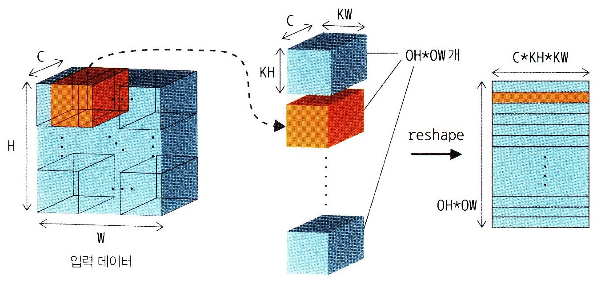
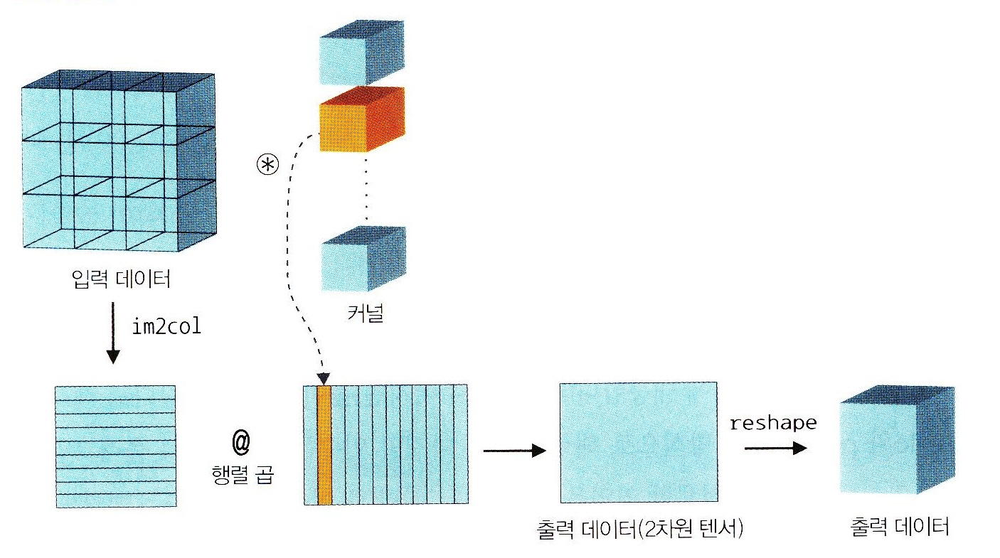
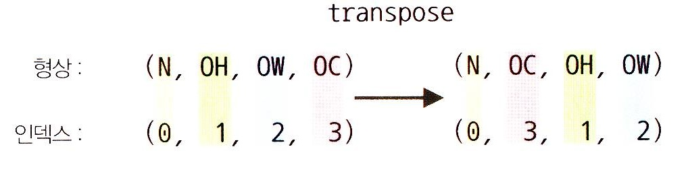
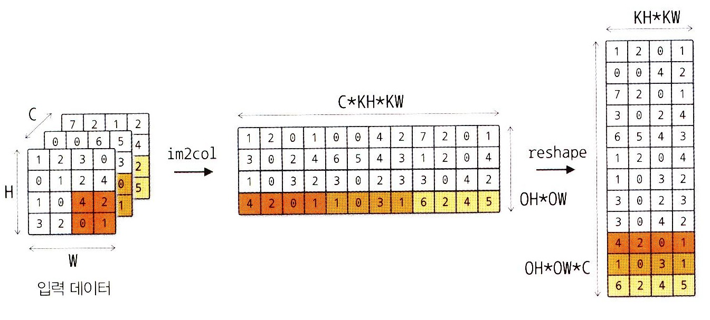
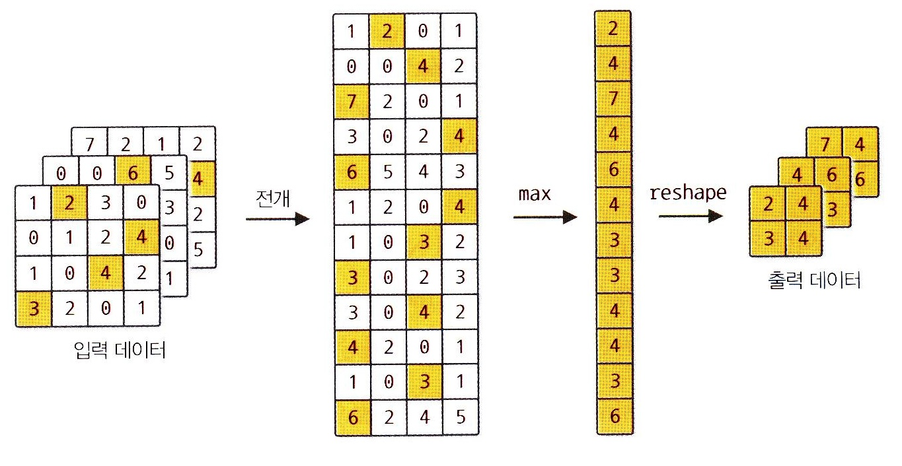

# 57단계 conv2d 함수와 pooling 함수

55~56단계에서 합성곱층과 풀링층에 대해 설명했습니다. 합성곱 연산을 곧이곧대로 구현하면 `for` 문이 겹겹이 중첩된 코드가 될 것입니다. 이렇게 코딩하기는 귀찮을 뿐 아니라 넘파이에서 `for` 문을 사용하면 속도가 느려진다는 단점도 있습니다. 그래서 `for` 문은 사용하지 않고 `im2col`이라는 편의 함수를 사용하여 간단히 구현하고자 합니다. 참고로 `im2col`은 'image to column'의 약자로, '이미지에서 열로' 변환한다는 의미를 담고 있습니다.

> **NOTE**
> DeZero에서는 신경망 변환 처리를 '함수'로 구현합니다. 그리고 매개변수를 갖는 계층은 `Layer` 클래스를 상속받아 매개변수 관리를 맡겼습니다. 이번 단계에서는 합성곱층에서의 처리를 `conv2d`(또는 `conv2d_simple`) 함수로 구현하며, `Layer` 클래스를 상속한 `Conv2d` 계층도 구현합니다. 그리고 풀링층에는 매개변수가 없기 때문에 (클래스는 빼고) `pooling` 함수만 구현합니다.

---

## 57.1 im2col에 의한 전개

`im2col`은 입력 데이터를 한 줄로 '전개'하는 함수로, 합성곱 연산 중 커널 계산에 편리하도록 입력 데이터를 펼쳐줍니다. [그림 57-1]과 같이 3차원 텐서인 입력 데이터로부터 커널을 적용할 영역을 추출하는 것이죠(정확하게는 배치 수를 포함한 4차원 텐서로부터 커널을 적용할 영역을 꺼냅니다).

#### 그림 57-1 커널 적용 영역의 전개

(입력 데이터 $(C, H, W)$ 로부터 필터를 적용할 영역을 추출하여 $OH \times OW$ 개의 $(C, KH, KW)$ 블록들을 만들고, 이를 행렬 곱을 위해 2차원 행렬 $(OH \times OW, C \times KH \times KW)$ 로 `reshape` 하는 변환 흐름)

[그림 57-1]과 같이 커널을 적용할 영역을 꺼낸 다음, 한 줄로 형상을 바꿔<sup>reshape</sup> 최종적으로는 '행렬(2차원 텐서)'로 변환합니다. 이것이 `im2col` 함수가 수행하는 작업입니다.

> **CAUTION**
> 체이너(Chainer)의 `im2col`은 [그림 57-1]의 1단계까지의 작업만 수행합니다(reshape 부분이 제외됩니다). 왜냐하면 영역을 꺼낸 후 텐서 곱\*을 하여 원하는 계산을 수행할 수 있기 때문입니다. 이 책에서는 (텐서 곱이 아닌) 행렬 곱을 사용하기 때문에 reshape까지 해줘야 합니다. 한편 DeZero의 `im2col` 함수는 인수로 `to_matrix` 플래그를 받는데, 이 값이 `True`일 때만 [그림 57-1]의 reshape 부분까지 처리해줍니다.

`im2col`로 입력 데이터를 전개한 후에는 합성곱층의 커널(필터)을 한 줄로 전개합니다. 그런 다음 [그림 57-2]처럼 두 행렬을 곱합니다.

[그림 57-2]와 같이 행렬 곱을 계산하면 행렬(2차원 텐서)이 출력됩니다. 마지막으로 이 출력을 3차원 텐서(정확하게는 배치 수를 포함한 4차원 텐서)로 변환합니다. 이상이 합성곱층의 구현 흐름입니다.

> **NOTE**
> 합성곱 연산 시 `im2col`로 전개하면 대부분의 경우 원소 수가 원래보다 많아지기 때문에 메모리를 많이 소비합니다. 하지만 행렬 곱으로 계산할 수 있기 때문에 행렬 라이브러리가 제공하는 최적화된 함수의 혜택을 누릴 수 있습니다.

---
\* 텐서 곱은 단순히 행렬 곱의 확장으로, 축을 지정하여 두 텐서를 곱셈한 후 누적하는 계산입니다. 참고로 이를 곱셈-누적 연산(multiply-accumulate operation)이라고 합니다. 넘파이에서는 `np.tensordot`과 `np.einsum`을 사용하여 텐서 곱을 계산할 수 있습니다.

#### 그림 57-2 입력 데이터와 커널의 행렬 곱 계산

(입력 데이터는 `im2col`을 통해 2차원 행렬로 변환되고, 커널도 2차원 행렬로 전개되어 행렬 곱(`@`)을 계산한 후, 출력 2차원 텐서를 다시 원래의 3차원 데이터 형상으로 `reshape` 하는 전체 합성곱 구현 과정)

---

## 57.2 conv2d 함수 구현

이 책에서는 DeZero의 `im2col` 함수를 블랙박스처럼 사용한다고 가정합니다(즉, 상세 구현은 신경 쓰지 않습니다). 어쨌든 `im2col`도 DeZero 함수이므로 입력으로 `Variable` 인스턴스를 받으며 `backward`를 호출하여 미분도 계산할 수 있습니다.

> **CAUTION**
> CNN에서 이용하는 함수들은 코드 양이 많으므로 `dezero/functions.py`가 아닌 `dezero/functions_conv.py`에 모아뒀습니다. DeZero의 `im2col` 함수 역시 `dezero/functions_conv.py`에 있습니다. 하지만 `dezero/functions_conv.py`에서 구현한 DeZero 함수들을 `dezero/functions.py`에서 임포트하고 있으므로 사용자는 `dezero/functions.py`만 임포트하면 모든 함수를 사용할 수 있습니다.

그럼 DeZero의 `im2col` 함수에 대해 살펴보겠습니다. 이 함수의 인터페이스는 다음과 같으며, 인수에 대한 설명을 [표 57-1]로 정리했습니다.

```python
im2col(x, kernel_size, stride=1, pad=0, to_matrix=True)
```

#### 표 57-1 im2col 함수의 인수

| 인수 | 데이터 타입 | 설명 |
|---|---|---|
| `x` | `Variable` 또는 `ndarray` | 입력 데이터 |
| `kernel_size` | `int` 또는 `(int, int)` | 커널 크기 |
| `stride` | `int` 또는 `(int, int)` | 스트라이드 |
| `pad` | `int` 또는 `(int, int)` | 패딩 |
| `to_matrix` | `bool` | 행렬로 형상 변환 여부 |

인수 `kernel_size`는 `int` 또는 `(int, int)` 튜플로 제공합니다. 만약 튜플로 주어지면 첫 번째 원소가 높이에, 두 번째 원소가 너비에 대응합니다. `int`로 주어지면 높이와 너비가 같다고 해석합니다. 인수 `stride`와 `pad`도 같은 방식으로 해석합니다. 마지막 인수는 `to_matrix` 플래그입니다. 이 플래그가 `True`면 커널을 적용할 영역을 추출한 후 '행렬'로 형상 변환합니다(행렬로 바꾸는 이유는 행렬 곱으로 계산하기 위해서입니다).

그럼 `im2col` 함수를 실제로 사용해보겠습니다.

**steps/step57.py**
```python
import numpy as np
import dezero.functions as F

x1 = np.random.rand(1, 3, 7, 7) # 배치 크기 = 1
col1 = F.im2col(x1, kernel_size=5, stride=1, pad=0, to_matrix=True)
print(col1.shape)

x2 = np.random.rand(10, 3, 7, 7) # 배치 크기 = 10
kernel_size = (5, 5)
stride = (1, 1)
pad = (0, 0)
col2 = F.im2col(x2, kernel_size, stride, pad, to_matrix=True)
print(col2.shape)
```

**실행 결과**
```
(9, 75)
(90, 75)
```

두 가지 예를 보여드렸습니다. 첫 번째로 준비한 데이터의 형상은 `(1, 3, 7, 7)`입니다. 배치 크기가 1, 채널 수가 3, 높이가 7, 너비가 7인 데이터입니다. 두 번째는 첫 번째 예에서 배치 크

기를 10으로 늘린 경우입니다. 각각에 `im2col` 함수를 적용하면 두 경우 모두에서 두 번째 차원의 원소 수는 75입니다. 커널의 원소 수와 일치하는 결과죠(채널 수 3에 $(5, 5)$ 형상의 데이터). 그리고 첫 번째 예의 결과는 $(9, 75)$ 인 반면, 두 번째 예는 배치 크기가 10이므로 그 10배인 $(90, 75)$ 가 되었습니다.

다음은 `im2col` 함수를 사용하여 합성곱 연산을 수행하는 'DeZero 함수'를 구현할 차례입니다. 그런데 그 전에 `pair(x)`라는 편의 함수부터 구현하겠습니다.

**dezero/utils.py**
```python
def pair(x):
    if isinstance(x, int):
        return (x, x)
    elif isinstance(x, tuple):
        assert len(x) == 2
        return x
    else:
        raise ValueError
```

`pair(x)` 함수는 인수 `x`가 `int`라면 `(x, x)` 형태의 튜플로 변환해 반환하고, `x`가 원소 2개짜리 튜플이면 그대로 돌려줍니다. 이 함수를 사용하면 다음과 같이 인수 타입이 `int`든 `(int, int)`든 상관없이 원소 2개짜리 튜플을 얻을 수 있습니다.

```python
from dezero.utils import pair

print(pair(1))
print(pair((1, 2)))
```

**실행 결과**
```
(1, 1)
(1, 2)
```

드디어 진짜로 합성곱 연산을 수행하는 함수 `conv2d_simple`을 구현할 시간입니다. 다음 코드는 `dezero/functions.py`가 아닌 `dezero/functions_conv.py`에 위치합니다.

**dezero/functions_conv.py**
```python
from dezero.utils import pair, get_conv_outsize

def conv2d_simple(x, W, b=None, stride=1, pad=0):
    x, W = as_variable(x), as_variable(W)

    Weight = W # Width의 'W'와 헷갈리지 않기 위해
    N, C, H, W = x.shape
    OC, C, KH, KW = Weight.shape
    SH, SW = pair(stride)
    PH, PW = pair(pad)
    OH = get_conv_outsize(H, KH, SH, PH)
    OW = get_conv_outsize(W, KW, SW, PW)

    col = im2col(x, (KH, KW), stride, pad, to_matrix=True) # ❶
    Weight = Weight.reshape(OC, -1).transpose() # ❷
    t = linear(col, Weight, b) # ❸
    y = t.reshape(N, OH, OW, OC).transpose(0, 3, 1, 2) # ❹
    return y
```

이 코드에서 중요한 부분은 음영을 칠해뒀습니다. 우선 ❶에서 입력 데이터를 `im2col`로 전개합니다. ❷에서는 커널 `Weight`를 [그림 57-2]에서와 같이 한 줄로 펼쳐 재정렬합니다. 여기에서 `Weight.reshape(OC, -1)`처럼 마지막 인수로 `-1`을 주었는데, 이는 `reshape` 함수의 편의 기능입니다. 마지막 인수를 `-1`로 지정하면 그 앞의 인수들로 정의한 다차원 배열에 전체 원소들을 적절히 분배해줍니다. 예를 들어 `(10, 3, 5, 5)` 형상의 배열이라면 원소가 총 750개인데, 이 배열에 `reshape(10, -1)`을 수행하면 `(10, 75)` 형상의 배열로 바뀝니다(총 750개를 10개의 묶음으로 배분한 결과입니다).

그리고 ❸에서 행렬 곱을 계산합니다. 이때 선형 변환인 `linear` 함수를 사용하여 편향까지 포함한 계산을 수행합니다. 마지막으로 ❹에서 출력 크기를 적절한 형상으로 바꾼 후 DeZero의 `transpose` 함수를 사용했습니다. 38단계에서 설명한대로 `transpose` 함수는 텐서의 축 순서를 바꿔주는데, 여기에서는 [그림 57-3]처럼 교체한 것입니다.

#### 그림 57-3 transpose 함수에 의한 축의 순서 교체


$$
\text{transpose}
$$

$$
\begin{aligned}
\text{형상: } & (N, OH, OW, OC) & \longrightarrow & \quad (N, OC, OH, OW) \\
\text{인덱스: } & (0, \ \ 1, \ \ 2, \ \ 3) & \longrightarrow & \quad (0, \ \ 3, \ \ 1, \ \ 2)
\end{aligned}
$$

이상이 `conv2d_simple` 함수입니다. 이번 합성곱 연산도 지금까지 구현해둔 DeZero 함수를 사용하여 구현했기 때문에 역전파도 문제없이 동작합니다. 그래서 `conv2d_simple` 함수를 다음처럼 사용할 수도 있습니다.

**steps/step57.py**
```python
N, C, H, W = 1, 5, 15, 15
OC, (KH, KW) = 8, (3, 3)

x = Variable(np.random.randn(N, C, H, W))
W = np.random.randn(OC, C, KH, KW)
y = F.conv2d_simple(x, W, b=None, stride=1, pad=1)
y.backward()

print(y.shape)
print(x.grad.shape)
```

**실행 결과**
```
(1, 8, 15, 15)
(1, 5, 15, 15)
```

이와 같이 합성곱 연산을 수행할 수 있게 되었습니다. 참고로 지면으로는 간단한 구현 방식만을 설명했습니다(그래서 함수 이름도 `conv2d_simple`입니다). 더 나은 방식은 물론 `Function` 클래스를 상속하여 `Conv2d` 클래스로 구현하는 것이죠. `dezero/functions_conv.py`에 `Conv2d` 클래스와 `conv2d` 함수를 준비해뒀으니 관심 있는 분은 참고하세요.

> **NOTE**
> `Conv2d` 클래스에서는 순전파 시 `im2col` 메서드를 이용하는데, (행렬 곱이 아닌) 텐서 곱 방식으로 계산합니다. 또한 `im2col`로 전개한 2차원 텐서(변수 이름은 `col`입니다)는 사용 후 메모리에서 즉시 삭제합니다(`col`은 매우 크기 때문에 메모리를 많이 소비합니다). 그리고 역전파는 '전치 합성곱<sup>transposed convolution</sup>'\** 방식으로 계산합니다.

---
\** 디컨볼루션(Deconvolution)이라고도 하며, 합성곱(컨볼루션)의 역방향 변환을 해줍니다.

---

## 57.3 Conv2d 계층 구현

이어서 (함수가 아닌) '계층'으로서의 `Conv2d` 클래스를 구현해보죠.

**dezero/layers.py**
```python
class Conv2d(Layer):
    def __init__(self, out_channels, kernel_size, stride=1,
                 pad=0, nobias=False, dtype=np.float32, in_channels=None):
        super().__init__()
        self.in_channels = in_channels
        self.out_channels = out_channels
        self.kernel_size = kernel_size
        self.stride = stride
        self.pad = pad
        self.dtype = dtype

        self.W = Parameter(None, name='W')
        if in_channels is not None:
            self._init_W()

        if nobias:
            self.b = None
        else:
            self.b = Parameter(np.zeros(out_channels, dtype=dtype), name='b')

    def _init_W(self, xp=np):
        C, OC = self.in_channels, self.out_channels
        KH, KW = pair(self.kernel_size)
        scale = np.sqrt(1 / (C * KH * KW))
        W_data = xp.random.randn(OC, C, KH, KW).astype(self.dtype) * scale
        self.W.data = W_data

    def forward(self, x):
        if self.W.data is None:
            self.in_channels = x.shape[1]
            xp = cuda.get_array_module(x)
            self._init_W(xp)

        y = F.conv2d_simple(x, self.W, self.b, self.stride, self.pad)
        # 또는 y = F.conv2d(x, self.W, self.b, self.stride, self.pad)
        return y
```

보다시피 `Layer` 클래스를 상속하고, 초기화 시 [표 57-2]의 인수들을 받습니다.

#### 표 57-2 Conv2d 클래스의 초기화 인수

| 인수 | 데이터 타입 | 설명 |
|---|---|---|
| `out_channels` | `int` | 출력 데이터의 채널 수 |
| `kernel_size` | `int` 또는 `(int, int)` | 커널 크기 |
| `stride` | `int` 또는 `(int, int)` | 스트라이드 |
| `pad` | `int` 또는 `(int, int)` | 패딩 |
| `nobias` | `bool` | 편향 사용 여부 |
| `dtype` | `numpy.dtype` | 초기화할 가중치의 데이터 타입 |
| `in_channels` | `int` 또는 `None` | 입력 데이터의 채널 수 |

[표 57-2]에서 주의할 점은 `in_channels`의 기본값이 `None`이라는 것입니다. 이 값이 `None`이면 `forward(x)`에 주어지는 `x`의 형상으로부터 `in_channels`의 값을 얻고, 그 시점(순전파)에 가중치 데이터를 초기화합니다. 완전연결계층의 `Linear` 계층과 동일한 작동 방식입니다.

주요 처리는 앞서 구현한 `conv2d_simple`(혹은 `conv2d`)을 이용합니다. 이상으로 `Conv2d` 계층의 구현을 살펴봤습니다.

---

## 57.4 pooling 함수 구현

마지막으로 `pooling` 함수를 구현하겠습니다. 이 함수도 `conv2d_simple`과 마찬가지로 `im2col`을 사용하여 입력 데이터를 전개합니다. 그러나 풀링은 채널 방향과는 독립적이라는 점이 합성곱층과 다릅니다. 다시 말해 [그림 57-4]와 같이 풀링의 적용 영역은 채널마다 독립적으로 전개합니다.

#### 그림 57-4 입력 데이터에 대해 풀링 적용 영역을 전개(2x2 풀링의 예)

(입력 데이터 $(C, H, W)$ 에 `im2col`을 적용해 $(OH \times OW, C \times KH \times KW)$ 행렬을 만든 후, 이를 채널별로 독립적으로 세로 전개하여 $(OH \times OW \times C, KH \times KW)$ 형상의 행렬로 `reshape` 하는 과정)

* **입력 데이터**: 형상 $(C, H, W)$
* **`im2col` 결과 행렬**: 형상 $(OH \times OW, C \times KH \times KW) = (4, 12)$
  ```
  [ 1  2  0  1 | 0  0  4  2 | 7  2  0  1 ]
  [ 3  0  2  4 | 6  5  4  3 | 1  2  0  4 ]
  [ 1  0  3  2 | 3  0  2  3 | 3  0  4  2 ]
  [ 4  2  0  1 | 1  0  3  1 | 6  2  4  5 ]
  ```
* **`reshape` 결과 행렬**: 형상 $(OH \times OW \times C, KH \times KW) = (12, 4)$
  ```
  [ 1  2  0  1 ]  <-- Channel 0, 영역 0
  [ 0  0  4  2 ]  <-- Channel 1, 영역 0
  [ 7  2  0  1 ]  <-- Channel 2, 영역 0
  [ 3  0  2  4 ]  <-- Channel 0, 영역 1
  [ 6  5  4  3 ]  <-- Channel 1, 영역 1
  [ 1  2  0  4 ]  <-- Channel 2, 영역 1
  [ 1  0  3  2 ]  ...
  [ 3  0  2  3 ]
  [ 3  0  4  2 ]
  [ 4  2  0  1 ]
  [ 1  0  3  1 ]
  [ 6  2  4  5 ]
  ```

이렇게 전개한 후 전개된 행렬의 각 행별로 최댓값을 구해 적절한 형상으로 바꾸면 끝입니다. 그림으로 표현하면 [그림 57-5]와 같습니다.

#### 그림 57-5 pooling 함수의 구현 흐름(색칠된 원소 = 풀링 적용 영역에서 값이 가장 큰 원소)

(입력 데이터 전개 후, $(12, 4)$ 행렬의 각 행별 최댓값(Max)을 추출하여 $(12, 1)$ 열벡터를 구하고, 이를 출력 데이터 형상으로 `reshape` 하는 흐름)

1. **전개 행렬**: 각 행의 최댓값을 구함 (각 행의 최댓값은 대괄호 `[ ]`로 표시)
   ```
   [ 1 [2] 0  1 ]  --> 2
   [ 0  0 [4] 2 ]  --> 4
   [[7] 2  0  1 ]  --> 7
   [ 3  0  2 [4]]  --> 4
   [[6] 5  4  3 ]  --> 6
   [ 1  2  0 [4]]  --> 4
   [ 1  0 [3] 2 ]  --> 3
   [[3] 0  2  3 ]  --> 3
   [ 3  0 [4] 2 ]  --> 4
   [[4] 2  0  1 ]  --> 4
   [ 1  0 [3] 1 ]  --> 3
   [[6] 2  4  5 ]  --> 6
   ```
2. **`max` 추출 결과**: `[2, 4, 7, 4, 6, 4, 3, 3, 4, 4, 3, 6]^T`
3. **`reshape` 결과**: 출력 데이터 형상으로 변환

이상이 `pooling` 함수의 구현 흐름입니다. 다음은 코드를 볼 차례입니다.

**dezero/functions_conv.py**
```python
def pooling_simple(x, kernel_size, stride=1, pad=0):
    x = as_variable(x)

    N, C, H, W = x.shape
    KH, KW = pair(kernel_size)
    PH, PW = pair(pad)
    SH, SW = pair(stride)
    OH = get_conv_outsize(H, KH, SH, PH)
    OW = get_conv_outsize(W, KW, SW, PW)

    col = im2col(x, kernel_size, stride, pad, to_matrix=True) # ❶ 전개
    col = col.reshape(-1, KH * KW)
    y = col.max(axis=1) # ❷ 최댓값
    y = y.reshape(N, OH, OW, C).transpose(0, 3, 1, 2) # ❸ 형상 변환
    return y
```

`pooling` 함수(정확히는 `pooling_simple` 함수) 구현은 세 단계로 진행됩니다. ❶에서 입력 데이터를 전개하고, ❷에서 각 행의 최댓값을 찾고, ❸에서 적절한 크기로 출력의 형상을 변환합니다.

> **NOTE**
> 최댓값 계산에는 DeZero의 `max` 함수를 이용합니다. `max` 함수는 인수로 넘파이의 `np.max`와 같은 값을 지정할 수 있습니다. 앞의 코드에서는 인수 `axis`를 지정하여 어떤 축을 기준으로 최댓값을 구할지 명시했습니다.

이상이 `pooling` 함수의 구현입니다. 지금까지 본 것처럼, 먼저 입력 데이터를 풀링하기 쉬운 형태로 전개해주면 그 후의 구현은 매우 간단합니다.
