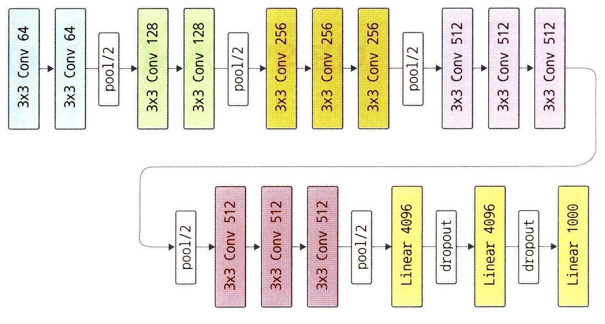
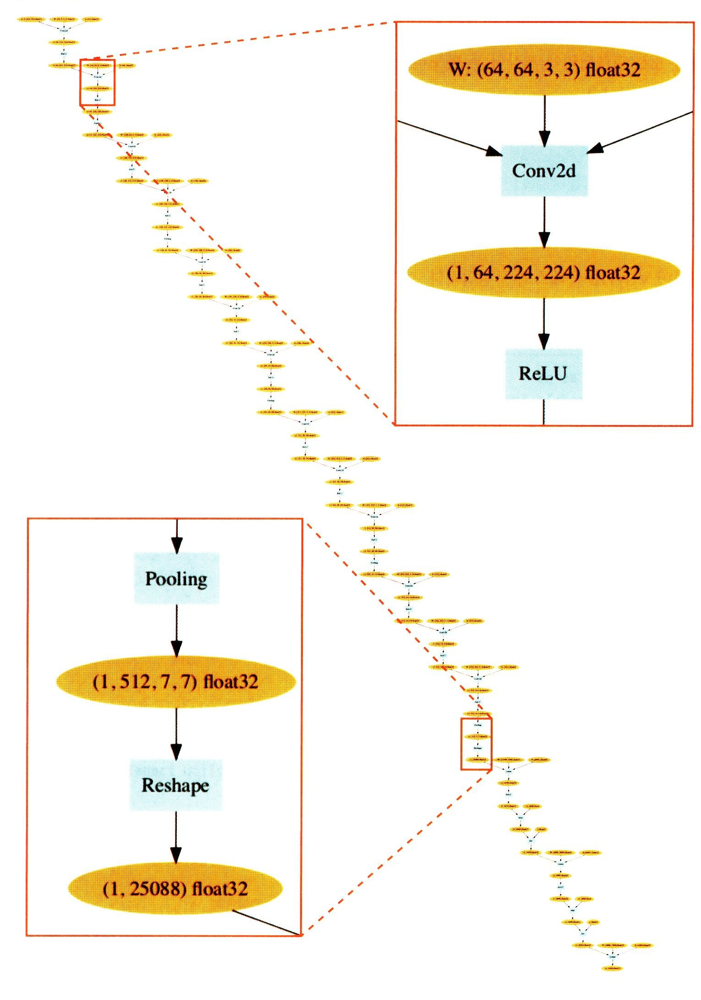
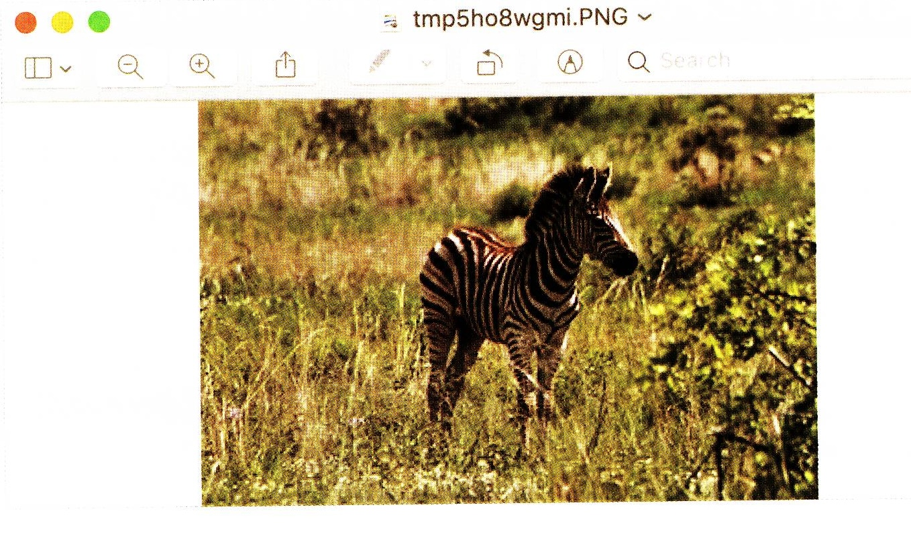

# 58단계 대표적인 CNN(VGG16)

이번 단계에서는 이전 단계에서 구현한 `Conv2d` 계층과 `pooling` 함수를 이용하여 유명한 모델 하나를 구현하려 합니다. 바로 VGG16이라는 모델입니다. 또한 학습된 가중치를 사용하여 추론도 해보겠습니다.

---

## 58.1 VGG16 구현

VGG는 2014년 ILSVRC 대회에서 준우승한 모델입니다. 논문 [36]을 보면 사용되는 계층 수에 따라 여러 종류의 모델을 제안하고 있는데, 우리는 그중 'VGG16' 모델을 구현할 것입니다. VGG16의 신경망 구성은 [그림 58-1]과 같습니다.

#### 그림 58-1 VGG16 신경망 구성(활성화 함수 ReLU는 생략)

* **1층 영역**: $\rightarrow$ [3x3 Conv 64] $\rightarrow$ [3x3 Conv 64] $\rightarrow$ [pool/2] $\rightarrow$ [3x3 Conv 128] $\rightarrow$ [3x3 Conv 128] $\rightarrow$ [pool/2] $\rightarrow$ [3x3 Conv 256] $\rightarrow$ [3x3 Conv 256] $\rightarrow$ [3x3 Conv 256] $\rightarrow$ [pool/2] $\rightarrow$ [3x3 Conv 512] $\rightarrow$ [3x3 Conv 512] $\rightarrow$ [3x3 Conv 512] $\rightarrow$ (아래 행으로 연결)
* **2층 영역**: $\rightarrow$ [pool/2] $\rightarrow$ [3x3 Conv 512] $\rightarrow$ [3x3 Conv 512] $\rightarrow$ [3x3 Conv 512] $\rightarrow$ [pool/2] $\rightarrow$ [Linear 4096] $\rightarrow$ [dropout] $\rightarrow$ [Linear 4096] $\rightarrow$ [dropout] $\rightarrow$ [Linear 1000] $\rightarrow$

[그림 58-1]의 '3x3 conv 64'는 커널 크기가 $3 \times 3$ 이고 출력 채널 수가 64개라는 뜻입니다. 또한 'pool/2'는 $2 \times 2$ 풀링을, 'Linear 4096'은 출력 크기가 4096인 완전연결계층을 가리킵니다. 이 VGG16의 특징으로는 다음과 같은 점들을 꼽을 수 있습니다.

* $3 \times 3$ 합성곱층 사용(패딩은 $1 \times 1$)
* 합성곱층의 채널 수는 (기본적으로) 풀링하면 2배로 증가($64 \rightarrow 128 \rightarrow 256 \rightarrow 512$)
* 완전연결계층에서는 드롭아웃 사용
* 활성화 함수로는 ReLU 사용

그러면 [그림 58-1]을 참고하여 VGG16을 구현해보죠.

**dezero/models.py**
```python
import dezero.functions as F
import dezero.layers as L

class VGG16(Model):
    def __init__(self):
        super().__init__()
        # ❶ 출력 채널 수만큼 지정
        self.conv1_1 = L.Conv2d(64, kernel_size=3, stride=1, pad=1)
        self.conv1_2 = L.Conv2d(64, kernel_size=3, stride=1, pad=1)
        self.conv2_1 = L.Conv2d(128, kernel_size=3, stride=1, pad=1)
        self.conv2_2 = L.Conv2d(128, kernel_size=3, stride=1, pad=1)
```

```python
        self.conv3_1 = L.Conv2d(256, kernel_size=3, stride=1, pad=1)
        self.conv3_2 = L.Conv2d(256, kernel_size=3, stride=1, pad=1)
        self.conv3_3 = L.Conv2d(256, kernel_size=3, stride=1, pad=1)
        self.conv4_1 = L.Conv2d(512, kernel_size=3, stride=1, pad=1)
        self.conv4_2 = L.Conv2d(512, kernel_size=3, stride=1, pad=1)
        self.conv4_3 = L.Conv2d(512, kernel_size=3, stride=1, pad=1)
        self.conv5_1 = L.Conv2d(512, kernel_size=3, stride=1, pad=1)
        self.conv5_2 = L.Conv2d(512, kernel_size=3, stride=1, pad=1)
        self.conv5_3 = L.Conv2d(512, kernel_size=3, stride=1, pad=1)
        self.fc6 = L.Linear(4096) # ❷ 출력 크기만 지정
        self.fc7 = L.Linear(4096)
        self.fc8 = L.Linear(1000)

    def forward(self, x):
        x = F.relu(self.conv1_1(x))
        x = F.relu(self.conv1_2(x))
        x = F.pooling(x, 2, 2)
        x = F.relu(self.conv2_1(x))
        x = F.relu(self.conv2_2(x))
        x = F.pooling(x, 2, 2)
        x = F.relu(self.conv3_1(x))
        x = F.relu(self.conv3_2(x))
        x = F.relu(self.conv3_3(x))
        x = F.pooling(x, 2, 2)
        x = F.relu(self.conv4_1(x))
        x = F.relu(self.conv4_2(x))
        x = F.relu(self.conv4_3(x))
        x = F.pooling(x, 2, 2)
        x = F.relu(self.conv5_1(x))
        x = F.relu(self.conv5_2(x))
        x = F.relu(self.conv5_3(x))
        x = F.pooling(x, 2, 2)
        x = F.reshape(x, (x.shape[0], -1)) # ❸ 형상 변환
        x = F.dropout(F.relu(self.fc6(x)))
        x = F.dropout(F.relu(self.fc7(x)))
        x = self.fc8(x)
        return x
```

코드가 길지만 구성은 간단합니다. 초기화에서는 필요한 계층들을 생성합니다. 그리고 `forward` 메서드에서 이 계층들과 함수를 사용하여 진행합니다. 로직이 간단하니 주석이 달린 세 곳만 설명을 보충하겠습니다.

❶에서는 합성곱층을 생성할 때 입력 데이터의 채널 수를 지정하지 않습니다. 입력 데이터의 채널 수는 순전파 시에 흐르는 데이터로부터 얻고, 그 시점에 가중치 매개변수를 초기화합니다. 또한 ❷의 `L.Linear(4096)`에서도 마찬가지로 출력 크기만 지정합니다. 입력 크기는 실제로 흘러들어온 데이터를 보고 자동으로 결정하기 때문이죠.

이어서 ❸에서는 합성곱층에서 완전연결계층으로 전환하기 위해 데이터의 형상을 변환합니다. 합성곱층에서는 4차원 텐서를 처리하지만 완전연결계층에서는 2차원 텐서를 처리합니다. 따라서 완전연결계층에 데이터를 제공하기 전에 `reshape` 함수를 사용하여 2차원 텐서로 바꿉니다. 이상이 `VGG16` 클래스의 구현입니다.

---

## 58.2 학습된 가중치 데이터

VGG16은 이미지넷<sup>ImageNet</sup>이라고 하는 거대한 데이터셋으로 학습합니다. 그리고 학습이 완료된 가중치 데이터가 공개되어 있습니다. 이번 절에서는 이 학습된 가중치 데이터를 읽어오는 기능을 `VGG16` 클래스에 추가하겠습니다.

> **NOTE**
> http://www.robots.ox.ac.uk/~vgg/research/very_deep/ 에 가보면 VGG16 모델이 Creative Commons Attribution 라이선스(https://creativecommons.org/licenses/by/4.0/ )로 공개되어 있습니다. 그리고 원래의 가중치 데이터를 DeZero가 읽을 수 있도록 살짝 수정한 파일을 https://github.com/koki0702/dezero-models 에 준비해뒀습니다.

다음은 앞서 구현한 `VGG16` 클래스에 추가할 부분입니다.

**dezero/models.py**
```python
from dezero import utils

class VGG16(Model):
    WEIGHTS_PATH = 'https://github.com/koki0702/dezero-models/' \
                   'releases/download/v0.1/vgg16.npz'

    def __init__(self, pretrained=False):
        ...

        if pretrained:
            weights_path = utils.get_file(VGG16.WEIGHTS_PATH)
            self.load_weights(weights_path)
```

이와 같이 `VGG16` 클래스의 초기화 메서드에 인수 `pretrained=False`를 추가합니다. 이 플래그를 `True`로 설정하면 지정된 장소에서 가중치 파일(DeZero용으로 변환된 가중치 파일)을 받아 캐시 디렉터리에 저장한 후 메모리로 읽어 들입니다. 가중치 파일 읽기는 53단계에서 추가한 기능입니다.

> **NOTE**
> `dezero/utils.py`에 보면 `get_file` 함수가 있습니다. 이 함수는 지정된 URL에서 파일을 내려받은 후 (PC 상의) 절대 경로를 반환합니다. 또한 캐시 디렉터리에 이전에 받아둔 파일이 이미 있다면 해당 파일의 전체 경로를 반환합니다. 참고로 DeZero의 캐시 디렉터리는 `~/.dezero`입니다.

이상이 `VGG16` 클래스의 구현입니다. 이 `VGG16` 클래스를 `dezero/models.py`에 추가하면 다음과 같이 훈련된 `VGG16`을 사용할 수 있습니다.

```python
import numpy as np
from dezero.models import VGG16

model = VGG16(pretrained=True)

x = np.random.randn(1, 3, 224, 224).astype(np.float32) # 더미 데이터
model.plot(x) # 계산 그래프 시각화
```

코드 마지막에서 `VGG16`의 계산 그래프를 시각화하였고, 결과는 [그림 58-2]와 같습니다.

#### 그림 58-2 VGG16의 계산 그래프

(매우 길고 복잡한 VGG16 신경망의 전체 계산 그래프 중 상단의 Conv2d-ReLU 영역과 하단의 Pooling-Reshape 영역을 확대하여 보여주는 다이어그램)

* **상단 확대 영역 (첫 번째 Conv2d 계층 주변)**
  ```mermaid
  graph TD
      W("W: (64, 64, 3, 3) float32") --> Conv2d
      Input(...) --> Conv2d
      Conv2d --> Output1["(1, 64, 224, 224) float32"]
      Output1 --> ReLU
  ```

* **하단 확대 영역 (풀링 후 완전연결층 진입 전 Reshape 주변)**
  ```mermaid
  graph TD
      Pooling --> Output2["(1, 512, 7, 7) float32"]
      Output2 --> Reshape
      Reshape --> Output3["(1, 25088) float32"]
  ```

---

## 58.3 학습된 VGG16 사용하기

이어서 학습된 VGG16을 사용하여 이미지를 얼마나 잘 인식하는지 살펴보겠습니다. 우선 샘플 이미지를 읽는 일부터 시작하죠.

```python
import dezero
from PIL import Image

url = 'https://github.com/WegraLee/deep-learning-from-scratch-3/' \
      'raw/images/zebra.jpg'
img_path = dezero.utils.get_file(url)
img = Image.open(img_path)
img.show()
```

앞 절에서 설명한 `dezero.utils.get_file` 함수를 사용하여 이미지 파일을 내려받았습니다. 그리고 내려받은 이미지를 PIL 패키지를 사용하여 읽어옵니다. 코드를 실행하면 [그림 58-3]이 모니터에 출력됩니다.

#### 그림 58-3 PIL을 사용하여 가져온 샘플 이미지

(얼룩말이 들판에 서 있는 모습을 보여주는 샘플 이미지 창 예시)

> **NOTE**
> PIL<sup>Python Image Library</sup>은 이미지 처리 라이브러리입니다. 이미지 읽기와 쓰기, 이미지 변환 등 다양한 기능을 제공하죠. PIL을 설치하려면 `pip install pillow` 명령을 실행해주세요.

앞의 코드에서 이미지를 읽어오는 부분은 `img = Image.open(img_path)`이고, 이때 `img`의 데이터 타입은 `PIL.Image`입니다. 하지만 DeZero는 `ndarray` 타입 데이터를 취급하므로 적절히 변환해줘야 합니다. 이를 위해 DeZero는 `VGG16` 클래스에 정적 메서드인 `preprocess`를 준비해뒀습니다. 사용법은 다음과 같습니다.

```python
from dezero.models import VGG16

x = VGG16.preprocess(img)
print(type(x), x.shape)
```

**실행 결과**
```
<class 'numpy.ndarray'> (3, 224, 224)
```

`preprocess`는 정적 메서드이므로 인스턴스가 아닌 클래스에서 호출해야 합니다. 인수로 `PIL.Image` 타입의 데이터를 제공하면 내부에서 높이 224, 너비 224 크기로 조정한 후 `ndarray` 인스턴스로 변환해 돌려줍니다. 여기서 $(224, 224)$ 는 VGG16 입력 이미지의 크기입니다. 그리고 `VGG16.preprocess` 메서드는 이미지넷을 학습할 때 필요한 또 다른 전처리도 해줍니다. 예를 들어 색상 채널을 BGR 순서로 재정렬\*하거나 이미지넷 데이터셋으로 미리 구해둔 채널별 평균<sup>mean</sup>을 모든 픽셀에서 빼주는\** 등의 전처리를 해줍니다.

> **CAUTION**
> 학습된 가중치 데이터를 사용하여 미지의 데이터를 추론할 때는 모델을 학습시켰을 때와 똑같은 전처리를 해줘야 합니다. 그렇지 않으면 모델에 입력되는 데이터의 형태가 달라지기 때문에 올바로 인식하지 못합니다.

이제 준비가 끝났으니 학습된 VGG16을 사용해서 분류를 해봅시다.

**steps/step58.py**
```python
import numpy as np
from PIL import Image
import dezero
from dezero.models import VGG16
```

---
\* 옮긴이\_ 원래의 VGG16을 구현할 때 딥러닝 프레임워크로 카페(Caffe)를 사용했는데, 카페는 이미지 처리에 OpenCV 라이브러리를 사용하며, 바로 이 OpenCV가 이미지 데이터를 BGR 포맷으로 처리하기 때문입니다.  
\** 옮긴이\_ VGG16 신경망의 속도와 정확도를 높이기 위한 보정 작업입니다.

```python
url = 'https://github.com/WegraLee/deep-learning-from-scratch-3/' \
      'raw/images/zebra.jpg'
img_path = dezero.utils.get_file(url)
img = Image.open(img_path)
x = VGG16.preprocess(img)
x = x[np.newaxis] # 배치용 축 추가

model = VGG16(pretrained=True)
with dezero.test_mode():
    y = model(x)
predict_id = np.argmax(y.data)

model.plot(x, to_file='vgg.pdf') # 계산 그래프 시각화
labels = dezero.datasets.ImageNet.labels() # 이미지넷의 레이블
print(labels[predict_id])
```

**실행 결과**
```
zebra
```

먼저 이미지를 읽어 들여 전처리를 끝낸 후 배치용 축을 맨 앞에 추가했습니다. 이제 `x`의 형상은 $(3, 224, 224)$ 에서 $(1, 3, 224, 224)$ 로 바뀌었습니다. 이어서 VGG16에 데이터를 주어 추론을 수행합니다. 여기에서는 출력층(1000 클래스)에서 가장 큰 값을 가리키는 인덱스가 모델이 분류한 결과입니다.

또한 `dezero/datasets.py`에는 이미지넷 레이블(키가 객체 ID이고, 값이 레이블 이름인 딕셔너리)도 준비되어 있습니다. 이 데이터를 사용하면 객체의 ID로 레이블 이름을 알아낼 수 있습니다. 실행 결과를 보면 [그림 58-3]의 이미지를 zebra<sup>얼룩말</sup>라고 제대로 인식했음을 알 수 있습니다. 이상으로 VGG16 구현을 마칩니다.

> **NOTE**
> `dezero/models.py`에는 VGG16 외에도 ResNet [37]과 SqueezeNet [38] 등의 유명 모델이 들어 있습니다. 관심 있는 분은 참고하기 바랍니다.
