# 59단계 RNN을 활용한 시계열 데이터 처리

지금까지는 피드포워드<sup>feed forward</sup> 구조의 신경망을 살펴보았습니다. 피드포워드란 데이터를 순<sup>forward</sup>방향으로만 계속 입력해준다<sup>feed</sup>는 뜻입니다. 신호가 한 방향으로만 흘러가기 때문에 입력 신호만으로 출력을 결정한다는 특징이 생깁니다. 한편 순환 신경망<sup>Recurrent Neural Network</sup> (RNN)은 [그림 59-1]과 같이 순환<sup>loop</sup> 구조를 가지고 있습니다.

#### 그림 59-1 RNN의 구조
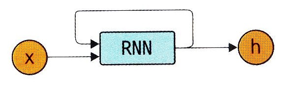
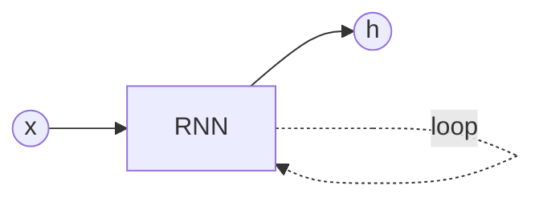

[그림 59-1]과 같은 순환 구조 때문에 RNN의 출력은 자신에게 피드백됩니다. 그래서 RNN은 '상태'를 가지게 되죠. 즉, RNN에 데이터가 입력되면 '상태'가 갱신되고 그 '상태'도 (입력과 더불어) 출력에 영향을 줍니다.

이번 단계의 주제는 바로 이 RNN입니다. RNN은 피드포워드 신경망보다 계산이 복잡하지만 DeZero를 이용하면 간단하게 구현할 수 있습니다. 이번 단계에서는 구현 코드와 함께 RNN의 원리를 설명하겠습니다.

---

## 59.1 RNN 계층 구현

먼저 RNN을 수식으로 이해해보겠습니다. 시계열<sup>time series</sup> 데이터인 입력 $\mathbf{x}_t$ 가 있고, 은닉 상태 $\mathbf{h}_t$ 를 출력하는 RNN을 생각해보죠. 여기서 $t$ 는 시계열 데이터의 시각(혹은 몇 번째 데이터인지)을 의미합니다. 또한 RNN의 상태는 은닉 상태<sup>hidden state</sup>라는 점에서 수식 $\mathbf{h}$ 로 표기했습니다. [식 59.1]은 이때의 RNN 순전파를 표현한 수식입니다.

$$
\mathbf{h}_t = \tanh(\mathbf{h}_{t-1} \mathbf{W}_h + \mathbf{x}_t \mathbf{W}_x + \mathbf{b})
$$

 <span style="float:right;">[식 59.1]</span>

먼저 [식 59.1]에 사용된 각 기호의 뜻을 설명하겠습니다. RNN에는 가중치가 두 개 있습니다. 하나는 입력 $\mathbf{x}$ 를 은닉 상태 $\mathbf{h}$ 로 변환하기 위한 가중치 $\mathbf{W}_x$ 이고, 또 하나는 RNN의 출력을 다음 시각의 출력으로 변환하기 위한 가중치 $\mathbf{W}_h$ 입니다. 마지막으로 편향 $\mathbf{b}$ 가 있습니다. 참고로 $\mathbf{h}_{t-1}$ 과 $\mathbf{x}_t$ 는 행벡터입니다.

> **NOTE**
> [식 59.1]은 행렬 곱 계산을 수행한 다음, 그 합을 $\tanh$ 함수(쌍곡탄젠트 함수)로 변환합니다. 결과값은 시각 $t$ 에서의 출력 $\mathbf{h}_t$ 입니다. 이 $\mathbf{h}_t$ 는 연결된 다음 계층의 입력으로 사용되는 동시에 다음 시각의 RNN 계층(자기 자신)의 입력으로도 사용됩니다.

그러면 DeZero용 RNN 계층을 구현해보죠. 이번에도 `Layer` 클래스를 상속하고 순전파 로직을 `forward` 메서드에 작성합니다.

**dezero/layers.py**
```python
class RNN(Layer):
    def __init__(self, hidden_size, in_size=None):
        super().__init__()
        self.x2h = Linear(hidden_size, in_size=in_size)
        self.h2h = Linear(hidden_size, in_size=in_size, nobias=True)
        self.h = None

    def reset_state(self):
        self.h = None

    def forward(self, x):
        if self.h is None:
            h_new = F.tanh(self.x2h(x))
        else:
            h_new = F.tanh(self.x2h(x) + self.h2h(self.h))
```

```python
        self.h = h_new
        return h_new
```

초기화 메서드 `__init__`는 `hidden_size`와 `in_size`를 받습니다. `in_size`가 `None`이라면 은닉 계층의 크기만 지정해두고, 입력 크기는 순전파 때 흐르는 데이터로부터 자동으로 구하겠다는 뜻입니다. 그리고 `__init__` 메서드에서 다음 두 `Linear` 계층을 생성합니다.

* `x2h`: 입력 `x`에서 은닉 상태 `h`로 변환하는 완전연결계층
* `h2h`: 이전 은닉 상태에서 다음 은닉 상태로 변환하는 완전연결계층

이어서 `forward` 메서드는 `self.h`(은닉 상태)의 유무에 따라 처리 방식이 달라집니다. 처음에는 `self.h == None`이므로 입력 `x`만으로 은닉 상태를 계산합니다. 두 번째 이후로는 앞서 저장해둔 은닉 상태(`self.h`)를 사용하여 새로운 은닉 상태를 계산합니다. 마지막으로 `reset_state`라는 이름으로 은닉 상태 재설정 메서드를 제공합니다.

> **CAUTION**
> [식 59.1]에서 알 수 있듯이 RNN의 편향은 한 개입니다. 따라서 `x2h`의 편향만 사용하고 `h2h`(Linear 계층)의 편향은 생략하기로 합니다(앞의 코드에서 `h2h`를 초기화할 때 `nobias=True`로 지정했습니다).

다음 코드를 실행하여 상단 RNN 계층에 실제로 데이터를 주어봅시다.

```python
import numpy as np
import dezero.layers as L

rnn = L.RNN(10) # 은닉층의 크기만 지정
x = np.random.rand(1, 1)
h = rnn(x)
print(h.shape)
```

**실행 결과**
```
(1, 10)
```

우선 $(1, 1)$ 형상의 더미 데이터 `x`를 만들었습니다. 배치 크기가 1인 (즉, 데이터가 하나뿐인) 1차원 데이터라는 뜻입니다. 입력 `x`를 `rnn`에 주면 은닉 상태 `h`를 얻을 수 있습니다. 이때 만들어지는 계산 그래프는 [그림 59-2]와 같습니다.

#### 그림 59-2 최초 x를 주었을 때의 계산 그래프(x2h는 Linear 계층)
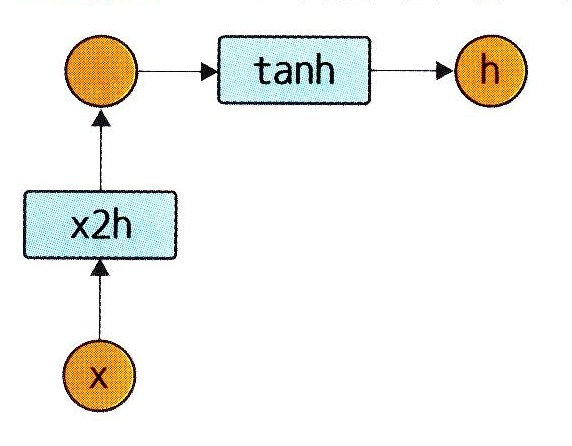
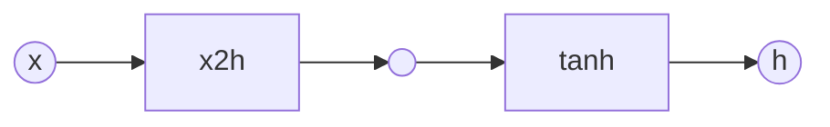

계속해서 데이터를 더 주어보겠습니다. 앞 코드에 바로 이어서 `y = rnn(np.random.rand(1, 1))`을 실행했다고 가정해보죠. [그림 59-3]은 이때 만들어지는 계산 그래프입니다.

#### 그림 59-3 두 번째 입력 데이터가 처리된 후의 계산 그래프
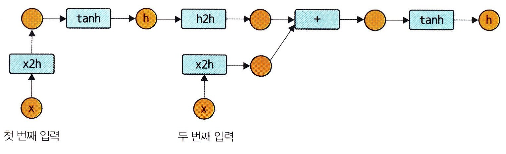
(첫 번째 입력 처리에 따른 은닉 상태 h가 h2h 계층을 거쳐 두 번째 입력 처리 시 x2h를 거친 결과와 더해지는 구조)
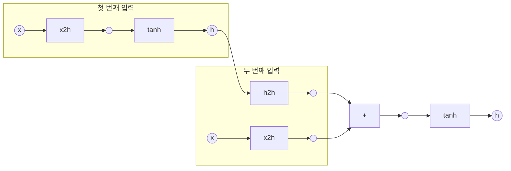

[그림 59-3]과 같이 [그림 59-2]의 그래프가 '성장'하여 더 큰 계산 그래프가 만들어집니다. 이 계산 그래프의 '성장'을 가능하게 하는 매개체가 바로 RNN의 은닉 상태입니다. RNN 계산 그래프는 이전의 은닉 상태를 매개로 이전 시각의 계산 그래프와 '연결'되는 것입니다.

> **CAUTION**
> [그림 59-3]과 같이 RNN은 입력 데이터 '전부'를 포함하는 계산 그래프를 만듭니다. 따라서 입력 데이터들이 어떻게 '연결'되는지도 학습할 수 있습니다. 참고로 [그림 59-3]에는 `x2h`가 두 개 등장하지만 모두 같은 `Linear` 인스턴스이며, 가중치도 동일한 것이 사용됩니다.

---

## 59.2 RNN 모델 구현

계속해서 RNN 계층을 이용하여 신경망(모델)을 구현하겠습니다. 이를 위해 `Linear` 계층을

사용하여 RNN 계층의 은닉 상태를 출력으로 변환하겠습니다. 다음의 `SimpleRNN` 클래스가 그 결과입니다.

**steps/step59.py**
```python
from dezero import Model
import dezero.functions as F
import dezero.layers as L

class SimpleRNN(Model):
    def __init__(self, hidden_size, out_size):
        super().__init__()
        self.rnn = L.RNN(hidden_size)
        self.fc = L.Linear(out_size)

    def reset_state(self):
        self.rnn.reset_state()

    def forward(self, x):
        h = self.rnn(x)
        y = self.fc(h)
        return y
```

이와 같이 인스턴스 변수 `fc`에 `Linear` 계층을 추가합니다. 이 `Linear` 계층은 RNN 계층의 은닉 상태를 입력받아 모델의 최종 출력을 계산합니다. 그리고 `reset_state` 메서드는 RNN 계층의 은닉 상태를 재설정하는 역할을 합니다. 이제 모델을 학습시켜봅시다. 손실 함수로는 평균 제곱 오차(`mean_squared_error` 함수)를 써보죠. 그러면 다음과 같이 기울기를 구할 수 있습니다.

```python
seq_data = [np.random.randn(1, 1) for _ in range(1000)] # 더미 시계열 데이터
xs = seq_data[:-1]
ts = seq_data[1:] # 정답 데이터: xs보다 한 단계 앞선 데이터

model = SimpleRNN(10, 1)

loss, cnt = 0, 0
for x, t in zip(xs, ts):
    y = model(x)
    loss += F.mean_squared_error(y, t)

    cnt += 1
```

```python
    if cnt == 2:
        model.cleargrads()
        loss.backward()
        break
```

우선 더미 시계열 데이터인 `seq_data`를 생성합니다. 여기에서는 이 시계열 데이터보다 한 단계 앞의 데이터를 예측하는 모델을 학습시키고자 합니다. 이를 위해 입력 데이터에 대한 정답 데이터로는 한 단계 앞의 데이터를 보관해둡니다.

다음은 중요한 역전파인데, 여기에서는 예시를 위해 두 번째 입력 데이터가 들어왔을 때 역전파를 수행합니다. 참고로 두 번째 입력 데이터가 들어왔을 때의 계산 그래프는 [그림 59-4]와 같습니다.

#### 그림 59-4 손실 함수 적용 후의 계산 그래프
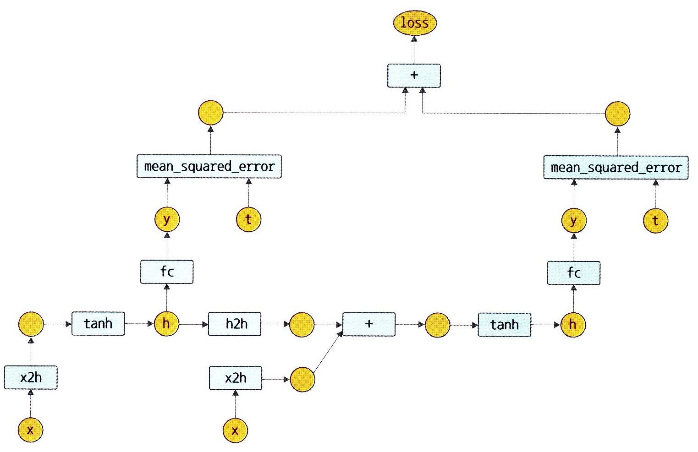
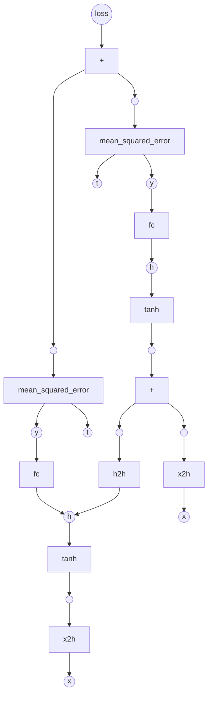

[그림 59-4]와 같은 계산 그래프가 만들어진 후로는 `loss.backward()`를 통해 각 매개변수의 기울기를 구할 수 있습니다. 이처럼 일련의 입력 데이터로 구성된 계산 그래프에서의 역전파를 '시간을 거슬러 역전파한다'는 의미를 담아 **BPTT**<sup>Backpropagation Through Time</sup>라고 합니다.

> **NOTE**
> RNN은 입력 데이터가 '나열되는' 패턴을 학습할 수 있습니다. 이때 데이터의 나열 '순서'는 시계열 데이터의 '시간'에 해당합니다. Backpropagation Through Time이라는 이름에 시간<sup>Time</sup>이 포함되는 이유입니다.

[그림 59-4]는 데이터를 단 두 개만 입력했을 때의 계산 그래프입니다. 물론 입력 데이터는 10개든 100개든 원하는 만큼 제공할 수 있습니다. 몇 개가 입력되든 계산 그래프는 문제없이 계속 길게 뻗어갑니다. 하지만 역전파를 잘하려면 계산 그래프를 적당한 길이에서 '끊어줘야' 합니다. 이것이 **Truncated BPTT**입니다(truncate는 '길이를 줄이다', '절단하다'라는 뜻입니다). 앞의 예에는 입력 데이터 2개째에서 절단했습니다.

Truncated BPTT를 수행할 때는 RNN의 은닉 상태가 유지된다는 점에 주의해야 합니다. 가령 [그림 59-4]의 계산 그래프에서 역전파를 한 후 그다음 입력 데이터를 더 제공하는 경우를 생각해보죠. 그렇다면 [그림 59-5]처럼 RNN의 은닉 상태는 이전의 은닉 상태에서 시작해야 합니다.

[그림 59-5]와 같이 최초의 은닉 상태는 이전의 마지막 은닉 상태에서 시작합니다. 그리고 그 은닉 상태 변수에서 계산의 '연결'을 끊어야 합니다. 그러면 이전 학습에서 사용한 계산 그래프로까지 기울기가 흐르지 못하게 됩니다(이것이 Truncated BPTT입니다).

#### 그림 59-5 다음 반복에서 만들어지는 계산 그래프
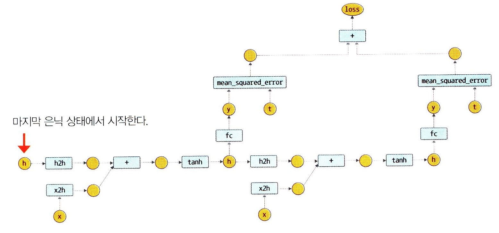
(새로운 반복의 시작 위치에서, 이전 학습의 최종 은닉 상태가 현재 시점의 초기 상태로 이어지나 역전파의 경로는 여기서 절단됨)
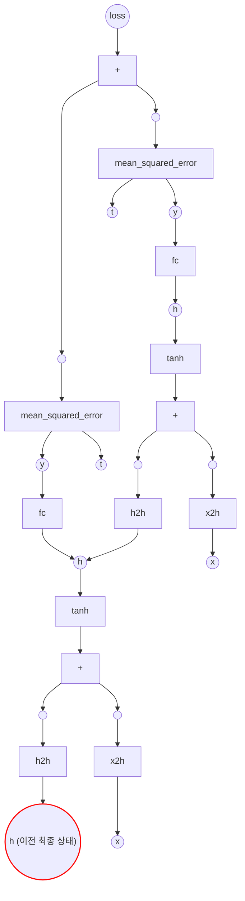

---

## 59.3 '연결'을 끊어주는 메서드

그래서 `Variable` 클래스에 '연결'을 끊어주는 메서드가 필요해집니다. `dezero/core.py` 파일을 찾아서 `Variable` 클래스에 다음 `unchain` 메서드를 추가합니다.

**dezero/core.py**
```python
class Variable:
    ...

    def unchain(self):
        self.creator = None
```

`unchain` 메서드는 참조자인 `self.creator`를 `None`으로 설정하는 게 다입니다. 단순히 부모 함수로의 연결을 끊는 것이죠.

그런 다음 연결을 끊기 위한 편의 메서드를 하나 더 추가합니다. 바로 `unchain_backward` 메서드입니다. 이 메서드는 호출된 변수에서 시작하여 계산 그래프를 거슬러 올라가며 마주치는 모든 변수의 `unchain` 메서드를 호출합니다.

**dezero/core.py**
```python
class Variable:
    ...

    def unchain_backward(self):
        if self.creator is not None:
            funcs = [self.creator]
            while funcs:
                f = funcs.pop()
                for x in f.inputs:
                    if x.creator is not None:
                        funcs.append(x.creator)
                        x.unchain()
```

보다시피 변수와 함수를 거꾸로 거슬러 올라가면서 변수의 `unchain` 메서드를 호출합니다. 거슬러 올라간다는 점에서 `Variable` 클래스의 `backward` 메서드와 같지만, 변수를 추적하는 순서(변수의 '세대')는 고려하지 않기 때문에 코드는 더 간결합니다.

---

## 59.4 사인파 예측

이상을 바탕으로 RNN 학습을 시작해보겠습니다. 데이터셋으로는 노이즈가 낀 사인파<sup>sine wave</sup>를 이용해보죠. 이 데이터셋은 `dezero/datasets.py`의 `SinCurve` 클래스를 사용하여 다음과 같이 읽어올 수 있습니다.

```python
import numpy as np
import dezero
import matplotlib.pyplot as plt

train_set = dezero.datasets.SinCurve(train=True)
print(len(train_set))
print(train_set[0])
print(train_set[1])
print(train_set[2])

# 그래프 그리기
xs = [example[0] for example in train_set]
ts = [example[1] for example in train_set]
plt.plot(np.arange(len(xs)), xs, label='xs')
plt.plot(np.arange(len(ts)), ts, label='ts')
plt.show()
```

**실행 결과**
```
(array([-0.03458701]), array([0.01726473]))
(array([0.01726473]), array([0.04656735]))
(array([-0.02867358]), array([0.03284844]))
```

이 예에서는 `train_set`의 0, 1, 2번째 데이터를 출력했습니다. 각 데이터는 튜플이며, 첫 번째 원소가 입력 데이터, 두 번째 원소가 정답 데이터(레이블)입니다. 코드를 실행하면 다음 그래프가 모니터에 나타날 것입니다.

#### 그림 59-6 사인 데이터셋으로 출력한 그래프
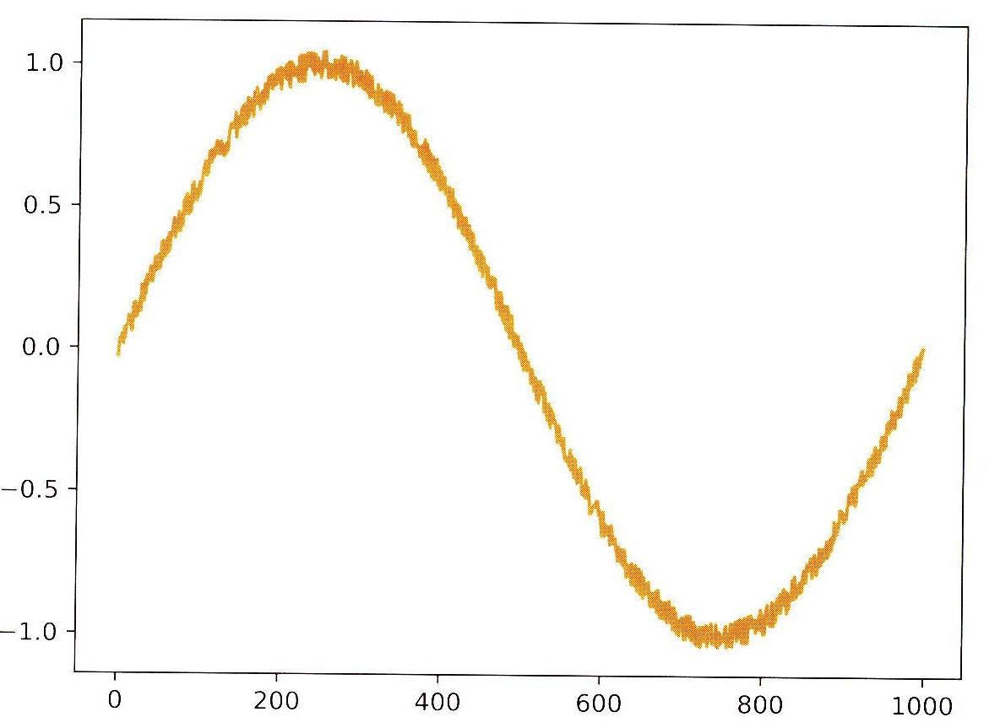
(0에서 시작하여 대략 250 부근에서 최댓값 1.0에 도달한 뒤, 750 부근에서 최솟값 -1.0을 찍고 1000에서 다시 0으로 수렴하는 거친 노이즈가 섞인 단일 사인 곡선 형태)

[그림 59-6]과 같이 이 데이터는 노이즈가 낀 사인파임을 알 수 있습니다. 그런데 데이터를 분명 두 개(`xs`와 `ts`) 렌더링했는데, 곡선은 1개뿐입니다. 그 이유는 사실 `ts`가 `xs`보다 한 단계 앞선 데이터이기 때문이죠. 그래서 두 곡선이 거의 겹쳐 그려진 것입니다.

> **NOTE**
> 사인파 데이터셋의 정답 데이터는 입력 데이터보다 한 단계 '미래'의 데이터입니다. 앞의 코드로 말하면 `xs[1:] == ts[:-1]`입니다. 이러한 데이터셋은 시계열 데이터를 예측하는 문제(지금까지 주어진 데이터로부터 다음 데이터를 예측하는 문제)에 사용됩니다.

이제 RNN으로 사인파 데이터셋을 학습해보죠. 코드는 다음과 같습니다. 임포트 부분은 생략했습니다.

**steps/step59.py**
```python
# 하이퍼파라미터 설정
max_epoch = 100
hidden_size = 100
bptt_length = 30 # BPTT 길이
train_set = dezero.datasets.SinCurve(train=True)
seqlen = len(train_set)

model = SimpleRNN(hidden_size, 1)
optimizer = dezero.optimizers.Adam().setup(model)
```

```python
# 학습 시작
for epoch in range(max_epoch):
    model.reset_state()
    loss, count = 0, 0

    for x, t in train_set:
        x = x.reshape(1, 1) # ❶ 형상을 (1, 1)로 변환
        y = model(x)
        loss += F.mean_squared_error(y, t)
        count += 1

        # ❷ Truncated BPTT의 타이밍 조정
        if count % bptt_length == 0 or count == seqlen:
            model.cleargrads()
            loss.backward()
            loss.unchain_backward() # ❸ 연결 끊기
            optimizer.update()

    avg_loss = float(loss.data) / count
    print('| epoch %d | loss %f' % (epoch + 1, avg_loss))
```

코드에서 세 가지만 추가로 설명하겠습니다. 우선 ❶에서 `x`의 형상을 $(1, 1)$ 로 변환합니다. DeZero 신경망에서는 입력 데이터를 2차원 텐서 혹은 4차원 텐서(CNN의 경우)로 제공해야 합니다. 따라서 입력 데이터가 하나뿐이라면 2차원 텐서인 $(1, 1)$ 로 변환해야 합니다.

다음으로 ❷에서 `backward` 메서드를 언제 호출할지 결정합니다. 데이터를 30번 흘려보냈을 때 혹은 데이터셋의 마지막(끝)에 도달했을 때로 정했습니다. 마지막으로 ❸에서 `unchain_backward` 메서드를 호출하여 RNN의 은닉 상태의 '연결'을 끊습니다.

> **NOTE**
> `loss.unchain_backward()`를 호출하면 `loss`부터 거슬러 올라가며 만나는 모든 변수는 '연결'이 끊어집니다. 그 결과 RNN의 은닉 상태의 '연결'도 자연스럽게 끊기는 것입니다.

코드를 실행하면 손실(loss)이 순조롭게 감소합니다. 이렇게 학습도 끝났으니 모델이 얼마나 잘 동작하는지 시험해볼까요? 이번에는 새롭게 (노이즈가 없는) 코사인파<sup>cosine wave</sup>를 입력하면서 한 단계 미래의 값을 예측해보죠. 코드는 다음과 같으며, 결과는 [그림 59-7]과 같습니다.

**steps/step59.py**
```python
import matplotlib.pyplot as plt

xs = np.cos(np.linspace(0, 4 * np.pi, 1000))
model.reset_state() # 모델 재설정
pred_list = []

with dezero.no_grad():
    for x in xs:
        x = np.array(x).reshape(1, 1)
        y = model(x)
        pred_list.append(float(y.data))

plt.plot(np.arange(len(xs)), xs, label='y=cos(x)')
plt.plot(np.arange(len(xs)), pred_list, label='predict')
plt.xlabel('x')
plt.ylabel('y')
plt.legend()
plt.show()
```

#### 그림 59-7 새로운 데이터(y = cos(x))에 대한 모델의 예측 결과
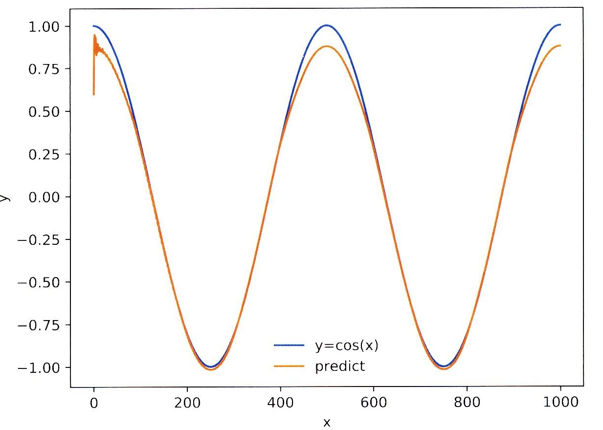
(파란색 실선 `y=cos(x)` 곡선과 주황색 실선 `predict` 곡선이 시각적으로 나란히 나타나며, 주황색 곡선은 극대점 근처에서 다소 낮게 예측하는 경향과 극소점 부근을 잘 추종하는 모습을 보임)

[그림 59-7]에서 보듯 예측 결과는 대체로 양호하게 나왔습니다. 그러나 현재 구현에서는 데이터를 하나씩 처리하기 때문에(배치 크기가 1) 시간이 오래 걸립니다. 배치 크기를 늘리면 1

에포크의 처리 시간이 단축됩니다. 그래서 다음 단계에서는 데이터를 미니배치 단위로 한꺼번에 처리하도록 수정하겠습니다. 나아가 LSTM 계층을 사용한 더 나은 모델도 구현할 것입니다.
