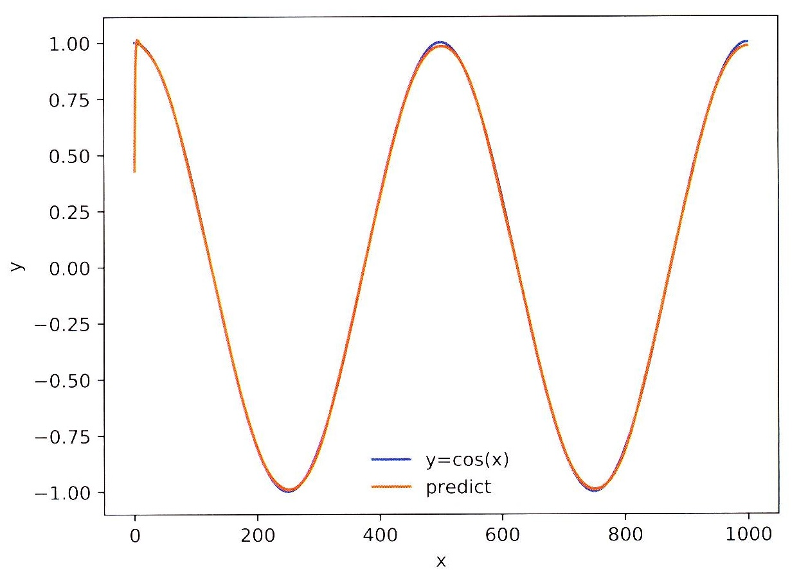
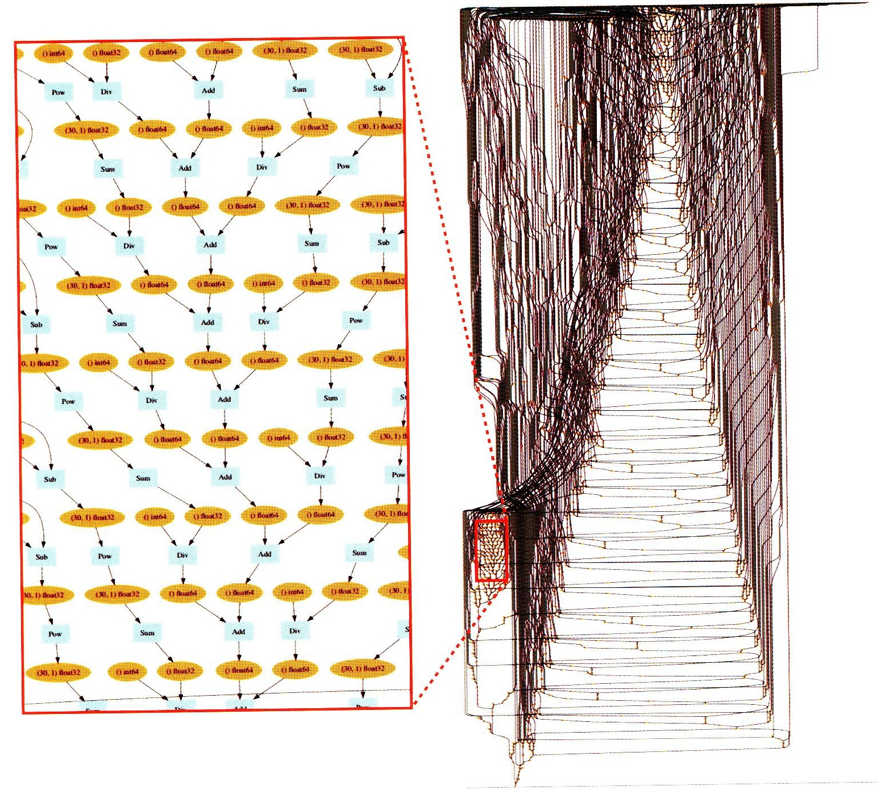

# 60단계 LSTM과 데이터 로더

이전 단계에서는 RNN을 사용하여 시계열 데이터(사인파)를 학습했습니다. 이번에는 이전 단계의 코드에서 두 가지를 개선하겠습니다.

첫 번째는 시계열 데이터용 '데이터 로더'를 만드는 것입니다. 이전 단계에서는 모델에 데이터를 하나씩(배치 크기가 1로) 전달해 순전파를 하였습니다. 앞으로는 시계열 데이터용 데이터 로더를 사용하여 여러 데이터를 묶은 미니배치 단위로 순전파하겠습니다.

두 번째는 RNN 계층 대신 LSTM 계층을 사용하는 것입니다. LSTM 계층을 사용하면 더 나은 인식 성능을 기대할 수 있습니다. 이상의 두 개선을 구현한 후 다시 한 번 사인파를 학습해보려 합니다.

---

## 60.1 시계열 데이터용 데이터 로더

이전 단계에서는 시계열 데이터를 처음부터 하나씩(배치 크기가 1로) 꺼내 시간이 오래 걸렸습니다. 그래서 이번에는 여러 데이터를 미니배치로 모아 학습하려 합니다. 이를 위해 전용 데이터 로더를 작성할 것입니다.

시계열 데이터를 미니배치로 처리하려면 데이터를 뽑는 시작 위치를 배치별로 다르게 지정해야 합니다. 가령 데이터 1000개로 구성된 시계열 데이터를 두 개의 미니배치로 만든다고 가정

해보죠. 그러면 첫 번째 샘플 데이터는 시계열 데이터의 시작(0번째)부터 꺼내고 두 번째 샘플 데이터는 500번째 데이터부터 꺼내면 됩니다.

이 원리를 염두에 두고 시계열 데이터용 데이터 로더를 구현합니다.

**dezero/dataloaders.py**
```python
class SeqDataLoader(DataLoader):
    def __init__(self, dataset, batch_size, gpu=False):
        super().__init__(dataset=dataset, batch_size=batch_size, shuffle=False,
                         gpu=gpu)

    def __next__(self):
        if self.iteration >= self.max_iter:
            self.reset()
            raise StopIteration

        jump = self.data_size // self.batch_size
        batch_index = [(i * jump + self.iteration) % self.data_size for i in
                       range(self.batch_size)]
        batch = [self.dataset[i] for i in batch_index]

        xp = cuda.cupy if self.gpu else np
        x = xp.array([example[0] for example in batch])
        t = xp.array([example[1] for example in batch])

        self.iteration += 1
        return x, t
```

우선은 초기화 부분을 변경합니다. 데이터의 순서가 바뀌면 안 되기 때문에 시계열 데이터에서는 `shuffle=False`로 설정합니다.

`__next__` 메서드에서는 다음 미니배치 데이터를 가져오는 로직을 구현합니다. 음영 부분의 코드가 중요한데, 우선 시작 위치까지 몇 개의 데이터를 건너뛸지 계산하여 `jump`에 저장합니다. 그리고 각 샘플 데이터를 꺼낼 인덱스의 시작 위치를 `batch_index`에 설정합니다. 마지막으로 데이터셋의 `self.dataset`에서 데이터를 가져옵니다.

이상이 시계열 데이터용 데이터 로더의 구현입니다. 다음은 실제 사용 예입니다.

```python
train_set = dezero.datasets.SinCurve(train=True)
dataloader = SeqDataLoader(train_set, batch_size=3)
x, t = next(dataloader)
print(x)
print('------------------')
print(t)
```

**실행 결과**
```
[[-0.04725922]
 [ 0.83577416]
 [-0.83650972]]
------------------
[[ 0.04529467]
 [ 0.83116588]
 [-0.88256346]]
```

---

## 60.2 LSTM 계층 구현

이어서 두 번째 개선으로 RNN 계층을 대신할 LSTM 계층을 구현하겠습니다. 먼저 LSTM에서 수행되는 계산을 수식으로 정리해봤습니다.

$$
\mathbf{f}_t = \sigma(\mathbf{x}_t \mathbf{W}_x^{(f)} + \mathbf{h}_{t-1} \mathbf{W}_h^{(f)} + \mathbf{b}^{(f)})
$$

$$
\mathbf{i}_t = \sigma(\mathbf{x}_t \mathbf{W}_x^{(i)} + \mathbf{h}_{t-1} \mathbf{W}_h^{(i)} + \mathbf{b}^{(i)})
$$

$$
\mathbf{o}_t = \sigma(\mathbf{x}_t \mathbf{W}_x^{(o)} + \mathbf{h}_{t-1} \mathbf{W}_h^{(o)} + \mathbf{b}^{(o)})
$$

$$
\mathbf{u}_t = \tanh(\mathbf{x}_t \mathbf{W}_x^{(u)} + \mathbf{h}_{t-1} \mathbf{W}_h^{(u)} + \mathbf{b}^{(u)})
$$

<p align="right">[식 60.1]</p>

$$
\mathbf{c}_t = \mathbf{f}_t \odot \mathbf{c}_{t-1} + \mathbf{i}_t \odot \mathbf{u}_t
$$

<p align="right">[식 60.2]</p>

$$
\mathbf{h}_t = \mathbf{o}_t \odot \tanh(\mathbf{c}_t)
$$

<p align="right">[식 60.3]</p>

이상이 LSTM에서 수행되는 계산입니다. LSTM에서는 은닉 상태 $\mathbf{h}$ 외에도 기억 셀 $\mathbf{c}$ 를 사용합니다. 참고로 [식 60.2]와 [식 60.3]에 사용된 기호 $\odot$ 는 아다마르 곱<sup>Hadamard product</sup>이라 하며,

같은 크기의 두 행렬의 각 성분을 곱하는 연산입니다. 수식 설명은 이쯤하고, 이상의 수식을 DeZero로 구현하겠습니다.

> **NOTE**
> 이 책에서는 LSTM을 개요 수준에서만 설명합니다. 자세한 설명은 『밑바닥부터 시작하는 딥러닝 2』의 '6장 게이트가 추가된 RNN'을 참고하기 바랍니다.

앞의 세 수식을 DeZero로 구현해봅시다.

**dezero/layers.py**
```python
class LSTM(Layer):
    def __init__(self, hidden_size, in_size=None):
        super().__init__()

        H, I = hidden_size, in_size
        self.x2f = Linear(H, in_size=I)
        self.x2i = Linear(H, in_size=I)
        self.x2o = Linear(H, in_size=I)
        self.x2u = Linear(H, in_size=I)
        self.h2f = Linear(H, in_size=H, nobias=True)
        self.h2i = Linear(H, in_size=H, nobias=True)
        self.h2o = Linear(H, in_size=H, nobias=True)
        self.h2u = Linear(H, in_size=H, nobias=True)
        self.reset_state()

    def reset_state(self):
        self.h = None
        self.c = None

    def forward(self, x):
        if self.h is None:
            f = F.sigmoid(self.x2f(x))
            i = F.sigmoid(self.x2i(x))
            o = F.sigmoid(self.x2o(x))
            u = F.tanh(self.x2u(x))
        else:
            f = F.sigmoid(self.x2f(x) + self.h2f(self.h))
            i = F.sigmoid(self.x2i(x) + self.h2i(self.h))
            o = F.sigmoid(self.x2o(x) + self.h2o(self.h))
            u = F.tanh(self.x2u(x) + self.h2u(self.h))

        if self.c is None:
            c_new = (i * u)
        else:
            c_new = (f * self.c) + (i * u)
```

```python
        h_new = o * F.tanh(c_new)

        self.h, self.c = h_new, c_new
        return h_new
```

코드가 좀 길어졌지만, 잘 보면 LSTM 수식을 코드로 1:1 대체한 수준입니다. 이처럼 DeZero를 이용하면 LSTM 같은 복잡한 수식도 어렵지 않게 구현할 수 있습니다. 그럼 마지막으로 이전 단계의 사인파 데이터를 다시 학습해보겠습니다.

**steps/step60.py**
```python
import numpy as np
import dezero
from dezero import Model
from dezero import SeqDataLoader
import dezero.functions as F
import dezero.layers as L

max_epoch = 100
batch_size = 30
hidden_size = 100
bptt_length = 30

train_set = dezero.datasets.SinCurve(train=True)
# ❶ 시계열용 데이터 로더 사용
dataloader = SeqDataLoader(train_set, batch_size=batch_size)
seqlen = len(train_set)

class BetterRNN(Model):
    def __init__(self, hidden_size, out_size):
        super().__init__()
        self.rnn = L.LSTM(hidden_size) # ❷ LSTM 사용
        self.fc = L.Linear(out_size)

    def reset_state(self):
        self.rnn.reset_state()

    def forward(self, x):
        y = self.rnn(x)
        y = self.fc(y)
        return y

model = BetterRNN(hidden_size, 1)
optimizer = dezero.optimizers.Adam().setup(model)
```

```python
for epoch in range(max_epoch):
    model.reset_state()
    loss, count = 0, 0

    for x, t in dataloader:
        y = model(x)
        loss += F.mean_squared_error(y, t)
        count += 1
        if count % bptt_length == 0 or count == seqlen:
            # dezero.utils.plot_dot_graph(loss) # 계산 그래프 그리기
            model.cleargrads()
            loss.backward()
            loss.unchain_backward()
            optimizer.update()
    avg_loss = float(loss.data) / count
    print('| epoch %d | loss %f' % (epoch + 1, avg_loss))
```

이전 단계에서 달라진 부분은 두 곳뿐입니다. 첫 번째로 `SeqDataLoader` 클래스를 데이터 로더로 사용했고, 두 번째로는 LSTM 계층을 사용하여 모델을 설계했습니다. 이제 학습을 해보면 이전 단계보다 빠르게 진행됨을 확인할 수 있습니다.

이어서 학습이 끝난 모델을 사용하여 새로운 데이터(노이즈 없는 코사인)에 대해 예측해봅시다. 결과는 [그림 60-1]과 같습니다.

#### 그림 60-1 LSTM 계층을 사용한 모델의 예측 결과

(파란색 실선 `y=cos(x)` 곡선과 주황색 실선 `predict` 곡선이 시각적으로 거의 완벽하게 겹쳐서 일치함. 진폭의 스케일도 주황색 곡선이 파란색 곡선을 정확하게 따라감)

[그림 60-1]에서 보듯 예측 결과가 매우 우수합니다. 실제로 이전 단계의 결과(그림 59-7)와 비교해 정확도가 많이 향상됐음을 알 수 있습니다. 우리는 LSTM 같은 복잡한 계층도 제대로 구현하고, 시계열 데이터 처리라는 복잡한 작업을 수행하는 데도 성공했습니다!

마지막으로 앞의 코드로 만들어지는 계산 그래프를 감상하며 이번 단계를 마치겠습니다. 결과는 [그림 60-2]와 같습니다.

#### 그림 60-2 LSTM을 사용한 모델로 시계열 데이터를 학습할 때 만들어지는 계산 그래프

(왼쪽: 수많은 오렌지색 타원형 변수 노드들과 'Pow', 'Div', 'Add', 'Sum', 'Sub' 등 연산 박스들이 그물망처럼 복잡하게 얽혀 있는 계산 그래프의 확대도 / 오른쪽: 거대하고 빽빽하게 수천 개의 노드와 엣지들이 모여 폭포수처럼 흘러내려가며 형성하는 거대한 계산 그래프의 전체 구조도)

[그림 60-2]와 같이 매우 복잡한 계산 그래프가 만들어집니다. 이런 복잡한 계산 그래프를 DeZero 같은 프레임워크 없이 만들기란 현실적으로 거의 불가능합니다. DeZero의 유연성 덕분에 이처럼 복잡한 작업이 놀라우리만치 간단해진 것이죠. 앞으로 어떤 복잡한 계산과 마주쳐도 DeZero가 있다면 간단하게 해결할 수 있을 겁니다.

<p align="center">★ ★ ★ ★ ★ ★ ★ ★</p>

이상으로 이 책이 안내하는 60단계를 모두 끝마쳤습니다. 여기가 이 책의 결승선인 셈이죠. 여기까지 무사히 도달하신 여러분은 딥러닝 프레임워크를 직접 제작해본다는 '큰 목표'를 달성했다는 뜻입니다. 축하합니다! 그리고 긴 여정에 동반자가 되어주셔서 감사합니다. 긴 시간 동안 이렇게 많은 내용을 읽어주셔서 저자로서 진심으로 기쁘게 생각합니다.

되돌아보면 DeZero는 자그마한 '상자'에서 시작했습니다. 거기서부터 조금씩 확장하고 다양한 문제와 실험에 임하면서 한 걸음씩 내디뎠습니다. 그런 작은 개선들이 쌓여 DeZero는 훌륭한 딥러닝 프레임워크로 성장했습니다. 실제로 지금의 DeZero는 현대적인 프레임워크가 갖춰야 할 특징을 많이 갖추고 있습니다.

이 책은 여기서 끝냅니다만, 앞으로 더 해볼 만한 일을 얼마든지 생각할 수 있습니다. 멈춰 서지 말고 미래를 개척해보세요. 책에서 얻은 지식을 바탕으로 자신만의 독창적인 프레임워크를 만들어도 좋고 DeZero를 확장해도 좋습니다. 파이토치나 텐서플로 같은 프레임워크로 갈아타셔도 좋습니다. 새로운 여행을 마음껏 즐기세요. 이어지는 마지막 칼럼에서는 '앞으로 앞으로'라는 제목으로 DeZero의 향후 방향에 대해 논의하고 있습니다. 관심 있는 분은 읽어보시기 바랍니다.
