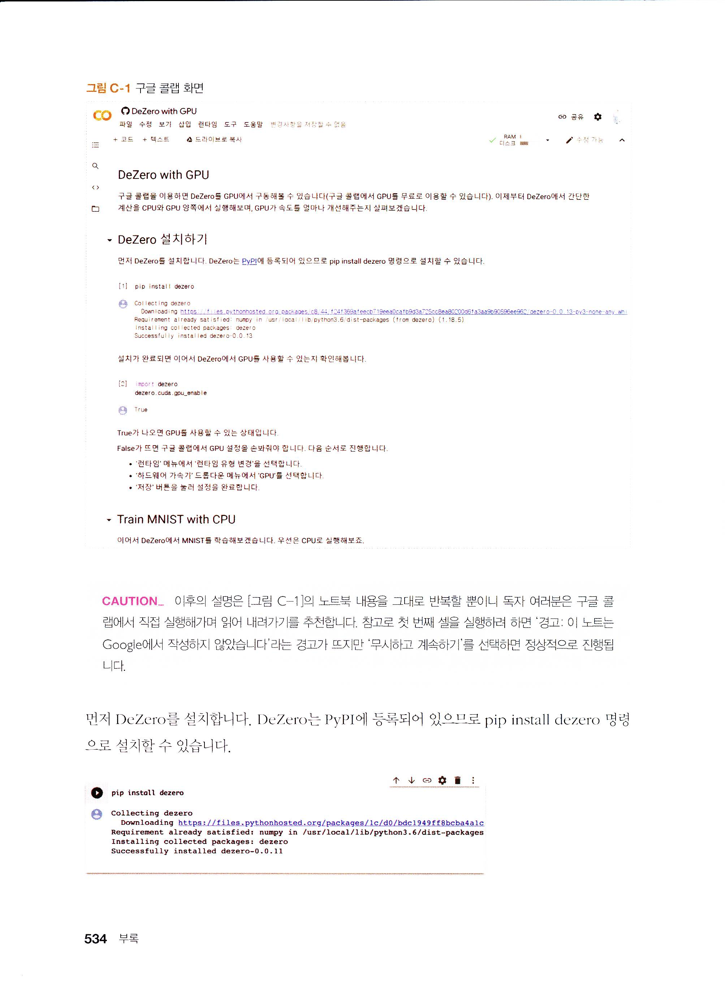

# APPENDIX C 구글 콜랩에서 실행


구글 콜랩은 클라우드에서 실행되는 주피터 노트북 환경입니다. 환경을 따로 구축할 필요 없이 브라우저만 있으면 누구나 이용할 수 있답니다. 더구나 CPU뿐 아니라 GPU도 사용할 수 있지요.

이번 부록에서는 DeZero가 구글 콜랩에서 작동하는 모습을 보여드리겠습니다. 52단계에서 이용한 코드(MNIST 학습 코드)를 예로 실습해보죠. 우선 다음 링크를 방문해봅시다.

https://colab.research.google.com/github/WegraLee/deep-learning-from-scratch-3/blob/master/examples/mnist_colab_gpu.ipynb

\<단축 URL\> https://bit.ly/3iXfwcC

이 링크를 브라우저에서 열면 [그림 C-1]과 같은 화면이 나타납니다. [그림 C-1]처럼 노트북 내용이 '셀<sup>cell</sup>'로 나뉘어 있는데, 셀에서는 텍스트 외에도 파이썬 같은 프로그래밍 언어로 코드를 작성하고 실행할 수 있습니다. 셀의 코드를 실행하려면 셀을 클릭하여 선택한 다음 코드 왼쪽의 '셀 실행' 버튼을 클릭합니다. 또는 키보드 단축키 'Ctrl + Enter'로 실행할 수도 있습니다(맥에서는 'Command + Return').

> [!NOTE]
> [그림 C-1]은 이 교제의 깃허브 저장소에 있는 `examples/mnist_colab_gpu.ipynb` 문서를 구글 콜랩으로 연 모습입니다. 이처럼 깃허브에 저장해둔 ipynb 파일은 구글 콜랩에서 열 수 있는데, 단순히 URL 중 'github.com'을 'colab.research.google.com/github'로 대체하면 됩니다.

#### 그림 C-1 구글 콜랩 화면

(구글 콜랩 웹 브라우저 화면 캡처: 상단에 파일명 'DeZero with GPU'가 표시되어 있고, 아래로 'DeZero 설치하기' 설명글과 `pip install dezero` 셀 실행으로 'dezero-0.0.13' 버전이 성공적으로 설치되는 로그가 나옴. 이어서 `import dezero; dezero.cuda.gpu_enable` 결과값으로 `True`가 반환되어 GPU 사용 가능함을 확인하는 과정과 GPU 가속 설정을 위한 런타임 유형 변경 방법, 그리고 'Train MNIST with CPU' 장 도입부가 노트북 내에 구현되어 있음)

> [!CAUTION]
> 이후의 설명은 [그림 C-1]의 노트북 내용을 그대로 반복할 뿐이니 독자 여러분은 구글 콜랩에서 직접 실행해가며 읽어 내려가기를 추천합니다. 참고로 첫 번째 셀을 실행하려 하면 '경고: 이 노트북은 Google에서 작성하지 않았습니다'라는 경고가 뜨지만 '무시하고 계속하기'를 선택하면 정상적으로 진행됩니다.

먼저 DeZero를 설치합니다. DeZero는 PyPI에 등록되어 있으므로 `pip install dezero` 명령으로 설치할 수 있습니다.

```bash
pip install dezero
Collecting dezero
  Downloading https://files.pythonhosted.org/packages/1c/d0/bdc1949ff8bcba4alc...
Requirement already satisfied: numpy in /usr/local/lib/python3.6/dist-packages
Installing collected packages: dezero
Successfully installed dezero-0.0.11
```

설치가 완료되면 이어서 DeZero에서 GPU를 사용할 수 있는지 확인해봅니다.

```python
import dezero
dezero.cuda.gpu_enable
```
*출력 결과:*
```
True
```

`True`가 나오면 GPU를 사용할 수 있는 상태입니다. `False`가 뜨면 구글 콜랩에서 GPU 설정을 손봐줘야 합니다. 다음 순서로 진행합니다.

* '런타임' 메뉴에서 '런타임 유형 변경'을 선택합니다.
* '하드웨어 가속기' 드롭다운 메뉴에서 'GPU'를 선택합니다.
* '저장' 버튼을 눌러 설정을 완료합니다.

이어서 DeZero에서 MNIST를 학습해보겠습니다. 우선은 CPU로 실행해보죠.

```python
import time
import dezero
import dezero.functions as F
from dezero import optimizers
from dezero import DataLoader
from dezero.models import MLP

max_epoch = 5
batch_size = 100
cpu_times = []

train_set = dezero.datasets.MNIST(train=True)
train_loader = DataLoader(train_set, batch_size)
model = MLP((1000, 10))
optimizer = optimizers.SGD().setup(model)

for epoch in range(max_epoch):
    start = time.time()
    sum_loss = 0

    for x, t in train_loader:
        y = model(x)
        loss = F.softmax_cross_entropy(y, t)
        model.cleargrads()
        loss.backward()
        optimizer.update()
        sum_loss += float(loss.data) * len(t)

    elapsed_time = time.time() - start
    cpu_times.append(elapsed_time)
    print('epoch: {}, loss: {:.4f}, time: {:.4f}[sec]'.format(
        epoch + 1, sum_loss / len(train_set), elapsed_time))
```
*출력 결과:*
```
epoch: 1, loss: 1.9140, time: 7.8949[sec]
epoch: 2, loss: 1.2791, time: 7.8918[sec]
epoch: 3, loss: 0.9211, time: 7.9565[sec]
epoch: 4, loss: 0.7381, time: 7.8198[sec]
epoch: 5, loss: 0.6339, time: 7.9302[sec]
```

다음은 GPU를 사용해볼 차례입니다.

```python
gpu_times = []

# GPU mode
train_loader.to_gpu()
model.to_gpu()

for epoch in range(max_epoch):
    start = time.time()
    sum_loss = 0

    for x, t in train_loader:
        y = model(x)
        loss = F.softmax_cross_entropy(y, t)
        model.cleargrads()
        loss.backward()
        optimizer.update()
        sum_loss += float(loss.data) * len(t)

    elapsed_time = time.time() - start
    gpu_times.append(elapsed_time)
    print('epoch: {}, loss: {:.4f}, time: {:.4f}[sec]'.format(
        epoch + 1, sum_loss / len(train_set), elapsed_time))
```
*출력 결과:*
```
epoch: 1, loss: 0.5678, time: 1.5356[sec]
epoch: 2, loss: 0.5227, time: 1.5687[sec]
epoch: 3, loss: 0.4898, time: 1.5498[sec]
epoch: 4, loss: 0.4645, time: 1.5433[sec]
epoch: 5, loss: 0.4449, time: 1.5512[sec]
```

마지막으로 참고삼아 CPU와 GPU의 속도를 비교해봅니다.

```python
cpu_avg_time = sum(cpu_times) / len(cpu_times)
gpu_avg_time = sum(gpu_times) / len(gpu_times)

print('CPU: {:.2f}[sec]'.format(cpu_avg_time))
print('GPU: {:.2f}[sec]'.format(gpu_avg_time))
print('GPU speedup over CPU: {:.1f}x'.format(cpu_avg_time/gpu_avg_time))
```
*출력 결과:*
```
CPU: 7.90[sec]
GPU: 1.55[sec]
GPU speedup over CPU: 5.1x
```

이상으로 구글 콜랩 설명을 마칩니다. 여기에서 보여드린 예 외에도 DeZero의 다른 샘플 코드들도 구글 콜랩에서 실행할 수 있습니다. 샘플뿐 아니라 DeZero를 사용하여 여러분이 직접 작성한 코드도 물론 실행할 수 있습니다. 구글 콜랩은 이처럼 아주 편리한 서비스이니 DeZero도 실험해보고 다양하게 활용해보세요.
